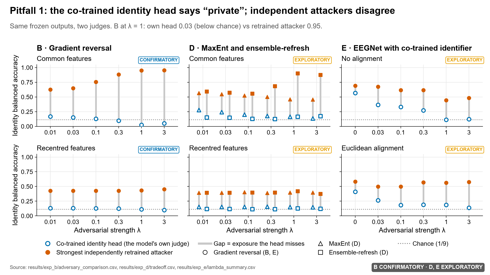
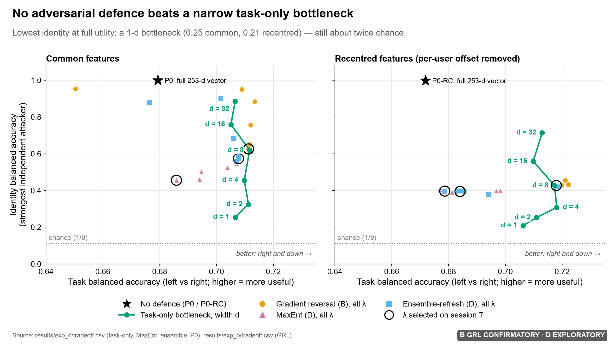
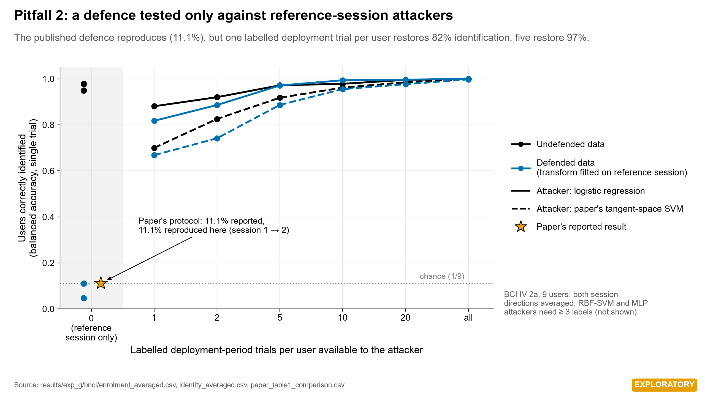
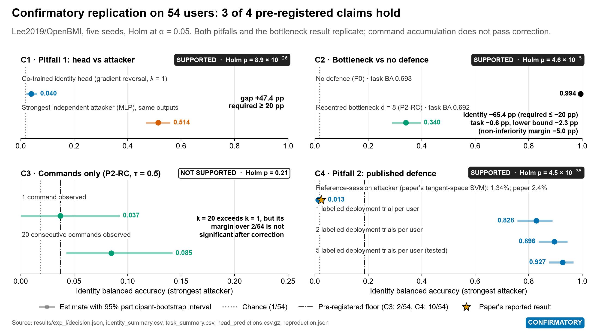
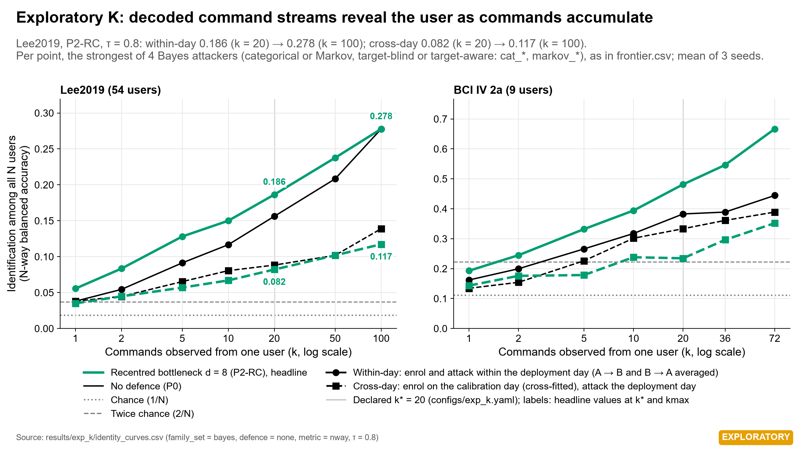
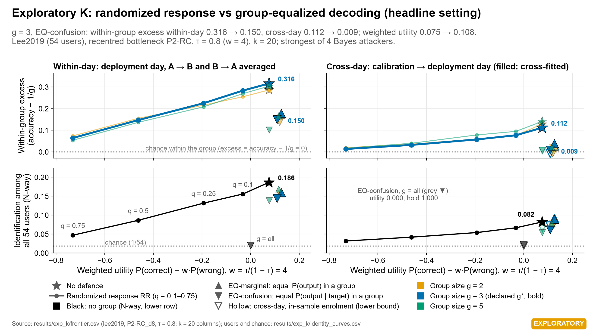

# BEAT: what a motor-imagery BCI reveals about its user

**Thesis.** Whether what a motor-imagery BCI transmits exposes its user, and whether a defence
protects that user, depends on which day's recording the attacker enrols with. One within-day
number therefore establishes neither risk nor protection. BEAT shows this on its own headline
result and on its own defence, and tests it on 51 new users under a time-stamped pre-registration:

- **Exposure.** Full 210-d features identify 54 Lee2019 users at 0.994 within a day
  (*confirmatory-sealed*) and at 0.520 across days (*pre-registered estimate*).
- **Defence.** Group-equalized decoding (EQ, g = 3) on L's command streams (P2-RC, τ = 0.8)
  removes almost all within-group identity for an attacker who enrols on the calibration day it
  was fitted to (excess at 20 commands 0.112 → 0.009). For an attacker who enrols on the
  deployment day it only reduces it (0.316 → 0.150) (*exploratory*).
- **New users.** A confirmatory cross-day replication on 51 users who were not used in any earlier
  BEAT analysis (Yang2025) was sealed on 2026-11-10 (UTC), and an RFC 3161 token from FreeTSA
  timestamps the seal. Two of its three claims were supported (*confirmatory-sealed*): raw
  features re-identify users across days (M1: 0.345 against 10/51), and the true user's rank is
  above chance and above its rank with one command (M3: 0.649 at 50 commands against 0.538 at 1).
  The rank is not an identification rate: top-1 identification at 50 commands is 0.061. The gap of
  pitfall 1 stayed below its sealed 0.10 floor across days (M2: 0.093–0.096, not supported).

For study M the pre-committed wording of outcome case (b) applies (`docs/decision_log.md`, commit
`7b14cee`): "새 사용자 51명, 다른 날: 사전등록한 주장 3개 중 2개가 지지됐다" (M1 supported, M2 not
supported, M3 supported) and "다른 날에는 M1·M3만 재현됐다. M2는 같은 날 조건의 결과로 남는다." In
English: 51 new users on different days, 2 of 3 pre-registered claims supported; across days only
M1 and M3 replicated, and M2 remains a result of the within-day condition.

The thesis was fixed before any final output of study M was read (`docs/decision_log.md`, entry of
2026-11-11, commit `7b14cee`): "BCI 전송물의 신원 노출과 방어 효과는 공격자가 어느 날의 기록으로
등록하느냐에 따라 달라지므로, 같은 날 수치 하나로는 위험도 보호도 주장할 수 없다." In English:
identity exposure in what a BCI transmits, and the effect of a defence on it, depend on which day's
recording the attacker enrols with, so one same-day number can claim neither risk nor protection.

**Evidence tiers.** Every headline number carries one of three labels:

- *confirmatory-sealed*: decided by a rule committed before the held-out data were scored
  (seals 1, 3 and 4).
- *pre-registered estimate*: fixed in a sealed plan and reported without a verdict.
- *exploratory*: not pre-registered, or computed on data that had already shaped the analysis
  (experiments D, E, G, K and R).

**Scenarios.** Every number also names its scenario. **Within-day** numbers enrol and test the
attacker on the same recording day. **Cross-day** numbers enrol on the calibration day and test
on the deployment day.

[](https://github.com/gigalove6783-pixel/beat-eeg-privacy/actions/workflows/ci.yml)

> **What this does not show**
> - **Closed sets only.** Identification is among 9 users (chance 0.111), 54 users
>   (chance 0.0185) and, in study M, 51 users (chance 1/51). No result transfers automatically to
>   other populations or to open-set verification.
> - **No anonymity claim.** Attackers are logistic regression, RBF-SVM and MLP on transmitted
>   outputs, Bayes (Dirichlet–categorical and Markov) attackers on command streams in K and M, and
>   covariance-space attackers in G. No white-box or adaptive encoder attack was tried, so every
>   identity score is a lower bound, and an attacker's failure is not anonymisation.
> - **Replay, not closed loop.** The arm replays recorded EEG; no person controlled it. Replay
>   processing time is not online latency.
> - **Exploratory parts.** Only A–C, L and study M's claims M1–M3 are confirmatory. D, E, G, K and
>   R are exploratory (D and E reuse held-out data that had already shaped them; K and R reuse
>   2a and Lee2019). L's main scenario links two phases recorded on the same day.
> - **EQ is not anonymity.** EQ's equality is exact only for the calibration-day confusion matrices
>   it was fitted to; an attacker who enrols on the deployment day still finds within-group
>   identity (exploratory). It hides identity only within groups of g = 3 users (18 groups of
>   exactly 3 on Lee2019), and group membership stays revealed.
> - **M's decoder is weak.** On Yang2025 the shared decoder reaches day-1 task BA 0.578 / 0.582 /
>   0.565 (P0 / P2-RC / P3; chance 0.5) and at τ* = 0.60 holds 72.3% of trials (*pre-registered
>   estimates* from day-1 development data); on days 2–3 the final models decode at 0.555 /
>   0.544 / 0.552, with 10–12 of 51 users below 0.5. Nothing was tuned on Yang2025. M1 does not
>   depend on the decoder, but M3 and the EQ estimates describe a weak system that held about 72%
>   of day-1 trials, not a more accurate one.
> - **M's limits.** M1 rests on the logistic and RBF-SVM attackers (0.345, 0.343); according to
>   the independent audit, the MLP attacker (0.273) alone would not pass after the ×3 Holm
>   correction. EQ's estimates differ across the pre-registered grid of attackers, command counts
>   and thresholds, so no single cell is the EQ result. The hold threshold τ* was calibrated on day
>   1 and is miscalibrated on later days: the hold rate falls from 0.723 to 0.473 and wrong moves
>   rise from 0.092 to 0.227.
> - **Self-attested seals 1–3.** Seals 1–3 are Git commits and tags made by the project itself,
>   all on 2026-11-10. No third party timestamped them, so they show the order of commits, not
>   when held-out data were first seen. Seal 4 (study M) also has an RFC 3161 timestamp, but the
>   log showing that no day-2/3 data were requested before it is self-attested.
> - **Out of scope.** Device compromise, identifying metadata and unobserved sensitive attributes.

## Headline numbers: within-day and cross-day side by side

Identity is measured as balanced accuracy (BA, mean per-user recall). "2a" is BCI IV 2a (9 users,
chance 0.111). "L" is Lee2019/OpenBMI (54 users, chance 0.0185). "M" is Yang2025 (51 users).
Within-day means 2a runs 1–3 ↔ 4–6 of session E and L's offline ↔ online phase of session 2; this
is the main, pre-registered scenario of A–C and L. Cross-day means 2a T → E and L session 1 → 2. In
K the within-day attacker enrols on one half of the deployment day and the cross-day attacker on
the cross-fitted calibration day.

| Quantity | Data | Within-day | Cross-day | Tier (source) |
|---|---|---|---|---|
| Full tangent vector (2a 253-d, L 210-d), strongest attacker | 2a | 1.00 | 0.951 | within: *confirmatory-sealed* (B); cross: *pre-registered estimate* (B's auxiliary rows) |
| | L | 0.994 | 0.520 | within: *confirmatory-sealed* (L, C2); cross: *pre-registered estimate* |
| Recentred 8-d task-only bottleneck (P2-RC) | L | 0.340 | 0.054 | within: *confirmatory-sealed* (L, C2); cross: *pre-registered estimate* |
| Pitfall 1: strongest independent attacker vs co-trained head, P3 λ = 1 | L | 0.514 | 0.239 | within: *confirmatory-sealed* (L, C1); cross: *pre-registered estimate*, compiled by R |
| Co-trained head, P3 λ = 1 (single value: trained on session 1, scored on all session-2 trials) | L | — (C1 tested 0.514 against the head's 0.040) | 0.040 (gap 19.9 pp to 0.239) | head: C1's tested contrast (*confirmatory-sealed*); gap: *pre-registered estimate*, below C1's 20 pp; R's table |
| Pitfall 2: five labelled deployment trials vs the reference-session defence | L | 92.7% | not measured | *confirmatory-sealed* (L, C4) |
| Commands, P2-RC, τ = 0.5, 20 commands (claim C3) | L | 0.085 (1 command: 0.037) | 0.019–0.029 | within: *confirmatory-sealed*, **not supported**; cross: *pre-registered estimate* |
| Same cell, cross-fitted enrolment: commands only / commands with cue | L | — | 0.008–0.027 / 0.046 (0.016–0.075; Bayes categorical), strongest 0.046 (0.021–0.072; logistic) | *exploratory* (K) |
| Commands, P2-RC, τ = 0.8, strongest Bayes attacker, 20 / 100 commands | L | 0.186 / 0.278 | 0.082 / 0.117 | *exploratory* (K) |
| EQ (g = 3): within-group excess, undefended → EQ, 20 commands | L | 0.316 → 0.150 | 0.112 → 0.009 | *exploratory* (K) |
| Commands, 20 commands, all models and τ | 2a | 0.211–0.478 | — | *pre-registered estimate*, descriptive (C, H3) |
| M1: full 190-d features, strongest attacker, day 1 → days 2–3 (threshold 10/51) | M | — | 0.345 (logistic), supported; day 2 ↔ 3: 0.419 | M1: *confirmatory-sealed*; day 2 ↔ 3: *pre-registered estimate* |
| M2: strongest independent attacker vs co-trained head, P3 λ = 1 | M | day-1 gate: gap 0.717 | 0.161 vs 0.064 (gaps 0.093–0.096, below the 0.10 floor), not supported | *confirmatory-sealed* (M2); day-1 gap: *pre-registered estimate* (day-1 development data) |
| M3: true user's mean percentile rank, P2-RC τ* = 0.60, 50 vs 1 command | M | — | 0.649 vs 0.538, supported; top-1 at 50 commands 0.061 (chance 1/51) | M3: *confirmatory-sealed*; top-1: *pre-registered estimate* |

Sources: `results/exp_l/identity_summary.csv` and `decision.json`, `results/exp_b/identity_final.csv`
(auxiliary rows) and `results/exp_d/tradeoff.csv`, `results/exp_r/cross_day_table.csv`, `results/exp_k/frontier.csv` and `identity_curves.csv`,
`results/exp_c/observation_strongest.csv`, `results/exp_m/decision.json`, `selection.json` and
`final_estimates_k_curves.csv`. Intervals are 95% intervals over users.

### Findings in detail

1. **Raw features identify everyone within a day, and most users across days.** The full
   Riemannian tangent vector (253-d on 2a, 210-d on L) gives identity BA 1.00 on 2a (B,
   *confirmatory-sealed*) and 0.994 on 54 users (L, *confirmatory-sealed*) within a day. Across
   days the same attackers reach 0.951 on 2a (logistic regression in all five seeds; B's sealed
   auxiliary rows, *pre-registered estimate*) and 0.520 on 54 users (logistic regression;
   0.510 RBF-SVM, 0.368 MLP; *pre-registered estimate*). On 51 new users, full 190-d features
   enrolled on day 1 identify users on days 2–3 at 0.345 (M1, *confirmatory-sealed*, supported).
2. **A narrow task-only bottleneck protected best, but identity stayed above chance.** On 2a, a
   1-d bottleneck gives 0.253 (common) / 0.209 (recentred) at task BA 0.707 / 0.706 (within-day).
   No T-CV-selected adversarial defence beat it (D, *exploratory*). On 54 users, the 1-d values
   are 0.057 / 0.085 within a day and 0.035 / 0.037 across days (*pre-registered estimate*,
   3 seeds), and a recentred 8-d bottleneck lowers
   within-day identity BA from 0.994 to 0.340 at −0.6 pp task BA (C2, *confirmatory-sealed*);
   across days it gives 0.054 (*pre-registered estimate*).
3. **Pitfall 1: the co-trained adversary misleads.** At λ = 1 the gradient-reversal identity head
   scores 0.026, below chance, while independent attackers recover 0.951 from the same frozen
   outputs (2a, within-day, session E; *confirmatory-sealed* run B; the head is a diagnostic).
   On 54 users C1 tested the strongest within-day attacker's 0.514 against the head's single
   value, 0.040 (trained on session 1, scored on session 2; C1, *confirmatory-sealed*); across
   days the gap is 17.6–19.9 pp (C1's cross-day components), *pre-registered estimates* below
   C1's 20 pp that no verdict decides on their own. Both pitfalls were confirmed on 54 users in
   the within-day setting;
   across days the strongest independent attacker reaches 0.239 against the
   head's 0.040 (*pre-registered estimate*). On 51 new users across days the gaps were
   0.093–0.096, below the sealed 0.10 floor (M2, *confirmatory-sealed*, not supported), against
   0.717 within day 1 (M2's development gate).
4. **Commands leak on 2a; the 54-user confirmation failed.** On 2a, within session E,
   left/right/hold commands alone exceed twice chance within five commands in 22 of 24 settings,
   and reach 0.211–0.478 at 20 commands (C, H3, *pre-registered estimate*, descriptive). On 54
   users the within-day point estimate rises from 0.037 to 0.085 at 20 commands, but **claim C3 was not
   supported** (Holm p = 0.21). Across days, in C3's setting (P2-RC, τ = 0.5, 20 commands),
   command identification stayed near chance (0.019–0.029), a *pre-registered estimate*. L's
   cross-day attacker enrolled on
   command streams that the decoder produced on its own training session (in-sample). K repeats
   the cell with cross-fitted streams (*exploratory*):
   - attackers that see only the commands, as in C3, stay at 0.008–0.027;
   - attackers that also see the cue reach 0.046 (95% interval 0.016–0.075, which reaches below
     chance 1/54) for the Bayes categorical attacker; the strongest target-aware attacker overall,
     logistic regression from L's battery, also gives 0.046 (0.021–0.072).

   At τ = 0.8 the cross-day point
   estimates of L at 20 commands exceed twice chance: 0.069 (95% interval 0.043–0.100) for full
   features, 0.065 (0.036–0.099) for P2-RC and 0.075 (0.052–0.099) for P3 (strongest attacker
   per representation; *pre-registered estimate*, 3 seeds; the P2-RC interval reaches below 2/54).
   On 51 new users across days, M3 tested the true user's rank rather than identification and
   was supported (finding 8); C3 stays not supported.
5. **Pitfall 2: reference-session-only attackers.** A training-free defence from a recent arXiv
   preprint (Muhaimin & Nagarajan, 2026) reproduces on its own cross-session protocol
   (90.8% → 11.1% identification). One or five labelled deployment trials per user, attacking
   the rest of the same session, restore 81.75% or 97.11% (G, *exploratory*). On 54 users the
   reference-session attack reaches 1.34% (paper 2.4%), and five labels reach 92.7% within a day
   (C4, *confirmatory-sealed*, adapted pipeline).
6. **Command streams accumulate identity; an equalizing defence held its equality for an attacker
   enrolled on the calibration day, not for one enrolled on the deployment day (K,
   *exploratory*).** Both attackers are tested on deployment-day outputs; only the enrolment day
   differs. For P2-RC at τ = 0.8 on L, the strongest Bayes attacker
   reaches 0.186 at 20 commands and 0.278 at 100 within a day, and 0.082 and 0.117 across days.
   EQ post-processes each user's commands so that, within a group, every user has the same
   output distribution given the target, *for the calibration-day confusion matrices it is
   fitted to*. At g = 3, the within-group excess at 20 commands falls from 0.112 to 0.009 for a
   cross-day attacker, but only from 0.316 to 0.150 for an attacker who enrols on the deployment
   day. Of that within-day residual (0.138 in K's decomposition), 0.020 is the estimator floor,
   0.017 is finite calibration data, and 0.100 is what the same-day simulation does not explain
   (day-to-day drift, decoder mismatch between cross-fitted and final outputs, sequential
   dependence and, for Lee2019, the offline → online phase shift between the deployment segments
   used by the within-day attacker). With one group of all 54 users the best equalizing release is "always hold"
   (utility 0.000, hold rate 1.000), hence groups of 3.
7. **Robustness addendum (R, *exploratory*).** R compiles L's within- and cross-day values for
   P0, P2-RC, P3 and the co-trained head into one table. It also refitted all 45
   non-converged confirmatory MLP attackers of L with up to 20,000 iterations; 42 of the refits converged.
   With the refitted predictions, L's own decision code changes no Holm decision, and the largest
   per-fit change in identity BA is 2.6 pp.
8. **51 new users, sealed and time-stamped: 2 of 3 claims supported (M,
   *confirmatory-sealed*).** The pre-registration was sealed at commit `e88154c` (tag `seal-4`;
   commit time 2026-11-10 20:25:51 UTC), and FreeTSA's RFC 3161 token shows that the commit
   existed no later than 2026-11-10 20:26:22 GMT. Every recording-day-2/3 request in the
   self-attested request log came after the token time. Pre-committed wording (case b):
   "새 사용자 51명, 다른 날: 사전등록한 주장 3개 중 2개가 지지됐다" / "다른 날에는 M1·M3만
   재현됐다. M2는 같은 날 조건의 결과로 남는다."
   - M1 supported: full features enrolled on day 1 identify users on days 2–3 at 0.345
     (Holm p 0.0136; threshold 10/51).
   - M2 not supported: the independent-attacker gaps over the co-trained head were 0.093–0.096,
     below the sealed 0.10 floor. The gaps are positive; they are not "no gap".
   - M3 supported: the true user's mean percentile rank is 0.649 at 50 commands against 0.538 at
     1 command (Holm p 1.1 × 10⁻⁴). The rank is not an identification rate: top-1 at 50 commands
     is 0.061 (chance 1/51).

   See [Study M](#study-m-cross-day-replication-on-51-new-users-sealed-2-of-3-claims-supported).

**Position.** High identifiability of EEG is long known from EEG biometrics, and pitfall 1 is the
effect Elazar and Goldberg showed for text. What BEAT adds is a pre-registered audit of a task
BCI's transmitted outputs, including the decoded command stream. A 2026 review (Sun et al., arXiv
preprint) names decoded outputs as a re-identification pathway, but among the sources we
reviewed we found no study that measures it. The two pitfalls are practices we found in specific works:
co-trained-only identifiers in ID-RemovalNet (published, IJCAI-25), and reference-session-only
attackers in Meng et al. (published, IEEE TNSRE 2023) and in the Muhaimin & Nagarajan arXiv
preprint (not peer-reviewed). We do not claim they are typical of the field.

EQ adapts equalized-odds post-processing (Hardt et al. 2016) and its multiclass black-box form
(Putzel & Lee 2022) to BCI command streams, with the user's identity as the protected attribute.
Within a group, its release has the same distribution whichever user produced it, which is the
perfect-privacy condition of Rassouli & Gündüz (2021) applied to identity within a group and for
the fitted distributions. BEAT's additions are:

- groups of g users instead of the whole cohort;
- a utility that weights wrong moves by the hold rule's cost;
- cross-fitted calibration;
- cross-day evaluation.

Randomized response (Warner 1965) is the baseline. Among the sources we reviewed, none applies
these methods to BCI command streams. In BEAT they are evaluated only in K, which is exploratory, and in
M as pre-registered estimates without a verdict. See [`docs/related_work.md`](docs/related_work.md)
§6–7.

### Pre-registered decisions

| Claim | Data | Prediction | Observed | p | Verdict |
|---|---|---|---|---|---|
| H1 | 2a | Tangent space beats CSP with 1 calibration run | 0.689 vs 0.669 BA (+2.0 pp; 6 of 9 users) | 0.10 (exact sign-flip) | Not supported |
| H2 | 2a | Gradient-reversal bottleneck (P3) ≥ 5 pp below the task-only bottleneck (P2) in strongest identity BA, with a positive per-user lower bound and task BA non-inferior (−5 pp), in both the common and the recentred family | λ = 0.01 selected; identity 0.626 vs 0.619 (common), 0.427 vs 0.427 (recentred) | 0.87 / 0.44 (protection, sign-flip) | Not supported |
| H3 | 2a | Identity left in command streams (descriptive) | Within session E: 1 command 0.156–0.198; 20 commands 0.211–0.478 (chance 0.111) | — | Quantified, above chance |
| C1 | L | P3 (λ = 1, d = 8): strongest independent attacker exceeds the co-trained head by ≥ 20 pp | Within-day 0.514 vs 0.040 (47.4 pp); cross-day gap 17.6–19.9 pp (pre-registered estimate, no verdict) | Holm 8.9 × 10⁻²⁶ | Supported |
| C2 | L | Recentred 8-d bottleneck (P2-RC) ≥ 20 pp below full features (P0), task BA non-inferior (−5 pp) | Within-day 0.994 → 0.340 (cross-day 0.520 → 0.054), cross-day a pre-registered estimate; task −0.62 pp (lower bound −2.27 pp) | Holm 4.6 × 10⁻⁵ | Supported |
| C3 | L | P2-RC commands at τ = 0.5: strongest BA at 20 commands exceeds 2/54 and exceeds that at 1 command | Within-day 0.085 vs 0.037 (cross-day 0.019–0.029 at 20), cross-day a pre-registered estimate | Holm 0.21 | **Not supported** |
| C4 | L | Five deployment labels per user exceed 10/54 against the preprint's defence (benchmark gate first) | 92.7% within-day; benchmark gate passed (1.34% vs 2.4%) | Holm 4.5 × 10⁻³⁵ | Supported |
| M1 | M | 원 특징의 다른 날 식별(사전등록상 저위험 재현): cross-day, the strongest of three attackers on full 190-d features exceeds 10/51 | 0.345 (logistic; RBF-SVM 0.343, MLP 0.273) vs 10/51 | 0.0068; Holm 0.0136 | Supported |
| M2 | M | 독립 공격자와 공동 학습 head의 격차가 0보다 크고 관측값이 0.10 이상: cross-day, P3 λ = 1 | Attackers 0.160 / 0.158 / 0.161 vs head 0.064; gaps 0.095 / 0.093 / 0.096 < 0.10, so no attacker was tested | 1 by rule; Holm 1 | **Not supported** |
| M3 | M | 본인의 순위가 우연보다 높고 명령 1개일 때보다 높다: cross-day, P2-RC at τ* = 0.60, target-aware Bayes attacker, mean percentile rank of the true user at 50 commands > 0.5 and > that at 1 command | 0.649 (0.588–0.711) at 50 commands vs 0.538 (0.503–0.572) at 1 | 3.7 × 10⁻⁵; Holm 1.1 × 10⁻⁴ | Supported |

H1 and H2 are tested on 9 users. C1–C4 (54 users) and M1–M3 (51 users) are each decided by
Holm's procedure at α = 0.05 (`docs/analysis_plan.md`, plan v3; `docs/preregistration_m.md` §6). The Korean M wording is the pre-committed fixed phrase for each claim
(`docs/decision_log.md`, commit `7b14cee`). In English:

- M1: cross-day identification from raw features, a low-risk replication by pre-registration.
- M2: the gap between the independent attacker and the co-trained head is greater than 0, and its
  observed value is at least 0.10. It is never reported as "significantly at least 10 pp".
- M3: the user's own rank is above chance and above its rank with one command. It is never
  reported as "identified from commands alone".

Sources: `results/exp_a/h1.json`, `results/exp_b/decision.json`,
`results/exp_c/observation_strongest.csv`, `results/exp_m/decision.json` (M1–M3),
`results/exp_b/identity_final.csv` (2a cross-day:
rows with scenario = auxiliary; also in `results/exp_d/tradeoff.csv`),
`results/exp_l/decision.json` and `results/exp_l/identity_summary.csv` (L cross-day: rows with
scenario = auxiliary). Sections 5, 6.7 and 6.10 of the [report](docs/report.md) give the full
tables.
`python -m beat.verify` re-checks these numbers against the files (registry
[`docs/numbers.yaml`](docs/numbers.yaml)). The low C3 power is our
reading of the design, not a tested result: at 20 commands each user contributes only five test
groups per direction.

|  |  |
|---|---|
| **Pitfall 1** on 2a: B (confirmatory), D and E (exploratory) | **Frontier** on 2a: task-only bottlenecks vs adversarial defences |
|  |  |
| **Pitfall 2** on 2a: G (exploratory) | **Lee2019, 54 users:** claims C1–C4 (confirmatory) |

The same folder has three more figures: [command accumulation](results/figures/summary/fig3_command_accumulation.png),
[pre-registration timeline](results/figures/summary/fig5_preregistration_timeline.png) and
[identity vs cohort size](results/figures/summary/fig7_lee2019_users.png).

|  |  |
|---|---|
| **Command streams** (K, *exploratory*): within-day vs cross-day identification as commands accumulate | **RR vs EQ** (K, *exploratory*): within-group and N-way identity vs weighted utility, within-day and cross-day |

K's full-grid figures are in `results/exp_k/` (`identity_curves.png`, `frontier.png`).

## BEAT v2 studies

### Study K: identity in command streams, and equalized decoding (exploratory)

K reuses the already-analysed 2a and Lee2019 data (`beat/exp_k.py`, `configs/exp_k.yaml`,
`results/exp_k/`), so every K number is *exploratory* and conditional on the fitted systems.

- **Streams.** Each frozen decoder (P0, P2-RC d = 8, P3 λ = 1) issues left/right/hold at
  τ = 0.5 and 0.8. Calibration-day streams are **cross-fitted**: each comes from out-of-fold
  outputs of a model that did not train on that trial. In-sample streams are reported only as a
  contrast.
- **Attackers.** These are L's battery plus Bayes Dirichlet–categorical and first-order Markov
  attackers. Each Bayes attacker either ignores the cue (target-blind) or uses it
  (target-aware), and scores up to 72 (2a) or 100 (L) commands. Scenarios are within-day (one
  half of the deployment day → the other half) and cross-day (cross-fitted calibration day →
  deployment day).
- **Defences.** Randomized response RR(q) replaces each command by a uniform draw with
  probability q. EQ maps each user's command through a stochastic 3 × 3 matrix. A linear program
  chooses the matrices to maximize P(correct move) − w · P(wrong move), w = τ / (1 − τ), subject
  to identical output distributions for all users of a group. EQ-confusion equalizes
  P(output | target), and EQ-marginal equalizes P(output). Groups are formed by sorted
  calibration utility, with g ∈ {2, 3, 5, 9, all}.
- **Guarantee and its limits** (`results/exp_k/eq_guarantee.md`). For the confusion matrices it
  is fitted to, EQ-confusion gives every user of a group the same distribution of output sequences
  given the targets, if:
  - each trial is post-processed independently;
  - targets do not depend on the user;
  - commands are conditionally independent across trials.

  Under these conditions any attacker identifies a user within the group at exactly 1/|group|.
  Group membership stays revealed (at most log2(N/g) bits). Finite calibration data and any
  calibration → deployment change leave residual leakage.

| L, P2-RC d = 8, τ = 0.8, deployment day | Weighted utility | Hold rate | Within-group excess at 20 commands, within-day | Same, cross-day |
|---|---|---|---|---|
| Undefended | 0.075 | 0.648 | 0.316 | 0.112 |
| EQ-confusion, g = 3 | 0.108 | 0.773 | 0.150 | 0.009 |
| RR, q = 0.5 | below 0 (loss 0.538) | 0.491 | 0.147 | 0.032 |
| EQ-confusion, all 54 users in one group | 0.000 | 1.000 | — | — |

*Strongest Bayes attacker; `results/exp_k/frontier.csv` (`weighted_utility`,
`weighted_utility_loss`, `hold_rate`, `g3_excess_within_day_k20`, `g3_excess_cross_day_k20`).*

- **What the table supports.** At g = 3, EQ leaves almost no within-group identity for a cross-day
  attacker who enrols on the calibration day it was fitted to. A deployment-day attacker still
  finds 0.150. K's decomposition of that residual (`results/exp_k/residual_leakage.csv`,
  `excess_k20_*`) splits 0.138 into:
  - 0.020, the estimator floor;
  - 0.017, from finite calibration data;
  - 0.100 that the same-day simulation does not explain (day-to-day drift, mismatch between the
    cross-fitted calibration outputs and the final model's deployment outputs, sequential
    dependence and, for Lee2019, the offline → online phase shift between the deployment
    segments used by the within-day attacker).

  K computes the decomposition separately from the frontier, so its total is not the frontier's
  0.150.
- **What it does not support.**
  - EQ's higher utility than the undefended rule is not a free gain. The LP also recalibrates
    each user's commands toward that user's utility optimum, so the comparison mixes
    recalibration into the effect. On Yang2025 recording day 1 at τ* = 0.60, EQ's cost against
    recalibration alone is 0.015 (95% interval −0.002 to 0.032) (`results/exp_m/selection.json`,
    `rr_matched["0.60"].eq_privacy_cost`; `docs/preregistration_m.md` §4).
  - K's RR had no recalibration, so the table does not compare EQ and RR at equal utility. That
    comparison is study M's pre-registered estimate (RR-matched).

### Study R: robustness addendum on L (exploratory)

R reads L's result files and does not re-decide any of L's claims (`beat/exp_r.py`,
`results/exp_r/`).

- **Cross-day table** (`results/exp_r/cross_day_table.csv`). For P0, P2-RC d = 8 and P3 λ = 1 it
  sets the strongest independent attacker within a day next to the strongest across days. The
  co-trained head is trained on session 1 and scored on session 2, so only a cross-day value
  exists. Across days the strongest independent attacker on P3 λ = 1 reaches 0.239 against the
  head's 0.040, a gap of 19.9 pp. These cross-day values come from L's sealed plan as
  *pre-registered estimates*; R only compiles them.
- **MLP sensitivity** (`results/exp_r/mlp_sensitivity.json`, `mlp_refits.csv`,
  `mlp_sensitivity_claims.csv`, `mlp_sensitivity_components.csv`). R refitted all 45 confirmatory
  MLP fits that stopped at L's 500-iteration budget, through L's own code path with up to 20,000
  iterations:
  - every sealed fit was first reproduced exactly at L's budget (45 of 45);
  - 42 refits converged; jobs 269, 278 and 280 (C3, k = 20, within-day) stopped again at
    20,000 iterations, and their larger-budget predictions were used;
  - L's decision code, rerun with the refitted predictions, changes no Holm decision (C1 and C2
    supported, C3 not supported; C4 had no non-converged MLP);
  - the C1 gap moved from 0.4744 to 0.4584 and the C2 gap from 0.6538 to 0.6599; C3's
    within-day MLP identity BA moved from 0.0763 to 0.0767 and its cross-day MLP BA from 0.0289
    to 0.0241;
  - the largest per-fit change in identity BA was 2.6 pp (C1).

  These values are *exploratory*. Two optional R items, open-set verification and per-trial
  identity information, were not done.

### Study M: cross-day replication on 51 new users (sealed; 2 of 3 claims supported)

| Item | Pre-registered design (`docs/preregistration_m.md`, `configs/exp_m.yaml`) |
|---|---|
| Data | Yang2025 WBCIC-SHU, 2-class motor imagery: 51 users, 3 recording days, 200 trials per day, CC BY 4.0. One source: the figshare+ archive, version 5, read member by member through HTTP ranges |
| Pipeline | L's causal route on the raw `.bdf` files: 19 of L's 20 motor channels (no CPz in this montage), 8–30 Hz causal filter, 250 Hz, 1–4 s after imagery onset (2.5–5.5 s after the video cue), 190-d tangent vectors |
| Systems | Fitted on day 1 only: P0, P2-RC d = 8, P3 λ = 1 with L's settings. τ* = 0.60 is the grid value whose day-1 P2-RC hold rate is closest to L's cross-fitted hold rate at its sealed τ = 0.8; the rule uses no identity outcome |
| Primary scenario | **cross-day**: enrol on day 1, test on days 2–3. Reported separately (never as a maximum): day 2 ↔ day 3, and same-day halves |
| Claims (Holm, α = 0.05) | M1 full-feature identification > 10/51; M2 independent attacker − co-trained head > 0 with an observed gap ≥ 0.10; M3 mean percentile rank of the true user at 50 commands > 0.5 and > that at 1 command |
| Estimates, no verdict | EQ-confusion (g = 3), recalibration only, RR at q = 0.5 and RR matched to EQ's day-1 utility, in all three scenarios: 사전등록한 추정치, 판정 없음 (pre-registered estimates, no verdict) |
| Power of M3 | 0.85 at α = 0.05 and 0.69 at α/3 if days 2–3 keep 55% of the day-1 within-day excess (`results/exp_m/dev_m3_power.csv`) |

- **Decoder accuracy (day 1, *pre-registered estimate*).** Each system's decoder is shared by all 51 users
  and keeps Lee2019's settings; by design nothing was tuned on Yang2025. Its day-1 cross-fitted
  task BA is 0.578 (P0), 0.582 (P2-RC d = 8) and 0.565 (P3 λ = 1) on a 2-class task (chance 0.5).
  At τ* = 0.60 the P2-RC decoder holds 72.3% of trials, and sends a correct command on 18.5% and a
  wrong one on 9.2%. These are day-1 development values recorded in the sealed pre-registration
  (`docs/preregistration_m.md` §4; `results/exp_m/dev_task.csv`, `results/exp_m/dev_streams.csv`).
  M1 uses the full features and does not depend on the decoder; M3 and the EQ estimates describe
  this weak system.

- **Seal and timestamp.**
  - Seal 4 is commit `e88154c` with annotated tag `seal-4`. It covers the pre-registration, both
    configs, all `beat/*.py`, the fetch script, the day-1 checksums and the day-1 selections.
  - An RFC 3161 request sent only the SHA-256 of the 40-character commit id to FreeTSA. The token
    time is 2026-11-10 20:26:22 GMT, verified with OpenSSL 3.5.7
    (`results/exp_m/seal4_timestamp/verification.json`).
  - The sealed final stage refuses to run unless the tag, the token, the seal manifest and the
    byte equality of every sealed file check out. It runs unchanged from a clean clone at a path
    without spaces, because OpenSSL splits a path with a space (`docs/decision_log.md`).
- **Procedure** (`docs/decision_log.md`, entries of the post-seal run and the audit).
  - All 51 users × 3 recording days were available; no user-day is missing
    (`results/exp_m/decision.json`, `missing_user_days`).
  - The day-2/3 fetch made 511 requests, all later than the token time (first request
    20:38:01.593Z; `results/exp_m/download_log_day23.jsonl`).
  - Both the fetch and the final stage ran from a clean clone of the sealed code. The final stage
    ran once (attempt 1, exit 0; `results/exp_m/final_attempts.jsonl`), and its outputs were
    copied back byte-identical.
  - An independent audit recomputed every statistic, p-value and decision from the stored final
    models with its own code and found them equal to `decision.json` (PASS).
- **Disclosures** (`docs/preregistration_m.md` §2, §12; `docs/decision_log.md`).
  - Before seal 4, member names and sizes of all three days were listed, but no day-2/3 member
    bytes were requested. The pre-M0 listing requests were not logged.
  - Day-1 identity results were inspected before τ*, the claims and the gates were frozen.
  - The dataset paper and its decoding statistics had been read.
  - Fetch attempt 1 ran with `--subjects 1` in the project folder and stopped in the timestamp
    guard with 0 requests.
  - Free RAM dipped to 2.94 GB during the fetch, below the plan's 8 GB floor; the outputs are
    unaffected.
  - The byte-range request log, and so every request time above, is self-attested.
- **Result (pre-committed wording, case b).** "새 사용자 51명, 다른 날: 사전등록한 주장 3개 중
  2개가 지지됐다" / "다른 날에는 M1·M3만 재현됐다. M2는 같은 날 조건의 결과로 남는다." In English:
  51 new users on different days, 2 of 3 pre-registered claims supported; across days only M1
  and M3 replicated, and M2 remains a result of the within-day condition. Decisions
  (cross-day, day 1 → days 2–3; Holm over M1–M3 at α = 0.05; `results/exp_m/decision.json`):

  | Claim | Fixed phrase | Effect | Claim p | Holm p | Verdict |
  |---|---|---|---|---|---|
  | M1 | 원 특징의 다른 날 식별(사전등록상 저위험 재현) | Strongest attacker 0.345 (logistic; RBF-SVM 0.343, MLP 0.273) vs 10/51 | 0.0068 | 0.0136 | Supported |
  | M2 | 독립 공격자와 공동 학습 head의 격차가 0보다 크고 관측값이 0.10 이상 | Gaps 0.095 / 0.093 / 0.096 (attackers 0.160 / 0.158 / 0.161, head 0.064), below the 0.10 floor, so no attacker was tested | 1 (by rule) | 1 | Not supported |
  | M3 | 본인의 순위가 우연보다 높고 명령 1개일 때보다 높다 | Mean percentile rank 0.649 (0.588–0.711) at 50 commands vs 0.538 (0.503–0.572) at 1; t = 4.88 vs 0.5, paired t = 4.32, permutation p 1.0 × 10⁻⁴ | 3.7 × 10⁻⁵ | 1.1 × 10⁻⁴ | Supported |

  - M2's gaps are positive, so the result is not "no gap"; within day 1 the gap was 0.717
    (development gate, `results/exp_m/selection.json`).
  - M3's rank is not an identification rate. Top-1 identification at 50 commands is 0.061
    (0.037–0.085; chance 1/51) (`final_estimates_k_curves.csv`, *pre-registered estimate*).
- **Pre-registered estimates (사전등록한 추정치, 판정 없음).**
  - M1 between days 2 and 3 (enrol on one, test on the other): 0.419 (logistic), p 1.6 × 10⁻⁴.
  - EQ (g = 3): the pre-committed reading rule applied to every pre-registered cell, four Bayes
    attackers × k = 20, 50 × τ = 0.60, 0.5 (`final_estimates_identification.csv`). The rule names
    no primary cell, so no single cell is "the" EQ result:
    - τ* = 0.60, k = 50: "K와 같은 방향" (same direction as K) for 3 of 4 attackers; for the
      command-only categorical attacker the reduction interval includes 0;
    - τ* = 0.60, k = 20: the reduction interval includes 0 for every attacker ("막을 노출은
      구별됐지만 EQ의 감소는 0과 구별되지 않았다", or, for the command-only categorical attacker,
      whose undefended interval also includes 0, "막을 노출이 구별되지 않아 EQ 효과를 말할 수
      없다");
    - τ = 0.5: "막을 노출이 구별되지 않아 EQ 효과를 말할 수 없다" (no EQ effect can be stated) in
      every cell.

    One cell as an example, not as the result (target-aware categorical attacker, τ* = 0.60,
    k = 50): across days the within-group excess falls from 0.101 (0.022–0.181) to −0.008
    (−0.058 to 0.042), a reduction of 0.109 (0.007–0.211), while EQ's own excess stays 0.059
    (0.007–0.110) between days 2 and 3 and 0.181 (0.108–0.253) within one day.
  - EQ does not lower N-way identification: for the same attacker at τ* = 0.60, 0.041 → 0.062 at
    20 commands and 0.061 → 0.066 at 50.
  - Utility on days 2–3 at τ* = 0.60 (the three scenarios score the same trials;
    `final_estimates_utility.csv`):
    - undefended weighted utility −0.041 (−0.086 to 0.004; w = 1.5), an interval that includes 0,
      while undefended net progress is +0.073 (0.039–0.106);
    - EQ 0.020 (−0.003 to 0.043), recalibration only 0.011;
    - EQ's privacy cost against recalibration only is −0.009 (−0.026 to 0.008) in weighted
      utility but +0.022 (0.012–0.032) in net progress, so EQ's privacy is not free;
    - hold rate undefended 0.473, recalibration only 0.680, EQ 0.825.

    The day-1 hold rate of 0.723 came from the cross-fitted day-1 models, and 0.473 from the
    final model on days 2–3, so the two are different models. The τ rule calibrated on day 1
    holds less and errs more on later days: wrong moves rise from 0.092 on day 1 to 0.227.
  - Decoding on days 2–3 (final models, argmax BA over users, days and seeds;
    `results/exp_m/final_task.csv`): P0 0.555, P2-RC 0.544, P3 0.552, with 10–12 of 51 users
    below 0.5. These are not comparable with the day-1 cross-fitted values above.

## Audit checklist (short form)

1. Retrain independent attackers on frozen outputs. Never cite a co-trained head as evidence;
   treat a below-chance score as a warning.
2. Attack with a few labelled deployment-period outputs, and report an enrolment curve as well as
   reference-session attacks.
3. For each number, state the scenario, the number of identities and the chance level. Compare
   cohorts relative to chance. Report exposure and defence effects for an attacker who enrols on
   the calibration day *and* for one who enrols on the deployment day. In K they disagree.
4. Before crediting an adversarial objective, compare it with a task-only bottleneck and with
   recentring, and measure utility on the same held-out data.
5. Report identity against observation length. Seal the analysis before scoring, and report
   failed claims, aborted runs and non-convergence.

The full list of ten items, with evidence for each, is in
[report §9](docs/report.md#9-audit-checklist-for-identity-protection-claims-in-bcis).

## How it was done

- **Data.**
  - BNCI2014-001 / BCI IV 2a: 9 users, sessions T and E on different days, 22 channels,
    left- vs right-hand imagery.
  - Lee2019/OpenBMI: 54 users, two sessions on different days, each with an offline and an
    online phase of 100 trials, reduced to 20 motor channels.
  - Yang2025/WBCIC-SHU (study M): 51 users, three recording days of 200 trials each, raw `.bdf`
    files reduced to 19 motor channels with L's causal pipeline.
  - Preprocessing is a causal 8–30 Hz filter and the window 1–4 s after the cue (in M, 1–4 s
    after imagery onset). G follows the preprocessing of its source paper instead.
- **Pre-registration and seals.** The plan, configs, code and every training-data-only
  selection were committed before held-out data were scored:

  | Seal | Commit | Covers | Status |
  |---|---|---|---|
  | E seal | `6ab5668` | Plan v1: A, B, C (A/B final runs at `e6c13c8`) | Confirmatory |
  | Seal 2 | `b216b7d` | Plan v2: D, E | Exploratory (reuses session E) |
  | — | — | G at the preprint's published operating point | Exploratory |
  | Seal 3 | `9757c3f` | Plan v3: L, claims C1–C4; session 2 unopened | Confirmatory |
  | — | — | K and R on 2a and Lee2019 (already analysed) | Exploratory |
  | Seal 4 | `e88154c` | Study M: claims M1–M3, estimates; recording days 2–3 not downloaded; RFC 3161 token 2026-11-10 20:26:22 GMT | Confirmatory (M1, M3 supported; M2 not supported) |

  Each fit step on the defended side raises `LeakageError` if it receives held-out trials, and
  the tests enforce this. [`seals/manifest.yaml`](seals/manifest.yaml) lists the sealed files of
  each seal and the commits allowed to change them later (the next seals and logged deviation 7);
  `python -m beat.verify --seals` checks the Git history and the working tree against it. Seals
  1–3 are self-attested: they fix the order of commits, not their time. Seal 4 adds a
  third-party time anchor for its commit; the log of when its test days were requested remains
  self-attested.
- **Independent attackers.** Logistic regression, RBF-SVM and MLP are retrained on the frozen
  outputs of every representation, scenario and seed. The reported score comes from the
  strongest of them. The main scenario trains the attacker on labelled outputs collected after
  deployment:
  - 2a: runs 1–3 ↔ 4–6 of session E.
  - L: offline ↔ online phase of session 2, recorded the same day.

  The auxiliary scenario is cross-day.
- **Failures are reported.** H1, H2 and C3 failed and are reported as results.
  - Experiment C's sealed rejection rule held 35% of session-E trials, so the primary C
    analysis replaced it; the sealed variant is still reported.
  - L's first run stopped at a seal-verifier check (CRLF line endings) before session 2 was
    opened.
  - L's attempt 1 then hit the sealed memory guard. Attempt 2, an unchanged re-execution,
    produced the results.
  - 286 of 586 MLP fits (45 of 85 confirmatory) did not converge within the fixed budget. Their
    predictions were kept, as the sealed rule requires.
  - M's first post-seal fetch stopped in the sealed timestamp guard before any day-2/3 request
    was made, because OpenSSL split the project path at its space (that attempt ran with
    `--subjects 1`). The sealed stages then ran unchanged from a clone at a path without
    spaces. During the fetch free RAM dipped to 2.94 GB, below the plan's 8 GB floor.

  Details: [`docs/analysis_plan.md`](docs/analysis_plan.md) (plans v1–v3, decision rules) and
  [`docs/decision_log.md`](docs/decision_log.md) (seals, deviations, run history).

## Repository map

| Path | Contents |
|---|---|
| `beat/` | Pipeline: `data.py` (loading, leakage guard), `features.py`, `models.py`, `attacks.py`, `stats.py`, `splits.py`, `lee2019.py`, `yang2025.py`, `exp_a.py` … `exp_g.py`, `exp_l.py`, `exp_k.py`, `exp_m.py`, `exp_r.py`, `common.py`, `verify.py`, `figures.py`, `run_all.py` |
| `configs/` | Data settings and one YAML per experiment, fixed at the seals |
| `scripts/` | `download_data.py` (BNCI2014-001), `prepare_lee2019.py` (Lee2019), `fetch_yang2025.py` (Yang2025, allowlisted byte ranges), `verify_inputs.py`, `check_references.py`, `make_summary_figures.py`, `export_demo_data.py` |
| `seals/`, `checksums/` | Seal manifest (`manifest.yaml`) and committed input hashes |
| `tests/` | Leakage guards, unit tests and synthetic end-to-end runs (see [Tests and CI](#tests-and-ci)) |
| `results/` | Tables (CSV/JSON) and figures per experiment; `results/figures/summary/` holds the summary figures |
| `docs/` | [`report.md`](docs/report.md) (technical report), [`explainer_ko.md`](docs/explainer_ko.md) (Korean explainer), `analysis_plan.md`, [`preregistration_m.md`](docs/preregistration_m.md), `decision_log.md`, `related_work.md`, `numbers.yaml` (number registry) |
| `demo/` | Static interactive results page |
| `presentation/` | Current talk (v2) slides in Korean with speaker notes (`BEAT_v2_talk.pptx`, PDF copy `BEAT_v2_talk.pdf`); the earlier v1 talk is kept as `BEAT_final_talk.pptx` and `BEAT_final_talk.pdf` |

## Reproduction

```powershell
python -m venv .venv
.venv\Scripts\python -m pip install -r requirements.txt   # pinned versions of the sealed runs (CPU PyTorch index)
.venv\Scripts\python -m pip install -e . --no-deps        # installs `beat`, so scripts\*.py can import it
.venv\Scripts\python scripts\download_data.py    # BNCI2014-001, about 750 MB, SHA-256 printed
.venv\Scripts\python scripts\prepare_lee2019.py  # Lee2019: streams 108 files (~66 GB raw), keeps reduced epochs
.venv\Scripts\python scripts\verify_inputs.py    # data files against the committed checksums/
.venv\Scripts\python -m pytest
.venv\Scripts\python -m beat.verify              # seal manifest and registered numbers (no data needed)
.venv\Scripts\python -m beat.run_all             # A, B and C (both gate variants) and their figures
```

`scripts\prepare_lee2019.py` imports `beat`, which is importable only after `pip install -e .`
(the script itself is left unchanged because it produced L's inputs). The editable install also
provides the commands `beat-run-all` and `beat-verify`.

**Input checksums.** `checksums/bnci2014_001.sha256` holds the SHA-256 of the 18 BNCI2014-001
files (as printed by `download_data.py`), `checksums/lee2019_raw.sha256` the 108 raw Lee2019
files (recorded by `prepare_lee2019.py` before each raw file was deleted), and
`checksums/lee2019_processed.sha256` the 108 reduced `.npz` files. The last were hashed on
2026-11-11, after the L run, so they show that the files have not changed since then, not that they
are the files L read. `python scripts/verify_inputs.py --lee2019-raw` re-downloads each raw Lee2019
file as a stream (about 66 GB, nothing written to disk) and compares it with the committed hash.

`beat.run_all` covers A–C only. Run the other experiments separately:

| Exp. | Command | Measured time |
|---|---|---|
| A | `python -m beat.exp_a` | 2 min |
| B | `python -m beat.exp_b dev`, then `final` | 3 + 4 min |
| C | `python -m beat.exp_c dev`, then `final` (add `--variant sealed_gate` for the sealed rule) | 13 min per gate variant |
| D | `python -c "from beat import exp_d; exp_d.main(['final'])"` | 13.3 min |
| E | `python -c "from beat import exp_e; exp_e.main(['final'])"` | 43 min (2 workers) |
| G | `python -m beat.exp_g bnci` | not timed |
| L | `python -m beat.exp_l dev`, then `timing`, then `final --seal-commit 9757c3fceca585db3f56530d54091ab0fa28ce0b` | 34.3 min (6 workers requested, 5 scheduled) |
| K | `python -m beat.exp_k pilot`, then `run` (needs B's and L's stored outputs in `artifacts/`) | 97 min first run |
| R | `python -m beat.exp_r crossday`; MLP refits: `pilot`, then `run` | MLP refits: 6479 s of fitting (`results/exp_r/mlp_sensitivity.json`) |
| M | `python scripts/fetch_yang2025.py` (day 1), `python -m beat.exp_m dev`, then `streams`; after seal 4: `python scripts/fetch_yang2025.py --days 2 3 --seal-commit e88154c6f0b3d1a7887f2368763808fc91d9a81a`, then `python -m beat.exp_m final --seal-commit e88154c6f0b3d1a7887f2368763808fc91d9a81a --result-dir results/exp_m --artifact-dir artifacts/exp_m` | final stage 22:36:31–22:39:54 UTC, one attempt (`results/exp_m/final_attempts.jsonl`); day-2/3 fetch about 2 h |
| Figures | `python scripts/make_summary_figures.py` | — |

- **Machine.** Times were measured on an 8-thread laptop CPU without a GPU. The whole chain has
  never been timed as one run.
- **D and E.** They are started through an import because `python -m beat.exp_d final` fails
  with a pickling error. The sealed code was left unchanged (decision log).
- **L.** `final` checks the sealed plan, config, selections and sources against the seal-3
  commit before opening session 2. It writes only to the sealed result paths, so re-running it
  overwrites `results/exp_l/`.
- **Lee2019 raw files.** `prepare_lee2019.py` deletes each raw file after reduction and records
  its SHA-256 in `data/processed/lee2019/SHA256SUMS`.

### Tests and CI

The tests need no EEG data. Apart from one loader check, every test generates synthetic signals
in pytest's temporary directory. `conftest.py` assigns two markers, because the sealed test files
cannot be edited:

- `data`: reads the raw BNCI2014-001 files under `data/` (`tests/test_foundation.py::test_loaded_trial_counts_and_shape`).
- `slow`: full synthetic development + final pipeline round trips (`test_synthetic_*final*`),
  about 25 s to 2 min each.

```powershell
.venv\Scripts\python -m pytest                              # everything; `data` tests skip without data/
.venv\Scripts\python -m pytest -m "not data"                # what CI runs
.venv\Scripts\python -m pytest -m "not data and not slow"   # quick check, about a minute
```

**CI** (`.github/workflows/ci.yml`) runs `pytest -m "not data"`, `python -m beat.verify` (seal
manifest on the full Git history, and the number registry) and `ruff` lint on every push and pull
request, on Windows (where the experiments ran) and Ubuntu, with Python 3.12 and the CPU-only
PyTorch from `requirements.txt`. Lint skips the sealed files, which cannot be edited; the
exclusion list is in `pyproject.toml`. The sealed `beat/exp_l.py` reads memory through the Windows API, so its
end-to-end test is skipped, with that reason, on Ubuntu and runs on Windows. It covers the
leakage guards, the feature, model, attack and statistics units, and the synthetic end-to-end
runs of each experiment. It never downloads EEG and uses no secrets, so it does not reproduce
the reported numbers. Those require the data scripts and experiment commands above.

## Demo

`demo/index.html` is a static page. It opens offline straight from the file system, with no
server or network access, and walks through study M's result card (M1–M3 verdicts), K's
frontier panel (RR vs EQ), the replay, both pitfalls, the frontier, the Lee2019 replication and
the checklist. Its data (`demo/data/`) is generated by
`python scripts/export_demo_data.py` from `results/` and from experiment C's replay artifacts in
`artifacts/exp_c/`. That data contains decoded commands and aggregate results only, with no EEG
or features. `demo/data/` is committed, so the page works in a fresh clone; regenerating it
requires experiment C's artifacts (not tracked) and the export script.

## Licence and data

- **BNCI2014-001** is licensed CC BY-ND 4.0.
- **Lee2019/OpenBMI** is downloaded from its GigaDB release (DOI 10.5524/100542), published
  under CC0 1.0.
- **Yang2025/WBCIC-SHU** is read from its figshare+ release (doi:10.25452/figshare.plus.22671172.v5),
  licensed CC BY 4.0.
- **No raw data is redistributed.** No raw EEG, reduced epochs or per-user features from either
  dataset are in this repository; the root `data/` folder and `artifacts/` are excluded from Git.

## References

These are the main works; the full, verified list is in the
[report's references](docs/report.md#references).

- M. Tangermann et al. Review of the BCI Competition IV. *Front. Neurosci.*, 6:55, 2012. doi:10.3389/fnins.2012.00055 (data set 2a = BNCI2014-001).
- M.-H. Lee et al. EEG dataset and OpenBMI toolbox for three BCI paradigms: an investigation into BCI illiteracy. *GigaScience*, 8(5):giz002, 2019. doi:10.1093/gigascience/giz002
- A. Barachant, S. Bonnet, M. Congedo, C. Jutten. Multiclass brain–computer interface classification by Riemannian geometry. *IEEE Trans. Biomed. Eng.*, 59(4):920–928, 2012. doi:10.1109/TBME.2011.2172210
- Y. Ganin, V. Lempitsky. Unsupervised domain adaptation by backpropagation. *Proc. ICML*, PMLR 37:1180–1189, 2015.
- Y. Elazar, Y. Goldberg. Adversarial removal of demographic attributes from text data. *Proc. EMNLP*, pp. 11–21, 2018. doi:10.18653/v1/D18-1002
- L. Meng, X. Jiang, J. Huang, W. Li, H. Luo, D. Wu. User identity protection in EEG-based brain–computer interfaces. *IEEE Trans. Neural Syst. Rehabil. Eng.*, 31:3576–3586, 2023. doi:10.1109/TNSRE.2023.3310883
- H. Wang et al. ID-RemovalNet: identity removal network for EEG privacy protection with enhancing decoding tasks. *Proc. IJCAI-25*, pp. 4209–4217, 2025. doi:10.24963/ijcai.2025/469
- S. S. Muhaimin, A. Nagarajan. Riemannian suppression of cross-session identity leakage in motor-imagery EEG. arXiv:2610.15626, October 2026 (preprint, not peer-reviewed; the defence tested in G and C4).
- L. Sun et al. Revisiting privacy preservation in brain-computer interfaces. arXiv:2605.11386, 2026 (preprint).
- M. Hardt, E. Price, N. Srebro. Equality of opportunity in supervised learning. *NIPS 2016*.
- P. Putzel, S. Lee. Blackbox post-processing for multiclass fairness. SafeAI 2022 workshop at AAAI-22, CEUR-WS vol. 3087.
- B. Rassouli, D. Gündüz. On perfect privacy. *IEEE J. Sel. Areas Inf. Theory*, 2(1):177–191, 2021. doi:10.1109/JSAIT.2021.3053432
- S. L. Warner. Randomized response: a survey technique for eliminating evasive answer bias. *J. Amer. Statist. Assoc.*, 60(309):63–69, 1965. doi:10.1080/01621459.1965.10480775
- B. Yang, F. Rong, Y. Xie, D. Li, J. Zhang, F. Li, G. Shi, X. Gao. A multi-day and high-quality EEG dataset for motor imagery brain-computer interface. *Sci. Data*, 12:488, 2025. doi:10.1038/s41597-025-04826-y; data doi:10.25452/figshare.plus.22671172.v5 (study M).
- C. Adams, P. Cain, D. Pinkas, R. Zuccherato. Internet X.509 Public Key Infrastructure Time-Stamp Protocol (TSP). RFC 3161, 2001. doi:10.17487/RFC3161 (the seal-4 timestamp).

Proposal: BEAT team (이동현, 장규범), 2026-10-09. Original proposal: `BEAT 프로젝트 기획안.pdf`.
