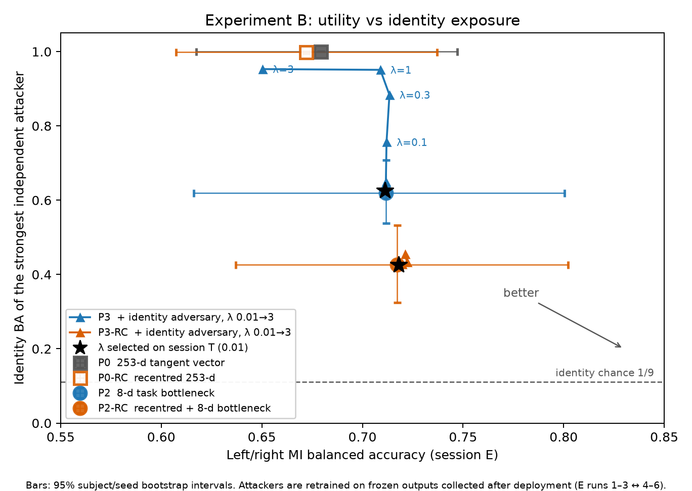
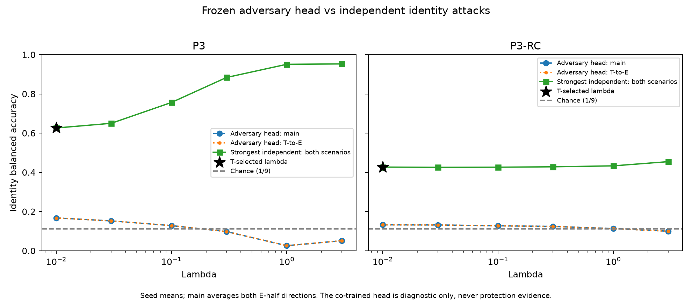
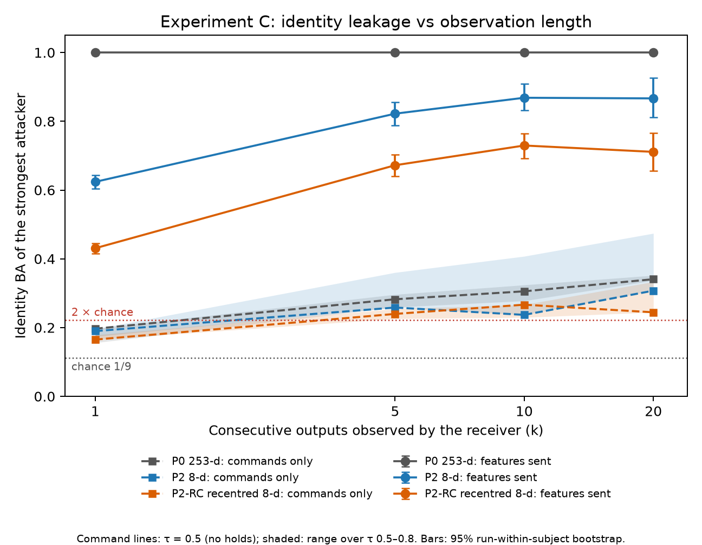
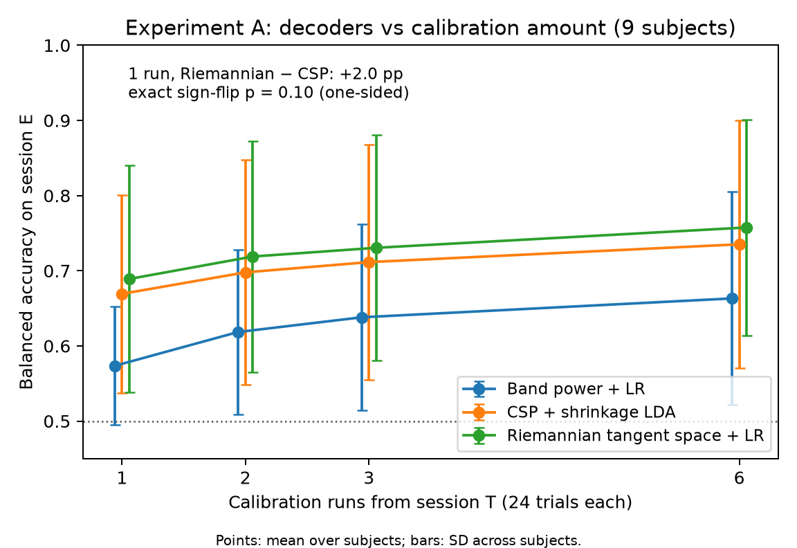

# BEAT: does a motor-imagery BCI reveal who you are?

[](https://github.com/gigalove6783-pixel/beat-eeg-privacy/actions/workflows/ci.yml)

> **What this does not show.** Results come from a 9-person closed set (BCI Competition IV 2a).
> Arm control is a replay of recorded EEG, not closed-loop control with a person. An attacker's
> failure is not anonymization. Device compromise, direct identifying metadata and unobserved
> sensitive attributes are out of scope. Replay processing time is not online latency.

A brain–computer interface often sends something off the device: a feature vector, a decoded
command, or both. This project measures how much of the **user's identity** leaks through what is
sent, and whether that leakage can be reduced without hurting left/right-hand motor-imagery (MI)
decoding. The analysis was **pre-registered**: plan, configuration, code and all
session-T-only selections were committed (E seal, `6ab5668`) before session E was evaluated.

## Key results (session E, recorded on a different day and held out until the seal)

| Question | Result | Verdict |
|---|---|---|
| **H1** With 1 calibration run, does a Riemannian tangent-space decoder beat CSP? | 0.689 vs 0.669 balanced accuracy (+2.0 pp, 6/9 subjects higher), exact sign-flip p = 0.10 | Not supported |
| **H2** Does identity-adversarial training reduce exposure beyond per-subject recentering, at ≤ 5 pp utility cost? | Selected λ = 0.01: identity BA 0.626 vs 0.619 (P3 vs P2), 0.427 vs 0.427 (P3-RC vs P2-RC) | Not supported (both families) |
| **H3** How much identity leaks when only left/right/hold commands are sent? | Above 2 × chance (2/9) within 5 commands in 22 of 24 model/τ settings; up to 0.48 at 20 commands | Residual leakage quantified |

1. **Raw features identify everyone.** Sending the 253-d tangent vector gives identity BA 1.00 for an
   attacker that collects outputs after deployment, and 0.998 even after per-subject recentering.
2. **A small task bottleneck is the effective protection.** An 8-d task-only bottleneck lowers
   identity BA to 0.62, and with recentering to 0.43, while MI accuracy rises (0.679 → 0.717).
3. **Gradient-reversal training backfired.** As λ grows, the co-trained identity head is fooled
   (identity BA 0.026 at λ = 1) while independently trained attackers reach 0.95. Judged by the
   training head, the model looks private; judged by an independent attacker, it leaks more.
   Session-T cross-validation therefore selected λ = 0.01, effectively no adversary.
4. **Commands still leak.** A single command identifies the user at 0.16–0.20 (chance 0.11);
   20 consecutive commands reach 0.21–0.48 depending on model and confidence threshold τ.
5. **Control.** Without holds (τ = 0.5) the replayed arm's mean angle error is 18.5–23.3° per
   20-trial episode with 5.8–6.6 wrong-direction moves; τ = 0.8 holds 60–79% of commands and cuts
   wrong moves to 0.5–1.2. Feature and command transmission give identical trajectories (108/108
   episodes). Median processing is 1.1–1.3 ms per trial on a laptop CPU (replay).

|  |  |
|---|---|
|  |  |

## What was done

- **Data.** BNCI2014-001 / BCI Competition IV 2a, 22 EEG channels, left vs right hand, 1–4 s after
  the cue, causal 8–30 Hz band-pass. Sessions T (training) and E (evaluation) were recorded on
  different days.
- **Experiment A.** Band power, CSP and Riemannian tangent space, per subject, fitted on every
  combination of 1, 2, 3 or 6 T runs and scored on E.
- **Experiment B.** One model pooled over the 9 subjects, with six conditions: P0 (253-d tangent
  vector), P0-RC (per-subject recentering), P2 (8-d bottleneck MLP), P2-RC, and P3 / P3-RC
  (bottleneck plus an identity adversary through gradient reversal, λ 0.01–3). Epochs and λ were
  chosen by leave-one-run-out cross-validation on T (5 seeds). Three independent attackers
  (logistic regression, RBF SVM, MLP) were retrained on frozen outputs: main scenario E runs 1–3 ↔
  4–6, auxiliary T → E.
- **Experiment C.** E trials replayed through a one-joint virtual arm (left −5°, right +5°, hold
  when the temperature-scaled confidence is below τ). The same attackers saw groups of k = 1, 5, 10
  or 20 consecutive features or commands.

## Integrity checks

- **E seal.** Commit `6ab5668` was pushed before any session-E evaluation; its hash is recorded in
  `docs/decision_log.md`. Experiment A's output records `sealed_paths_clean: true`.
- **Leakage tests.** Every fit step on the defended side raises `LeakageError` when given
  session-E trials (`tests/`).
- **Disclosed deviations** (`docs/analysis_plan.md`, `docs/decision_log.md`):
  - One pre-seal loader sanity check touched E; no setting was chosen from it.
  - Experiment C's sealed rejection rule held 35% of E trials (99% for subject 5) because it
    reacts to cross-day drift. The primary C analysis therefore holds only non-finite trials, a
    rule with no parameter E could influence. The sealed rule is still reported in
    `results/exp_c/sealed_gate/`.
- **Failures are reported.** H1 and H2 failed by the pre-registered rules and are reported as
  results.

## Reproduce

```powershell
python -m venv .venv
.venv\Scripts\python -m pip install -r requirements.txt
.venv\Scripts\python scripts\download_data.py   # about 750 MB, SHA-256 printed
.venv\Scripts\python -m pytest
.venv\Scripts\python -m beat.run_all            # all tables and figures
```

Stage times measured on an 8-thread laptop CPU without GPU: A 2 min, B 3 min (development) and
4 min (final), C 13 min per gate variant. That adds up to about 35 minutes; the whole chain has not
been timed as a single run.

| Path | Contents |
|---|---|
| `beat/` | `data.py` loading and leakage guard, `features.py`, `exp_a.py`, `exp_b.py`, `models.py`, `attacks.py`, `exp_c.py`, `figures.py`, `run_all.py` |
| `configs/` | All parameters, fixed at the seal |
| `results/` | Tables (CSV/JSON) and figures; `results/figures/` holds the summary figures |
| `docs/` | Analysis plan and decision log |

Raw EEG and per-subject features are not redistributed: the dataset is licensed CC BY-ND 4.0, and
`data/` and `artifacts/` are excluded from Git.

## Reproducing / tests

The tests need no EEG data: apart from one loader check, every test generates synthetic signals in
pytest's temporary directory. Two markers are assigned in `conftest.py` (the sealed test files are
not edited):

- `data`: reads the raw BNCI2014-001 files under `data/` (`tests/test_foundation.py::test_loaded_trial_counts_and_shape`).
- `slow`: full synthetic development + final pipeline round trips (`test_synthetic_*final*`),
  about 25 s to 2 min each.

```powershell
.venv\Scripts\python -m pytest                              # everything; `data` tests skip without data/
.venv\Scripts\python -m pytest -m "not data"                # what CI runs
.venv\Scripts\python -m pytest -m "not data and not slow"   # quick check, about a minute
```

**CI** (`.github/workflows/ci.yml`) runs on every push and pull request: Ubuntu, Python 3.12,
CPU-only PyTorch from `requirements.txt`, `pytest -m "not data"`. It covers the leakage guards
(every defended fit step rejects session-E trials), feature/model/attack/statistics units, and the
synthetic end-to-end runs of each experiment. It never downloads the dataset and uses no
secrets, so it does not reproduce the reported numbers; those require `scripts\download_data.py`
and `python -m beat.run_all` locally.

## References

1. BCI Competition IV Data Set 2a; BNCI Horizon 2020, BNCI2014-001.
2. Ramoser, Müller-Gerking, Pfurtscheller. Optimal spatial filtering of single trial EEG during
   imagined hand movement. IEEE Trans. Rehabil. Eng., 2000.
3. Barachant et al. Multiclass brain–computer interface classification by Riemannian geometry.
   IEEE Trans. Biomed. Eng., 2012.
4. Zanini et al. Transfer learning: a Riemannian geometry framework with applications to
   brain–computer interfaces. IEEE Trans. Biomed. Eng., 2018.
5. Ganin, Lempitsky. Unsupervised domain adaptation by backpropagation. ICML, 2015.
6. Elazar, Goldberg. Adversarial removal of demographic attributes from text data. EMNLP, 2018.

Proposal: BEAT team (이동현, 장규범), 2026-10-09. Original proposal: `BEAT 프로젝트 기획안.pdf`.
