# What a Motor-Imagery BCI Reveals About Its User: A Pre-Registered Audit of Identity Leakage, Defences and Two Evaluation Pitfalls

**이동현, 장규범** (BEAT team, School of Biomedical Engineering)

Technical report, November 2026 · Code and results: `gigalove6783-pixel/beat-eeg-privacy`

> **Scope and sources.** Experiments A–E and G are complete on BCI Competition IV 2a, and the confirmatory Lee2019/OpenBMI replication (L) is complete under seal 3 (§6.7). Version 2 adds the exploratory study K on identity in command streams and on equalized decoding (§6.8), the exploratory robustness addendum R (§6.9), and the confirmatory replication M on 51 new users. M was sealed under seal 4 with a third-party timestamp, and its sealed final run supported two of its three claims (§6.10). The MLP refit of R is still running. **Evidence tiers:** *confirmatory-sealed* means decided by a rule committed before the held-out data were scored (seals 1, 3 and 4). *Pre-registered estimate* means fixed in a sealed plan and reported without a verdict. *Exploratory* means not pre-registered, or computed on data that had already shaped the analysis (D, E, G, K, R). Every number in this report is taken from a file in `results/` or `docs/`; the source is named in each table caption or next to the claim, and the headline numbers are re-checked against their files by `python -m beat.verify` (registry `docs/numbers.yaml`). "Within-day" results train and test the attacker on data from the same recording day; "cross-day" results train on the calibration day and test on the deployment day.

## Abstract

A motor-imagery (MI) brain–computer interface (BCI) usually transmits a feature vector, a decoded command, or both. We measure how much of the user's identity such transmissions reveal, test defences, and examine how protection is evaluated. The confirmatory analyses of versions 1–2 were pre-registered and sealed by Git commits before held-out data were scored; the version 3 audit described at the end of this abstract is pre-specified (non-blind) or exploratory. On BCI Competition IV 2a (9 users), Riemannian tangent features identify every user within a day (balanced accuracy, BA, 1.00; chance 0.11) and 0.951 across days (a pre-registered estimate). Two evaluation practices found in published EEG identity-protection work overstate protection. First, a co-trained gradient-reversal adversary reports 0.026 BA while independently retrained attackers recover 0.95 from the same frozen outputs. Second, a training-free defence proposed in a recent preprint, which we reproduce on its own protocol (90.8% → 11.1%) is re-identified at 81.75% with one labelled deployment-period trial per user and 97.11% with five. A confirmatory replication on 54 Lee2019/OpenBMI users (chance 0.019) supported three of four pre-registered claims, all tested within a day (offline versus online phase of the second session): the co-trained head scored 0.040 against 0.514 for independent attackers; a recentred task-only bottleneck lowered identity BA from 0.994 to 0.340, still 18 times chance, at −0.6 pp task BA; five labels re-identified the defended output at 92.7%. Across days, the full tangent vector identified users at 0.520 rather than 0.994 (a pre-registered estimate that no verdict decides on its own). The pre-registered command-stream claim was not supported (0.085 at 20 commands within a day; Holm p = 0.21). Version 2 states the resulting thesis: exposure, and the effect of a defence on it, depend on which day's recording the attacker enrols with, so one within-day number establishes neither risk nor protection. An exploratory study (K) adapts equalized-odds post-processing to command streams as group-equalized decoding (EQ). On 54 users, EQ with groups of three lowered the within-group identification excess at 20 commands from 0.112 to 0.009 for an attacker enrolled on the calibration day it was fitted to. For an attacker enrolled on the deployment day it went only from 0.316 to 0.150. A confirmatory cross-day replication on 51 users who were not used in any earlier BEAT analysis was pre-registered and sealed, and the seal carries an RFC 3161 timestamp. Two of its three claims were supported: raw features enrolled on day 1 re-identified users on days 2–3 at 0.345 (threshold 10/51), and the true user's rank rose from 0.538 with one command to 0.649 with 50, which is not an identification rate (top-1 0.061). The co-trained-head gap of the first pitfall stayed below its sealed 0.10 floor across days (0.093–0.096). Version 3 asks whether an attacker who never enrolled a user can link two recordings of that user from what the BCI transmits; the evaluated attacker is given the transmitted outputs and each trial's task cue, and an attacker without the cues was not measured. The tool `beat_audit` measures this linkage on any BCI's outputs with methods from biometric testing and neighbouring fields, each validated on synthetic ground truth. In a batch fixed before computation and run once on the same 51 users (pre-specified, not blind), full features linked across days (mean per-user AUC 0.855 at 20 outputs; 0.5 is chance) and command streams linked weakly but detectably (0.567 at 50 commands). In an exploratory transmission ladder, commands showed lower measured linkage than the 8-d features they are decoded from at matched task utility on Yang2025 and Lee2019 (not established on 2a), but no transmitted alternative demonstrated the absence of linkage (every point estimate is above 0.5), and per-user decoders did not demonstrate consistent improvement in task accuracy. We distil an audit checklist.

## 1 Introduction

MI-BCIs decode imagined hand movements from EEG. In assistive and consumer deployments, decoding is often split between a wearable device and a host, phone or cloud service, so a representation of the signal leaves the device. EEG carries stable person-specific structure; across MI corpora, undefended attackers re-identify users with high accuracy [4–6]. What the device transmits is therefore a potential biometric identifier, even when the application only needs "left" or "right".

The original question of this project (proposal of 2026-10-09, `BEAT 프로젝트 기획안.pdf`) was whether identity cues in transmitted MI representations can be reduced *beyond* a non-learned per-subject Riemannian recentring baseline while losing at most 5 percentage points (pp) of left/right decoding accuracy, and how much identity remains when only discrete commands are sent. The proposal already committed to two measurement choices that turned out to matter: attackers are trained on outputs collected *after* deployment rather than on the defence's training distribution, and adversarial training is credited only for its gain over recentring.

While answering that question we found that the answer depends heavily on how protection is measured. This report therefore has two goals: an audit of identity leakage and defences in an MI pipeline, and a demonstration, on the same data, of two evaluation practices that overstate protection.

**Version 2 thesis.** The measurements above lead to one thesis: identity exposure in what a BCI transmits, and the effect of a defence on it, depend on which day's recording the attacker enrols with, so one same-day number can claim neither risk nor protection. BEAT's own headline shows it for exposure (54 users: 0.994 within a day, 0.520 across days; §6.7; the within-day value is confirmatory-sealed, the cross-day value a pre-registered estimate). BEAT's own defence shows it for protection: group-equalized decoding nearly removes within-group identity for a calibration-day attacker but not for a deployment-day attacker (exploratory; §6.8). A sealed, time-stamped replication on 51 new users tested it across days, and two of its three claims were supported (§6.10). In the pre-committed wording of that outcome (case b): "새 사용자 51명, 다른 날: 사전등록한 주장 3개 중 2개가 지지됐다" (M1 supported, M2 not supported, M3 supported) / "다른 날에는 M1·M3만 재현됐다. M2는 같은 날 조건의 결과로 남는다." Across days only M1 and M3 replicated; M2, the co-trained-head gap, remains a result of the within-day condition. The thesis was worded and committed before any final output of that replication was read (`docs/decision_log.md`, commit `7b14cee`): "BCI 전송물의 신원 노출과 방어 효과는 공격자가 어느 날의 기록으로 등록하느냐에 따라 달라지므로, 같은 날 수치 하나로는 위험도 보호도 주장할 수 없다." Whether a defence fitted to one day equalizes only that day, and not the person, is a question K raises; it is not a claim of this report.

**Contributions.**

1. **Leakage audit of MI transmissions (confirmatory on 2a and on 54 Lee2019 users).** Full tangent-space features identify all nine 2a users; per-subject recentring alone does not change this for an attacker who collects deployment-period outputs (§6.2). On 54 users the full tangent vector still gives 0.994 identity BA within a day and 0.520 across days (§6.7); the confirmatory verdicts cover the within-day values, and the cross-day values on both datasets are pre-registered estimates. On 51 new users, full 190-d features enrolled on day 1 identify users on days 2–3 at 0.345 (claim M1, confirmatory, supported; §6.10).
2. **Pitfall 1: co-trained evaluation.** Within one pre-registered protocol, we show side by side at every adversarial strength that the identity head trained with a gradient-reversal defence falls to or below chance while independently retrained attackers recover identity from the same frozen outputs (B, confirmatory; D, exploratory) (§6.3). The gap reappears in an end-to-end EEGNet with and without Euclidean alignment (E, exploratory), where the identifier approaches but does not fall below chance (§6.6), and it is confirmed on 54 users (L, claim C1: head 0.040 versus independent 0.514; the head stays above chance) (§6.7). On 51 new users across days the gaps were 0.093–0.096, below the sealed 0.10 floor (claim M2, not supported), against 0.717 within day 1 (§6.10).
3. **A simple baseline is hard to beat (exploratory on 2a; partly confirmed on 54 users).** A task-only bottleneck of width $d=1$–$4$ is not dominated on the utility–identity frontier by any T-CV-selected gradient-reversal, maximum-entropy or ensemble-refresh operating point; across all 36 adversarial settings, none combines higher task BA with lower identity BA than these bottlenecks. Its best identity BA, 0.21–0.25, is still about twice chance (§6.2). On 54 users a recentred $d = 8$ bottleneck lowers identity BA from 0.994 to 0.340 at non-inferior task BA (claim C2); L does not test dominance over adversarial variants (§6.7).
4. **Command streams leak on 2a; the 54-user confirmation failed.** Left/right/hold commands alone identify 2a users above chance; in 22 of 24 model/threshold settings, five commands exceed twice chance (§6.4). On 54 users the pre-registered claim that 20 commands exceed twice chance and exceed one command was not supported (claim C3, Holm $p = 0.21$), although point estimates moved in that direction (§6.7). On 51 new users across days, the rank-based claim M3 was supported; it concerns the true user's rank, not identification, and C3 stays not supported (§6.10).
5. **Pitfall 2: reference-session-only attackers (exploratory on 2a; confirmatory on 54 users).** We re-implement a training-free Riemannian defence from a recent arXiv preprint [6], reproduce its reference-session result, and show that one to five labelled deployment-period trials per user re-identify its output (§6.5). On 54 users, under an adapted pipeline that passed a benchmark gate, five labels re-identify it at 92.7% (claim C4, §6.7).
6. **Command-stream identity and group-equalized decoding (exploratory).** With cross-fitted calibration streams and Bayes attackers, identity in decoded command streams grows with the number of commands on both datasets. EQ makes command distributions identical within groups of users for the calibration-day estimates; its guarantee, assumptions and residual leakage are stated and decomposed (§6.8).
7. **A sealed, time-stamped cross-day replication on 51 new users (confirmatory; 2 of 3 claims supported).** The pre-registration of claims M1–M3 on Yang2025 is sealed by commit and tag, and its commit id is timestamped by an RFC 3161 token; according to the self-attested download log, no recording-day-2/3 byte was requested before the token time. M1 (cross-day identification from raw features) and M3 (the true user's rank is above chance and above its rank with one command) were supported; M2 (the gap between the independent attacker and the co-trained head is greater than 0 and its observed value is at least 0.10) was not (§6.10).
8. **Robustness addendum (exploratory).** A side-by-side within-/cross-day table of L and an MLP-convergence sensitivity analysis (§6.9).
9. **An audit checklist** distilled from both pitfalls and the replication (§9).

The project reports failures as results: the pre-registered hypotheses H1 and H2 and the confirmatory claims C3 and M2 were not supported (§6.1, §6.2, §6.7, §6.10).

**Related work.** The co-trained-adversary pitfall is known outside EEG: Elazar and Goldberg showed that adversarial removal can drive the training adversary to chance while a post-hoc attacker still recovers demographic attributes from the frozen encodings [9], and Barrett et al. stressed that the post-hoc attacker must be evaluated on genuinely separate data [10]. Song and Shmatikov showed that censored representations still leak [12]; Roy and Boddeti proposed a maximum-entropy adversary objective [11], which we test. In EEG, identity-protection results are measured in several incompatible ways. ID-RemovalNet reports user identification on BCI IV 2a falling from 91.50% to 0.04% using an identifier attached to the backbone, without an independently retrained attacker [2]; on nine users this value is far below chance (11.1%), which shows a systematically wrong identifier rather than removed identity. Özdenizci et al. also measure only the co-trained adversary, for cross-subject transfer rather than privacy [7]. Meng et al. [1], NeuroPriv [3] and SAFE [4] use independently trained attackers, and SAFE reports that identity BA on 2a recovers from 0.161–0.186 to 0.686 when the attacker trains and tests on protected data. An unreviewed multi-corpus benchmark reports that domain-adversarial defences that look effective under generic probes fail under encoder fine-tuning [5]. Muhaimin and Nagarajan propose a training-free Riemannian transform fitted on a reference session and evaluated defended-versus-defended across sessions [6]; this is the defence we re-audit in experiment G. Euclidean alignment and Riemannian recentring [18–20] reduce identity as a side effect but leave it far above chance [6]. Differential-privacy mechanisms for EEG [15, 16] either do not measure re-identification or were not evaluated here. Meng et al. extend perturbation-based protection to identity, gender and BCI experience together [24]. EEG biometrics treats identity as the target and documents its session dependence [13, 21–23]. In face recognition, Radiya-Dixit et al. show that protection fixed before release fails against attackers who adapt later [26]; pitfall 2 is the analogous asymmetry for a frozen EEG defence. The two pitfalls are practices we found in the sources above ([2, 7] for co-trained-only measurement; [6] and, with the attacker trained on the protected training session, [1]); this review is not a systematic count, so we do not claim that they are typical of the field. A 2026 review names decoded outputs among the BCI data that can be re-associated with individuals [27], but we found no opened source that measures identity leakage from decoded command streams. Defences for discrete outputs with stated guarantees exist outside BCIs: randomized response [31], equalized-odds post-processing [28] and its multiclass extension [29], and perfect-privacy releases [30]. Study K adapts them to command streams (§6.8). EQ applies the post-processing of [28, 29] with the user's identity as the protected attribute. Within a group of users it seeks the condition of [30] for identity: a release whose distribution does not depend on which user produced it, for the fitted distributions. It adds group relaxation, a hold-aware weighted utility, cross-fitted calibration and cross-day evaluation, and it compares against randomized response [31]. Among the sources we reviewed, none applies these methods to BCI command streams. Values across these works use different metrics, attackers and splits and are not directly comparable (`docs/related_work.md`).

## 2 Threat model

**System.** A pooled MI decoder runs on a device. It transmits, per trial, either a *feature* vector (the full tangent vector or a low-dimensional bottleneck) or a *command* in {left, right, hold}. The defence is fitted once on calibration data (session T) and then frozen.

**Adversary.** The adversary observes the transmitted messages and wants to know which enrolled user produced them (closed-set identification among the nine users of BCI IV 2a, chance $1/9 \approx 0.111$; among 54 users in L, chance $1/54 \approx 0.0185$). It does not compromise the device, does not see raw EEG, and does not use metadata such as account names. It trains its own classifiers and tunes them only on its own training data.

**Labelled-data assumptions.** Every scenario assumes the adversary holds some messages labelled with user identity, for example from an enrolment step, a support log or a linked account. The scenarios differ in *when* those labels were collected.

| Scenario | Attacker training data | Attacker test data | Role |
|---|---|---|---|
| **Main / post-deployment** (A–D) | Frozen outputs of session-E runs 1–3 of each user | Runs 4–6 of session E, and the reverse; directions averaged | Primary; adversary collects labelled outputs after deployment |
| **Auxiliary** (A–D) | Frozen outputs of session T | Session E (another day) | Cross-day; never sufficient alone to establish protection |
| **Reference-session** (G, as in [6]) | Defended session 1 | Defended session 2 | The published defence's own threat model |
| **Main / deployment** (L) | Frozen outputs of one phase (offline or online) of session 2 | The other phase of the same day; both directions averaged | Within-day, cross-phase linkage; auxiliary = session 1 → session 2 |
| **Deployment enrolment** (G, L-C4) | First $n \in \{1,2,5,10,20,\text{all}\}$ defended trials per user from one half (G) or one phase (L) of the deployment session | The other half or phase; both directions averaged | Measures how many deployment-period labels defeat a reference-session-fitted defence |
| **Within-day** (K) | One segment of the deployment day (2a: E runs 1–3 or 4–6; L: offline or online phase of session 2) | The other segment; both directions | Attacker enrols on the deployment day |
| **Cross-day** (K) | Cross-fitted calibration-day stream (2a: T; L: session 1) | Deployment day | Attacker enrols on the day the decoder and EQ were fitted on; the in-sample stream is a contrast only |
| **cal_to_dep** (M, primary) | Recording day 1 (cross-fitted stream or day-1 features) | Days 2 and 3 | Confirmatory claims M1–M3 |
| **dep_to_dep**, **same_day_halves** (M) | Day 2 (day 3), or trials 1–100 of day 2 or 3 | Day 3 (day 2), or the rest of the same day | Estimates only; reported separately, never as a maximum over scenarios |

**Co-trained head.** For adversarially trained models, the identity head trained jointly with the encoder is reported as a *diagnostic* only. The pre-registered rule states that a low head score is not evidence of protection (`docs/analysis_plan.md`, Experiment B).

**Out of scope.** Device compromise, identifying metadata, unobserved sensitive attributes, open-set verification and white-box or adaptive encoder attacks. An attacker's failure in any scenario is not evidence of anonymity.

## 3 Data

**BCI Competition IV 2a / BNCI2014-001** (experiments A–G) [25]. Nine users, two sessions (T and E) recorded on different days, 22 EEG channels at 250 Hz (3 EOG channels excluded). For A–E we use left- versus right-hand trials, 6 MI runs × 24 trials per session (144 per user and session), analysed 1–4 s after the cue with a causal 4th-order 8–30 Hz Butterworth band-pass applied per run (`configs/data.yaml`). Trials with the official artifact flag or any non-finite sample are excluded from A, B and D; 1,163 T trials are retained (`results/exp_e/dev_selection.json`). Experiment C replays all 1,296 E trials (`results/exp_c/summary.json`). Experiment G follows the protocol of [6] instead: all four MI classes, artifact-flagged trials retained (288 trials per session), cue + [0, 4) s, 5th-order zero-phase 8–30 Hz filtering (`beat/exp_g.py`, `AMBIGUITIES`). Files come from the TU Graz host of the BNCI release, with SHA-256 checksums (`docs/decision_log.md`). The data are licensed CC BY-ND 4.0 and are not redistributed.

**Lee2019 / OpenBMI** (experiment L, confirmatory) [32]. 54 participants, two sessions on different days, each with an offline and an online phase of 100 trials (50 left, 50 right). Data were reduced to 20 motor channels, causal 8–30 Hz filtering, decimation to 250 Hz and 1–4 s epochs by `scripts/prepare_lee2019.py`. Only file shapes and session-1 label balance were inspected before seal 3; the pre-seal access record lists session-1 files only (`results/exp_l/session_access.json`, committed with seal 3: `"session2_opened": false`). Session 2 was first loaded by the sealed final run (§6.7). No trial was excluded (`results/exp_l/exclusions.csv`).

**Yang2025 / WBCIC-SHU** (study M, confirmatory) [37]. 51 users, two-class (left- vs right-hand grasping) motor imagery on three recording days with 200 trials per day, CC BY 4.0. M reads the raw `.bdf` members of the figshare+ archive (version 5) through logged HTTP byte ranges and reduces them with L's causal pipeline (`beat/yang2025.py`). The pipeline keeps the 19 of L's 20 motor channels that this montage has (no CPz), giving 190-d tangent vectors, and uses the window 1–4 s after imagery onset, which is 2.5–5.5 s after the start of the 1.5 s video cue. Before seal 4 the reader was restricted to an allowlist of recording-day-1 members and top-level metadata (`docs/preregistration_m.md` §2–3).

## 4 Methods

### 4.1 Representations and decoders

For a trial $X \in \mathbb{R}^{22 \times 750}$ we estimate an OAS-shrunk covariance $C$. The Riemannian tangent vector at a fixed reference $C_{\text{ref}}$ (the Riemannian mean of the training covariances, not updated at test time) is

$$\mathbf{s}(C) = \operatorname{upper}\!\left(\log\!\left(C_{\text{ref}}^{-1/2}\, C\, C_{\text{ref}}^{-1/2}\right)\right) \in \mathbb{R}^{253},$$

with off-diagonal entries weighted by $\sqrt{2}$ [Barachant 2012]. **Per-subject recentring** (RC) replaces $C$ by $M_s^{-1/2} C M_s^{-1/2}$, where $M_s$ is the Riemannian mean of user $s$'s T covariances [18]; it needs no labels and no training.

**Experiment A** compares three per-subject decoders: B1 band power (log Welch power in 8–13 and 13–30 Hz per channel, logistic regression), B2 CSP (6 filters, log-variance, shrinkage LDA) [Ramoser 2000] and B3 tangent space + logistic regression, each fitted on every combination of 1, 2, 3 or 6 T runs and scored on all E trials (`configs/exp_a.yaml`).

**Experiments B–D** use one model pooled over the nine users, trained on T and frozen:

| Condition | Transmitted representation | Training |
|---|---|---|
| P0 / P0-RC | 253-d tangent vector, common reference / recentred | linear task classifier |
| P2 / P2-RC | $d$-dim bottleneck of an MLP encoder 253→64→$d$ ($d=8$ in B) | task loss only |
| P3 / P3-RC | same encoder, $d=8$ | task loss + gradient-reversal identity adversary |

The encoder is trained with Adam (learning rate $10^{-3}$, batch 128, at most 40 epochs, 5 seeds; `configs/exp_b.yaml`). For P3 the encoder minimises $\mathcal{L}_{\text{task}} - \lambda_p \mathcal{L}_{\text{id}}$ through a gradient-reversal layer [Ganin 2015], where $\mathcal{L}_{\text{id}}$ is the cross-entropy of a 9-way identity head with one hidden layer (16 units), and

$$\lambda_p = \lambda\left(\frac{2}{1+e^{-10p}} - 1\right),\qquad \lambda \in \{0.01, 0.03, 0.1, 0.3, 1, 3\},$$

with $p$ the training progress.

### 4.2 Defences compared in experiment D (exploratory)

- **D1, task-only bottleneck sweep:** P2 / P2-RC with $d \in \{1, 2, 4, 8, 16, 32\}$; the epoch budget per $d$ and family is chosen by T cross-validation (CV) task BA. $d=8$ reproduces B's P2 exactly (`results/exp_d/decision.json`, `exp_b_p2_consistency`: differences 0.0).
- **GRL-CE:** B's P3 / P3-RC (reference, not retrained).
- **MaxEnt** [11]: the adversary minimises identity cross-entropy; the encoder minimises $\lambda_p \cdot \mathrm{CE}(\mathcal{U}, q_\phi(\cdot\mid z))$, pushing the adversary posterior toward the uniform distribution $\mathcal{U}$.
- **Ensemble-refresh:** five adversary heads behind gradient reversal; the encoder is penalised through their mean cross-entropy; from epoch 2 one head is re-initialised per epoch in rotation (`configs/exp_d.yaml`).

For MaxEnt and ensemble-refresh, epoch budget (5, 10, 20, 40) and $\lambda$ are selected jointly in T-CV to avoid an under-trained adversary.

### 4.3 The reference-session-fitted defence of experiment G (exploratory)

We re-implemented the four-stage training-free transform of Muhaimin and Nagarajan [6] from its text (`beat/exp_g.py`, `FourStageDefense`): (1) per-subject Riemannian mean alignment toward the pooled mean, (2) per-subject tangent-space scatter whitening, (3) alignment of the 8–30 Hz band component, and (4) a final re-alignment, with strengths $(\gamma_1, \gamma_2, \alpha, \beta) = (0.9, 0.35, 0.6, 0.0)$, the published BCI IV 2a operating point (`configs/exp_g.yaml`). All statistics are fitted on session 1 and never updated. The paper underspecifies several details; our 18 interpretations (covariance formula, filter padding, CSP and XDAWN configurations, among others) are listed verbatim in `beat/exp_g.py` (`AMBIGUITIES`) and in `results/exp_g/bnci/summary.json`. Attackers: the paper-style tangent-space SVM (`paper_ts_svm`), XDAWN-SVM, CSP-SVM and CSP-LDA, plus our logistic regression, RBF-SVM and MLP attackers. SPDNet-ID and MI utility decoders were not run, so G does not measure the defence's decoding cost.

### 4.4 Attackers

Independent attackers are retrained for every representation, scenario and seed on the frozen outputs: multinomial logistic regression ($C=1$), an RBF-SVM with $C \in \{0.1, 1, 10\}$ and $\gamma \in \{\text{scale}, 0.01, 0.1\}$ tuned by 3-fold inner CV on the attacker's own training data, and an MLP (32 hidden units, L-BFGS) distinct from the adversary head (`configs/exp_b.yaml`). Identity BA is the mean per-user recall. The **strongest attacker** is the maximum seed-mean identity BA over attackers *and* scenarios.

### 4.5 Commands and replayed arm control (experiment C)

Each frozen B model issues one command per trial: left → −5°, right → +5°, and hold when the temperature-scaled maximum probability is below $\tau \in \{0.5, 0.6, 0.7, 0.8\}$ ($\tau = 0.5$ is the no-hold control). The temperature is fitted on T out-of-fold logits. E trials of each run are replayed in recorded order through a one-joint virtual arm (range ±90°) in episodes of 20 trials. Labels define only the target trajectory used for scoring. Two transmission modes use the same models, trials and $\tau$: *feature mode* sends the representation, *command mode* sends only left/right/hold. Observation-length attacks group $k \in \{1, 5, 10, 20\}$ consecutive outputs of one user: feature attackers use the mean and standard deviation of the $k$ representations; command attackers use hold rate, left/right bias, run lengths and transition frequencies (`configs/exp_c.yaml`). Training groups slide with stride 1 and test groups do not overlap.

### 4.6 Statistics

Per-user values are the unit of inference ($n=9$). H1 uses an exact one-sided sign-flip test over $2^9 = 512$ sign patterns. Utility non-inferiority (B, D) requires the one-sided 95% lower bound of the paired per-user task-BA difference to exceed −5 pp. Protection requires the strongest-attacker identity BA to drop by at least 5 pp *and* the one-sided 95% lower bound of the paired per-user identity-recall difference to exceed 0, in the main scenario and over both scenarios, in both the common and the RC family. Intervals for identity BA come from 2,000 bootstrap resamples of runs within user. In L, claim-level p-values are Bonferroni-adjusted within claims and combined with Holm's procedure at familywise $\alpha = 0.05$ (`docs/analysis_plan.md`, plan v3).

### 4.7 Pre-registration and seals

Every fitted step on the defended side uses session-T data only; fit entry points raise `LeakageError` on E trials, which the test suite enforces. Four seals fix the plan, configurations, code and calibration-only selections before evaluation (`docs/decision_log.md`, `seals/manifest.yaml`):

| Seal | Commit | Fixes | Status of analyses |
|---|---|---|---|
| E seal | `6ab5668` | Plan v1, A–C; 47 tests passed | **Confirmatory** (A, B, C) |
| E seal 2 | `b216b7d` | Plan v2, D and E; 73 tests passed | **Exploratory**: reuses session E, which already shaped D and E |
| — | none | G at the published operating point; no selection on session 2 | **Exploratory** |
| Seal 3 | `9757c3f` | Plan v3, Lee2019 claims C1–C4; 109 tests passed | **Confirmatory** (L); session 2 first scored by the sealed final run |
| — | none | K and R on already-analysed 2a and Lee2019 data | **Exploratory** |
| Seal 4 | `e88154c` | `docs/preregistration_m.md`, claims M1–M3 and estimates, `configs/exp_m.yaml`, `configs/exp_k.yaml`, all `beat/*.py`, the fetch script, day-1 checksums and selections; recording days 2–3 not downloaded | **Confirmatory** (M); RFC 3161 token time 2026-11-10 20:26:22 GMT; day 2–3 first scored by the sealed final run |
| Freeze 5 | `55cd01e` | `docs/plan_v3.md`, the `beat_audit` source, the cohort runner, `configs/audit.yaml`, the environment, export hashes, folds, seeds, job manifest and predictions V1–V2 | ***Pre-specified (non-blind)*** (Yang2025 audit, §6.11); no third-party timestamp |

For seal 4, an RFC 3161 request [38] sent only the SHA-256 of the 40-character seal commit id to FreeTSA. The token, the TSA and CA certificates, and the OpenSSL 3.5.7 verification output are stored in `results/exp_m/seal4_timestamp/` (`verification.json`, `token_time`). Seals 1–3 have no such anchor. A and B final runs were produced at commit `e6c13c8` with `sealed_paths_clean: true` (`results/exp_a/h1.json`). Freeze 5 of v3, like seals 1–3, is a Git commit and annotated tag without such an anchor (§6.11). All deviations are listed in Appendix A.

### 4.8 Statistics of the audit tool (v3)

Version 3 measures a different quantity from v1–v2: open-set linkage of transmitted outputs. The tool `beat_audit` (`docs/plan_v3.md` §3; `beat_audit/README.md`) takes any BCI's outputs (feature vectors or command codes) with user and day labels and, optionally, each trial's task cue (the `target` column: left or right). In BEAT's audits the attacker is given the outputs and the cue (`results/audit/export_manifest.json`); an attacker who sees the outputs without the cues was not measured. Each user's outputs are cut into non-overlapping windows of $k$ consecutive outputs within one segment of a day, $k \in \{1, 5, 10, 20, 50, 100\}$. Users are split into user-disjoint folds (9 users: 3 folds of 3; 51 and 54 users: 5 folds). Every comparator, prior, calibration map and threshold is fitted on a fold's development users only (the diagnostic Cllr_min below is fitted on the target scores and feeds no decision), and both windows of every scored pair belong to that fold's target users, so the target users are unseen by the attacker's comparator; they are not unseen by the BCI, whose encoders, recentring and decoders were fitted with their calibration data. A mated comparison pairs a reference window of user $u$ with a probe window of $u$ from another segment of the same day (*same-day*) or from another day (*cross-day*); a non-mated comparison uses a probe of another target user. Feature comparators are cosine and LDA with within-class covariance normalisation (Ledoit–Wolf shrinkage) followed by cosine, each on the window mean or on a *rich* summary (mean, mean per cue, log variance), and pairwise logistic regression on absolute differences of window means. The command comparator is a cue-aware Dirichlet-multinomial Bayes factor of same against different source. The rich summaries and the command Bayes factor condition on each trial's cue, and these are the comparators of V1 and V2; the mean-based comparators do not use the cue.

The statistic is $\mathrm{AUC}_u$, the probability that a mated score of $u$ exceeds a non-mated score of $u$ (ties count 0.5), averaged over partners, directions, days and model seeds; the reported value is the mean per-user AUC, with 0.5 as chance. It is a linkage score, not an identification rate. The only deciding test is a matching permutation test that reassigns whole side-B blocks among a fold's target users (10,000 draws, or all matchings when fewer exist). Intervals are 95% percentile intervals of a subject bootstrap (2,000 replicates), conditional on the fitted comparators and printed as unreliable for folds of three users. The paired same-day minus cross-day contrast is an estimate without a test. Descriptive metrics pool scores with equal weight per user: EER, TPR at fixed FPR, the unlinkability index $D_\mathrm{sys}$, Cllr, from a logistic calibration fitted on development users, and Cllr_min, an oracle diagnostic from an isotonic (pool-adjacent-violators) fit on the target users' own scores and labels (`beat_audit/metrics.py` `cllr_min`) that feeds nothing back into any decision. For commands, a sequential probability ratio test (nominal $\alpha = \beta = 0.05$) reports the number of commands needed to decide and its realised error rates. A gallery module predicts 1:N rank-1 rates under the independence model and checks each prediction against measured rates on held-out galleries; when any difference exceeds 0.05 it prints "independence model not supported" and no larger N. The fields these methods come from (biometric performance testing, template-protection unlinkability, speaker-anonymisation evaluation, forensic likelihood ratios, sequential analysis and large-population biometrics) and their sources are given in `docs/related_work.md` Section 8. Each method was checked on synthetic ground truth before use (§6.11). Each cell of a `report.md` prints *linkage detected* when its permutation p-value passes Holm's correction over the $k$ grid, and otherwise *not detected: insufficient evidence, not absence*; this is a per-cell convention of the tool, not a verdict.

## 5 Experimental status at a glance

| Exp. | Question | Status | Outcome |
|---|---|---|---|
| A | Tangent space vs CSP at 1 calibration run (H1) | Confirmatory | Not supported |
| B | Gradient-reversal bottleneck (P3) has strongest identity BA ≥ 5 pp below the task-only bottleneck (P2), with a positive lower bound on the per-user difference and task BA non-inferior (−5 pp), in both the common and the recentred family (H2) | Confirmatory | Not supported (both families) |
| C | Residual identity in command streams (H3) | Confirmatory (descriptive) | Quantified; above chance |
| D | Is the H2 failure specific to plain GRL? | Exploratory | No variant passes; no adversarial point dominates task-only |
| E | Co-trained identifier vs independent attacker in EEGNet | Exploratory (descriptive, no selection) | Gap reappears: identifier 0.11–0.19 vs independent 0.44–0.58 at high $\lambda$; never below chance |
| G | Reference-session-fitted defence under deployment enrolment | Exploratory | Reproduced; re-identified with 1–5 labels |
| L | Replication of C1–C4 on 54 users | Confirmatory (seal 3) | C1, C2, C4 supported; C3 not supported (Holm $p = 0.21$) |
| K | Identity in command streams; randomized response vs group-equalized decoding | Exploratory | Identity grows with the number of commands, within and across days; EQ (g = 3) nearly removes within-group identity across days but not within the deployment day |
| R | Within-/cross-day table of L; MLP convergence sensitivity | Exploratory | Table complete; all 45 non-converged MLP fits refitted, 42 converged; no Holm decision of L changes |
| M | Cross-day replication on 51 new users (M1–M3) | Confirmatory (seal 4, time-stamped) | M1 and M3 supported; M2 not supported (gaps 0.093–0.096 below the 0.10 floor) |
| V | Open-set linkage of transmitted outputs by an attacker who never enrolled the user (`beat_audit`, v3) | Pre-specified (non-blind) on Yang2025 (freeze 5); exploratory on 2a, Lee2019 and the transmission ladder | V1 and V2 supported (mean per-user AUC 0.855 and 0.567); commands below the 8-d features they are decoded from on Yang2025 and Lee2019, not established on 2a |

## 6 Results

### 6.1 Experiment A: decoding baseline (confirmatory)

| Decoder | 1 run | 2 runs | 3 runs | 6 runs |
|---|---|---|---|---|
| B1 band power | 0.573 | 0.618 | 0.638 | 0.663 |
| B2 CSP | 0.669 | 0.698 | 0.712 | 0.735 |
| B3 tangent space | 0.689 | 0.719 | 0.731 | 0.758 |

*Table 1. Mean session-E balanced accuracy over nine users by number of T calibration runs (`results/exp_a/summary.csv`).*

With one calibration run, B3 exceeded B2 by 2.0 pp on average (median 2.7 pp; 6 of 9 users higher), exact one-sided sign-flip $p = 0.10$ (`results/exp_a/h1.json`). **H1 is not supported** by the pre-registered rule. Spread between users is large: 1-run B3 ranges from 0.524 to 0.909 (`results/exp_a/summary.csv`). These per-subject decoders set the utility scale for the pooled models below.

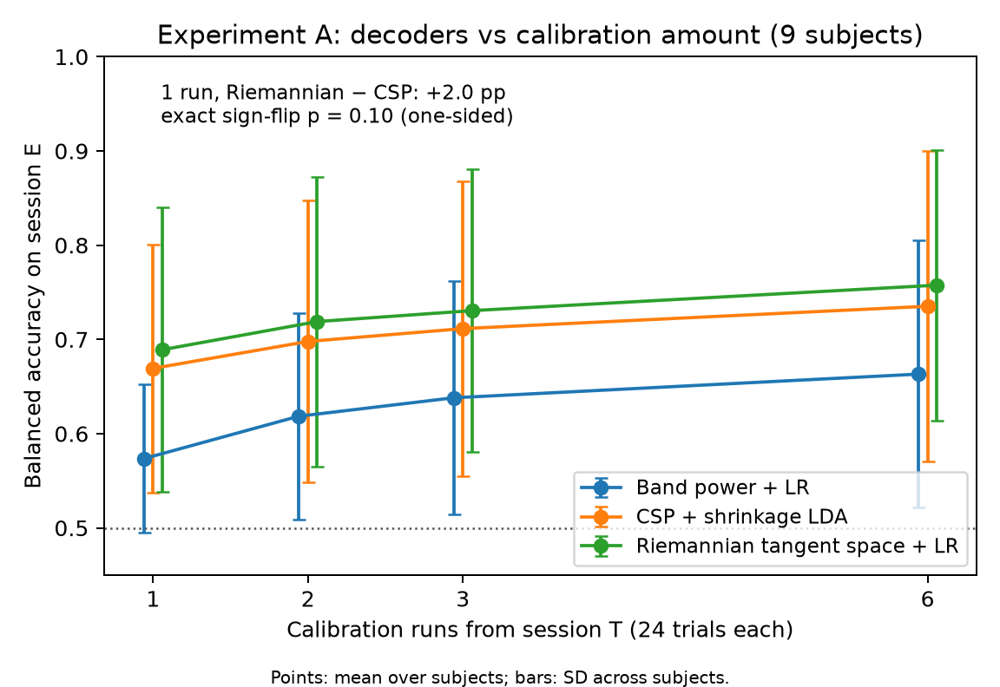

*Figure 1. Session-E balanced accuracy versus calibration runs (`results/figures/exp_a_calibration.png`).*

### 6.2 Feature leakage and defences (B confirmatory, D exploratory)

**Raw features identify every user.** Transmitting the 253-d tangent vector gives strongest-attacker identity BA 1.00 in the main scenario; after per-subject recentring it is 0.998 (95% interval 0.995–1.00) (`results/exp_b/tradeoff.csv`). Recentring does reduce *cross-day* identification: the auxiliary T→E attacker falls from 0.951 (P0) to 0.342 (P0-RC) (`results/exp_d/tradeoff.csv`). The P0 value is also in B's sealed auxiliary rows (`results/exp_b/identity_final.csv`, scenario = auxiliary, logistic regression in all five seeds), where it is a pre-registered estimate; the P0-RC value is D's and exploratory. This contrast shows that recentring mainly removes a user-specific offset that is stable within a session but not across days; it does not remove identity from the data an attacker collects after deployment.

**H2 (confirmatory).** T-CV selected $\lambda = 0.01$ in both families, effectively no adversary. Utility was non-inferior (common: mean −0.04 pp, lower bound −0.21 pp; RC: +0.06 pp), but protection failed: identity BA 0.626 for P3 versus 0.619 for P2, and 0.427 versus 0.427 for P3-RC versus P2-RC (`results/exp_b/decision.json`). **H2 is not supported.** The reason the CV rule picked the smallest $\lambda$ is pitfall 1 (§6.3).

**A narrow task-only bottleneck is the most effective defence tested (exploratory).**

| Family | $d$ | Task BA | Identity BA (strongest) | Identity BA (auxiliary T→E) |
|---|---|---|---|---|
| common | P0 (253) | 0.679 | 1.000 | 0.951 |
| common | 1 | 0.707 | 0.253 | 0.161 |
| common | 2 | 0.711 | 0.325 | 0.238 |
| common | 4 | 0.710 | 0.455 | 0.308 |
| common | 8 | 0.712 | 0.619 | 0.455 |
| common | 32 | 0.707 | 0.886 | 0.733 |
| RC | P0-RC (253) | 0.672 | 0.998 | 0.342 |
| RC | 1 | 0.706 | 0.209 | 0.145 |
| RC | 2 | 0.711 | 0.252 | 0.146 |
| RC | 4 | 0.718 | 0.308 | 0.155 |
| RC | 8 | 0.717 | 0.427 | 0.177 |
| RC | 32 | 0.713 | 0.714 | 0.202 |

*Table 2. Task-only bottleneck sweep (D1; $d=16$ omitted, see source). Session-E task BA and identity BA, seed means; chance 0.111 (`results/exp_d/tradeoff.csv`).*

Identity BA rises monotonically with bottleneck width while task BA stays within 0.705–0.718 for every $d$; every bottleneck decodes better than the full tangent vector (0.672–0.679). At $d=1$ the strongest attacker reaches 0.253 (common) and 0.209 (RC) at task BA 0.707 and 0.706. This is the lowest identity exposure observed in A–D, but it remains about twice chance: a single scalar per trial still carries user information.

| Variant (family) | Selected $\lambda$ / epochs | Task BA | Identity BA | Co-trained head BA | Utility rule | Protection rule |
|---|---|---|---|---|---|---|
| GRL-CE (common) | 0.01 / B budget | 0.711 | 0.626 | 0.167 | pass | fail |
| MaxEnt (common) | 3 / 40 | 0.686 | 0.456 | 0.134 | fail (lower bound −5.15 pp) | pass (−16.3 pp, $p=0.002$) |
| Ensemble (common) | 0.03 / 40 | 0.708 | 0.574 | 0.147 | pass | fail (−4.5 pp) |
| GRL-CE (RC) | 0.01 / B budget | 0.718 | 0.427 | 0.132 | pass | fail |
| MaxEnt (RC) | 0.03 / 20 | 0.684 | 0.394 | 0.153 | fail | fail (−3.3 pp) |
| Ensemble (RC) | 0.1 / 40 | 0.679 | 0.396 | 0.115 | fail | fail (−3.1 pp) |

*Table 3. T-CV-selected adversarial operating points at $d=8$ (D2) compared with the $d=8$ task-only encoder of the same family; protection is the identity drop relative to that encoder (`results/exp_d/decision.json`, `results/exp_d/tradeoff.csv`; GRL-CE from `results/exp_b/adversary_comparison.csv`).*

The two pre-registered questions of D were both answered *false* (`results/exp_d/decision.json`). (i) No variant passed the protection rule in both families; MaxEnt passed in the common family only, and failed the utility margin there. (ii) No selected adversarial operating point dominated the task-only frontier in the pre-registered sense (lower identity BA than every task-only bottleneck with equal or higher task BA): every selected adversarial point has a task-only bottleneck of equal or higher task BA with lower identity BA (comparator minima 0.253 common and 0.209 RC). As an additional descriptive check over all 36 adversarial points (every $\lambda$, not only the selected ones), 30 are dominated by some task-only bottleneck. The remaining six (GRL-CE at $\lambda \in \{0.1, 0.3\}$; GRL-CE-RC at $\lambda \in \{0.3, 1, 3\}$; ensemble-RC at $\lambda = 1$) exceed the best task-only task BA by at most 0.41 pp (0.722 versus 0.718) while their identity BA, 0.42–0.88, is well above that of the $d=4$ bottleneck of the same family (0.455 common, 0.308 RC) (computed from `results/exp_d/tradeoff.csv` and `results/exp_b/tradeoff.csv`). Conversely, two GRL-CE points ($\lambda = 0.1, 0.3$) dominate the wide common-family bottlenecks $d = 16$ and $d = 32$, so the advantage of the task-only baseline holds at narrow widths, not at every width. The "frontier dominance" of the simple baseline is therefore an exploratory, nine-user result for this encoder family. It does not show that adversarial training cannot work in general.

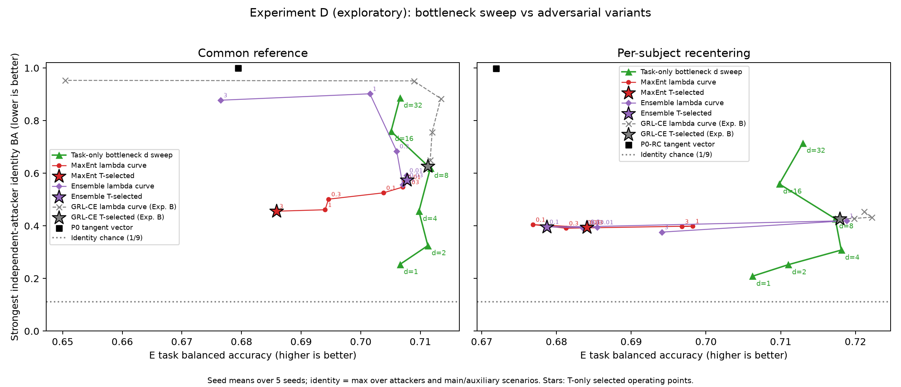

*Figure 2. Utility–identity frontier of task-only bottlenecks and adversarial variants, both families (`results/exp_d/frontier.png`). Experiment B's version is `results/figures/exp_b_tradeoff.png`.*

### 6.3 Pitfall 1: co-trained evaluation understates exposure

In experiment B, increasing $\lambda$ made the co-trained identity head look increasingly successful and the transmitted features increasingly identifying (Table 4, Figure 3). At $\lambda = 1$ the head scored 0.026 identity BA, far *below* chance, while an independently retrained MLP on the same frozen outputs scored 0.951 (`results/exp_b/adversary_comparison.csv`). Judged by its own head, the high-$\lambda$ model is the most private; judged by an independent attacker, it leaks more than the task-only bottleneck (0.619). This pattern was first seen in T-only development, before the seal (head 0.08–0.11 versus independent logistic regression up to 0.995; `docs/decision_log.md`), and was confirmed on session E.

| $\lambda$ | 0.01 | 0.03 | 0.1 | 0.3 | 1 | 3 |
|---|---|---|---|---|---|---|
| Co-trained head, P3 | 0.167 | 0.152 | 0.128 | 0.098 | 0.026 | 0.051 |
| Independent strongest, P3 | 0.626 | 0.650 | 0.756 | 0.884 | 0.951 | 0.953 |
| Co-trained head, P3-RC | 0.132 | 0.132 | 0.127 | 0.124 | 0.113 | 0.100 |
| Independent strongest, P3-RC | 0.427 | 0.425 | 0.426 | 0.428 | 0.433 | 0.454 |

*Table 4. Identity BA of the co-trained head (main scenario) and of the strongest independent attacker on the same frozen session-E outputs (`results/exp_b/adversary_comparison.csv`). Chance 0.111.*

The same gap appears with the stronger adversaries of experiment D (exploratory). At every $\lambda$, co-trained heads scored 0.12–0.28 in the common family while independent attackers reached 0.46–0.90, and 0.12–0.16 versus 0.38–0.42 in the RC family; at the selected operating points the heads scored 0.115–0.153 against independent 0.394–0.574 (`results/exp_d/tradeoff.csv`). MaxEnt, whose objective targets a uniform posterior rather than a wrong one, avoided below-chance head scores but still left the head and the independent attackers far apart.

**Interpretation.** A co-trained head measures whether *that* head, trained against a moving encoder, can read identity. A below-chance score means the encoder has learned to mislead that head systematically, which is itself information about identity. Our data show that this metric can rank models in the opposite order of independent attackers. Experiment E (§6.6) finds the same gap for an EEGNet backbone with a co-trained identifier, the setting of published EEG identity-removal work [2], although there the identifier stays at or slightly above chance rather than below it. The confirmatory replication on 54 users (§6.7, C1) shows the same gap with a head at about twice chance, again not below it.

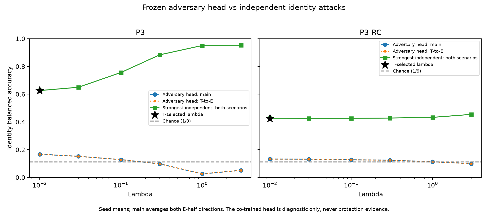

*Figure 3. Co-trained head versus independent attackers across $\lambda$ (`results/exp_b/adversary_vs_independent.png`).*

### 6.4 Experiment C: commands leak, and leakage grows with observation length (confirmatory)

**Commands alone identify users above chance.** A single command identifies the user at 0.156–0.198 BA across the six models and four thresholds (chance 0.111). With 20 consecutive commands the strongest attacker reaches 0.211–0.478 (`results/exp_c/observation_strongest.csv`). Both ranges come from the main, within-session scenario. The strongest value is the maximum over attackers *and* scenarios (§4.4); among the command cells of Table 5 only one maximum comes from the cross-day T→E scenario (marked there). In 22 of 24 model/$\tau$ settings, five commands already exceed twice chance ($2/9 \approx 0.222$); the exceptions are P0-RC at $\tau = 0.5$ (never reached by $k = 20$) and P0-RC at $\tau = 0.6$ (reached at $k = 10$) (`results/exp_c/observation_threshold.csv`). If one requires the lower 95% bound rather than the point estimate to exceed $2/9$, several recentred settings need $k = 10$ or do not reach the threshold (same file, `smallest_k_lower_bound`), so the five-command figure should be read as a point estimate. The corresponding confirmatory claim on 54 users (C3) was not supported (§6.7).

| Model | Command, $k=1$ ($\tau=0.5$ / $0.8$) | Command, $k=20$ ($\tau=0.5$ / $0.8$) | Feature, $k=1$ | Feature, $k=20$ |
|---|---|---|---|---|
| P0 | 0.197 / 0.156 | 0.341 / 0.352ᵃ | 1.000 | 1.000 |
| P0-RC | 0.156 / 0.168 | 0.211 / 0.352 | 0.999 | 1.000 |
| P2 | 0.190 / 0.174 | 0.307 / 0.474 | 0.624 | 0.867 |
| P2-RC | 0.165 / 0.178 | 0.244 / 0.304 | 0.431 | 0.711 |
| P3 | 0.190 / 0.174 | 0.319 / 0.478 | 0.625 | 0.867 |
| P3-RC | 0.165 / 0.179 | 0.248 / 0.304 | 0.430 | 0.715 |

*Table 5. Strongest-attacker identity BA by transmission mode and observation length $k$ (`results/exp_c/observation_strongest.csv`, column `scenario`). Every value is from the main, within-session scenario (runs 1–3 ↔ 4–6 of session E) except ᵃ, which is from the cross-day T→E scenario; the within-session maximum for that cell is 0.326 (`results/exp_c/observation_seed_mean.csv`). P0 features at $k = 20$ reach 1.000 in both scenarios (the file lists the cross-day row). Chance 0.111.*

Command-mode leakage is roughly an order of magnitude below feature-mode leakage at $k = 1$, but it does not vanish and generally grows with $k$. The growth is not strictly monotonic: for example, P2-RC at $\tau = 0.5$ gives 0.267 at $k = 10$ and 0.244 at $k = 20$ (`results/exp_c/observation_strongest.csv`), within the bootstrap intervals. Higher $\tau$ tends to increase command leakage at $k = 20$ for the bottleneck models (P2: 0.307 → 0.474), consistent with the hold pattern itself being user-specific. Feature-mode leakage grows strongly with $k$ for bottlenecks (P2-RC: 0.431 → 0.711), so averaging several messages erases much of the protection that a single message suggests.

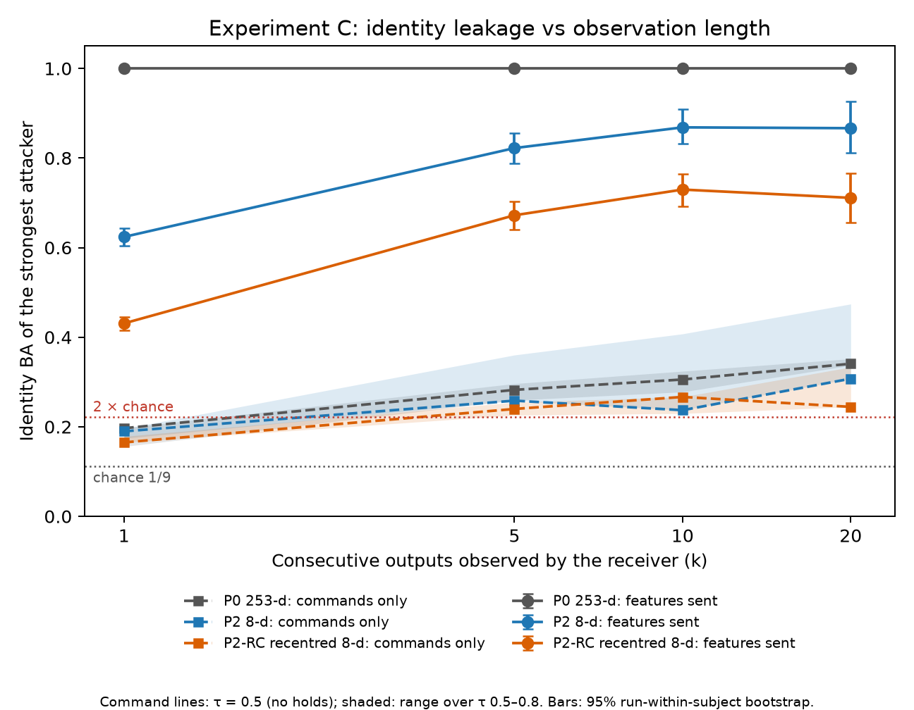

*Figure 4. Identity BA versus observation length for feature and command transmission; the command curve shows $\tau = 0.5$ with the $\tau$ range shaded (`results/figures/exp_c_observation_length.png`).*

**Replayed arm control.** Without holds ($\tau = 0.5$), the mean absolute angle error per 20-trial episode was 18.5–23.3° with 5.8–6.6 wrong-direction moves. At $\tau = 0.8$, 60–79% of commands were held, wrong-direction moves fell to 0.5–1.2, and the angle error to 11.2–12.3° (`results/exp_c/control_summary.csv`). The recentred bottleneck models (P2-RC, P3-RC) had the lowest error at $\tau = 0.5$ (18.5–18.6°). Feature and command transmission produced identical trajectories in all 108 episodes of every model, seed and threshold, and the live replay matched the saved model outputs (maximum absolute logit difference $1.4 \times 10^{-6}$) (`results/exp_c/transmission_check.csv`, `results/exp_c/summary.json`). Median processing time was 1.13–1.34 ms per trial (95th percentile 2.08–2.44 ms) on a laptop CPU (`results/exp_c/timing_summary.csv`). This is replay timing, not online latency, and the arm was not controlled by a person in closed loop.

**Disclosed deviation.** The sealed artifact-rejection rule held 3.4% of T trials but 35% of E trials (99.3% for user 5), because it reacts to cross-day drift rather than artifacts. The primary C analysis therefore holds only non-finite trials (none occurred: `results/exp_c/rejection_rates.csv`); the sealed rule is still reported in `results/exp_c/sealed_gate/` (Appendix A, deviation 7).

### 6.5 Pitfall 2: reference-session-only attackers (experiment G, exploratory)

**Reproduction on the published protocol.** With the paper's fixed tangent-space SVM, our re-implementation gives 90.82% undefended and 11.11% defended identification for session 1 → session 2, against 90.8% and 11.1% reported in [6]; the reverse direction gives 10.92% (paper 11.1%) (`results/exp_g/bnci/paper_table1_comparison.csv`). Other attacker rows are marked non-comparable because the paper's XDAWN filter count was chosen on the evaluation session and its CSP settings are underspecified; we do not report differences for those rows. Averaged over both directions, every reference-session attacker on defended data scored 4.7–11.7% at $k = 1$, against 76.5–97.8% on undefended data (`results/exp_g/bnci/identity_averaged.csv`). Under its own threat model, the defence works as reported.

**Deployment-period labels defeat it.** When the attacker trains on labelled *defended* trials from the deployment session (first half) and tests on the second half, identification is essentially unchanged by the defence: 97.5–99.9% on defended versus 96.5–100% on undefended data at $k = 1$ (`results/exp_g/bnci/identity_averaged.csv`). Per-user recall reductions under this scenario are at most 0.23 pp (exact sign-flip $p \ge 0.125$), against 65–93 pp under the reference-session scenario ($p \le 0.004$) (`results/exp_g/bnci/paired_subject_recall.csv`).

| Labelled trials per user, $n$ | 1 | 2 | 5 | 10 | 20 | all |
|---|---|---|---|---|---|---|
| Logistic regression | 81.75 | 88.62 | 97.11 | 99.38 | 99.65 | 99.92 |
| Paper tangent-space SVM | 66.82 | 74.15 | 88.66 | 95.52 | 97.65 | 99.77 |
| RBF-SVM | n/e | n/e | 94.68 | 97.26 | 99.07 | 99.77 |
| MLP | n/e | n/e | 90.32 | 95.64 | 98.61 | 99.88 |

*Table 6. Identification accuracy (%) on defended data versus enrolment size, single-trial test ($k=1$), both directions averaged; chance 11.1%. n/e: not evaluable because $n$ is below the 3 inner CV folds (`results/exp_g/bnci/enrolment_averaged.csv`).*

One labelled defended trial per user gives 81.75% identification, and five give 97.11% (Table 6, Figure 5). Undefended data at $n=1$ give 88.08% with the same attacker, so the defence costs the attacker about 6 pp at one label and essentially nothing at five or more (same file). The mechanism summary agrees: the defence raises the ratio of within-user to between-user distances in tangent space from 0.51 to 0.88, which shrinks but does not close the gap between users (`results/exp_g/bnci/mechanism.csv`).

**Interpretation.** These results do not show that the paper's reference-session results are wrong; we reproduce them. They show that the protection is specific to a threat model in which the attacker never obtains a labelled deployment-period sample. A transform fitted once and frozen maps each user's deployment-period data consistently, so a few labelled samples from the same period suffice. For this dataset, preprocessing and these attackers, protection depends on the attacker's labelled-data access, and a reference-session-only evaluation does not bound the risk under enrolment. The 2a results concern a 9-person closed set; the 54-user test, claim C4 of L, was supported under an adapted pipeline (§6.7).

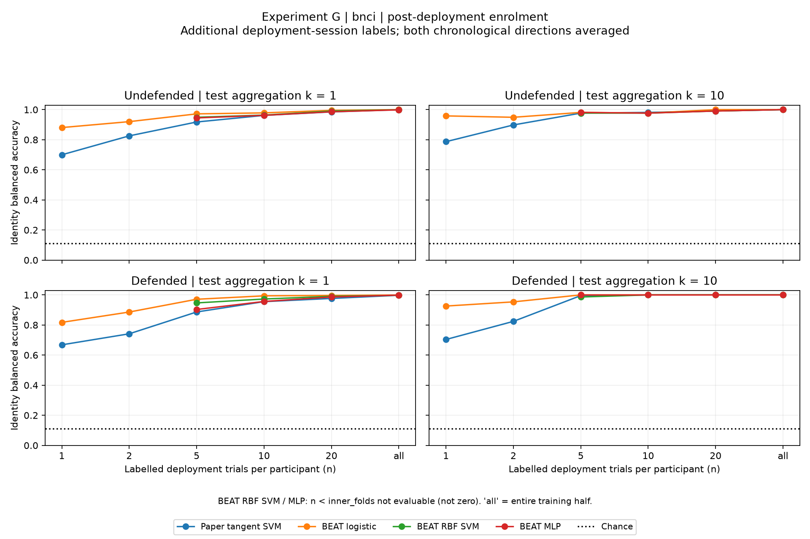

*Figure 5. Identification versus number of labelled deployment-period trials per user, defended and undefended (`results/exp_g/bnci/enrolment_curve.png`). Identification versus test aggregation is in `results/exp_g/bnci/identity_vs_k.png`.*

### 6.6 Experiment E: co-trained identifier versus independent attacker in EEGNet (exploratory)

EEGNet-8,2 [Lawhern 2018] is trained pooled over the nine users on all 1,163 retained T trials (decimated to 125 Hz; 176-d feature), with or without per-subject Euclidean alignment [20]. A two-layer identity identifier is attached through gradient reversal, $\lambda \in \{0, 0.03, 0.1, 0.3, 1, 3\}$, 3 seeds, fixed 40-epoch budget from T-only piloting (`configs/exp_e.yaml`, `results/exp_e/dev_selection.json`). Every $\lambda$ is reported; nothing is selected on E. This is not a reproduction of ID-RemovalNet [2]; it tests the evaluation metric on a backbone such methods build on.

The identifier is trained with the encoder on T and scored on all 1,183 retained E trials, so its score is a cross-day measure, comparable in data access with the auxiliary scenario. The independent attackers and scenarios are those of B (§4.4). In total 36 models (2 alignments × 6 $\lambda$ × 3 seeds) were trained, and all 108 attacker-MLP fits converged (`results/exp_e/summary.json`: `model_count`, `mlp_fits`, `mlp_nonconverged`). The final run used the import-based entry point recorded for D and E (Appendix A); the decision log records no other E-specific deviation.

| Alignment | $\lambda$ | Task BA | Co-trained identifier | Strongest independent, main | Strongest independent, auxiliary |
|---|---|---|---|---|---|
| none | 0 | 0.689 | 0.567 | 0.671 | 0.691 |
| none | 0.03 | 0.680 | 0.365 | 0.634 | 0.673 |
| none | 0.1 | 0.697 | 0.332 | 0.591 | 0.618 |
| none | 0.3 | 0.682 | 0.273 | 0.611 | 0.617 |
| none | 1 | 0.539 | **0.113** | 0.426 | 0.444 |
| none | 3 | 0.517 | **0.123** | 0.484 | 0.458 |
| EA | 0 | 0.739 | 0.409 | 0.583 | 0.471 |
| EA | 0.03 | 0.743 | 0.265 | 0.498 | 0.377 |
| EA | 0.1 | 0.732 | **0.182** | 0.499 | 0.337 |
| EA | 0.3 | 0.729 | **0.190** | 0.570 | 0.359 |
| EA | 1 | 0.717 | **0.188** | 0.563 | 0.306 |
| EA | 3 | 0.622 | **0.139** | 0.577 | 0.243 |

*Table 7. Experiment E (exploratory): session-E task BA (subject mean) and identity BA of the co-trained identifier and of the strongest independent attacker on the same frozen 176-d EEGNet features, seed means over 3 seeds. Identity chance 0.111; task chance 0.5. Bold: identifier within 0.08 of chance (`results/exp_e/lambda_summary.csv`).*

**The co-trained identifier understates exposure in EEGNet as well.** As $\lambda$ grows, the identifier's score approaches chance: 0.113–0.123 without alignment at $\lambda \ge 1$, and 0.139–0.190 with EA at $\lambda \ge 0.1$ (identification accuracy 0.116–0.195). On the same frozen features the strongest independent attacker reaches 0.444–0.484 without alignment and 0.499–0.577 with EA (Table 7, Figures 6 and 7). With EA at $\lambda = 1$, for example, the identifier reports 0.188 while an independent attacker reaches 0.563, at task BA 0.717. The gap is not only a matter of data access. An auxiliary attacker trained, like the identifier, on T and tested on E still scores 0.444 against the identifier's 0.113 (no alignment, $\lambda = 1$) and 0.306 against 0.188 (EA, $\lambda = 1$). Unlike B, however, the identifier never fell *below* chance (minimum 0.113). E therefore reproduces the gap of pitfall 1 in an end-to-end CNN, but not its below-chance signature, and it does not reproduce the near-zero identifier accuracy reported for ID-RemovalNet [2].

**Without alignment, a near-chance identifier coincides with failed decoding.** At $\lambda \in \{1, 3\}$ without alignment, task BA falls to 0.539 and 0.517 ($\kappa$ 0.078 and 0.034), close to the binary chance level, while independent attackers still identify users at 0.444–0.484 (`results/exp_e/lambda_summary.csv`). These settings are not usable operating points. With EA, task BA stays between 0.717 and 0.743 up to $\lambda = 1$ and drops to 0.622 at $\lambda = 3$.

| Alignment | $\lambda$ | Utility change, pp (lower bound) | Identity drop, pp (lower bound; $p$) | Utility non-inferior | Protection rule |
|---|---|---|---|---|---|
| none | 0.03 | −0.97 (−2.01) | 1.77 (−2.55; 0.227) | yes | fail |
| none | 0.1 | +0.79 (−1.19) | 7.30 (1.97; 0.021) | yes | pass |
| none | 0.3 | −0.71 (−2.42) | 7.38 (1.22; 0.029) | yes | pass |
| none | 1 | −15.06 (−23.35) | 24.64 (14.64; 0.002) | no | pass |
| none | 3 | −17.23 (−26.97) | 20.70 (11.48; 0.006) | no | pass |
| EA | 0.03 | +0.38 (−1.13) | 8.45 (3.91; 0.006) | yes | pass |
| EA | 0.1 | −0.69 (−2.14) | 8.35 (3.02; 0.012) | yes | pass |
| EA | 0.3 | −0.93 (−2.06) | 1.28 (−5.71; 0.373) | yes | fail |
| EA | 1 | −2.13 (−5.66) | 1.93 (−4.70; 0.301) | no | fail |
| EA | 3 | −11.68 (−15.87) | 0.57 (−8.33; 0.459) | no | fail |

*Table 8. Each $\lambda$ compared with $\lambda = 0$ of the same alignment (descriptive, unadjusted). Utility: mean paired per-user change in task BA with its one-sided 95% lower bound. Identity drop: decrease of the strongest independent attacker's identity BA, with the lower bound and exact sign-flip $p$ of the per-user recall differences. Thresholds are B's (−5 pp utility margin; drop ≥ 5 pp with lower bound > 0), as fixed in `configs/exp_e.yaml` (`results/exp_e/summary.json`, `paired_vs_lambda_zero`).*

**Some settings give modest protection relative to $\lambda = 0$.** Four of ten settings combine non-inferior utility with an identity drop that meets B's thresholds: no alignment at $\lambda = 0.1$ and $0.3$ (−7.3 and −7.4 pp) and EA at $\lambda = 0.03$ and $0.1$ (−8.5 and −8.4 pp) (Table 8). Plan v2 declares E descriptive with no selection on E, and these are ten unadjusted comparisons on reused session-E data, so they are not a decision. At these four points identity BA is still 0.50–0.62, about 4.5–5.6 times chance.

**Alignment and the identifier mainly remove cross-day identity.** At $\lambda = 0$, EA lowers the main-scenario attacker modestly (0.671 → 0.583) and the auxiliary attacker strongly (0.691 → 0.471). With EA, the auxiliary score keeps falling as $\lambda$ grows (0.471 → 0.243), whereas the main-scenario attacker, which holds labelled deployment-period outputs, stays between 0.498 and 0.583 at every $\lambda$ (Table 7). The alignment reference and the identifier are both fitted on T. Our interpretation, not tested directly, is that they suppress identity cues that carry over from T, while identity within the deployment period remains. This parallels the recentring contrast of §6.2 and pitfall 2 (§6.5).

**Comparison with the tangent-space models (descriptive).** EEGNet with EA has the highest task BA of any *pooled* model in this project: 0.743 at $\lambda = 0.03$ and 0.739 at $\lambda = 0$, against at most 0.722 for the pooled tangent-space models of B and D (`results/exp_b/tradeoff.csv`, `results/exp_d/tradeoff.csv`). Per-subject tangent-space decoders calibrated on all six T runs reach 0.758 (Table 1). The 176-d EEGNet feature at $\lambda = 0$ is less identifying than the 253-d tangent vector (strongest 0.583–0.691 versus 1.00), but more identifying than the narrow task-only bottlenecks of D (0.209–0.455 for $d \le 4$; Table 2). No EEGNet bottleneck sweep was run, so it is untested whether a narrow EEGNet bottleneck would match or beat the adversarial settings. The two model families differ in input (filtered, decimated EEG versus covariance matrices), feature width, number of seeds (3 versus 5) and status (B confirmatory; D and E exploratory), so these comparisons do not rank the methods.

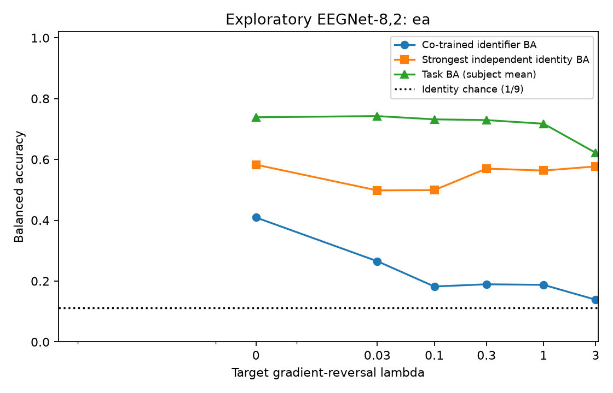

*Figure 6. Experiment E with Euclidean alignment: co-trained identifier BA, strongest independent identity BA and task BA across $\lambda$; dotted line, identity chance (`results/exp_e/identifier_vs_independent_ea.png`).*

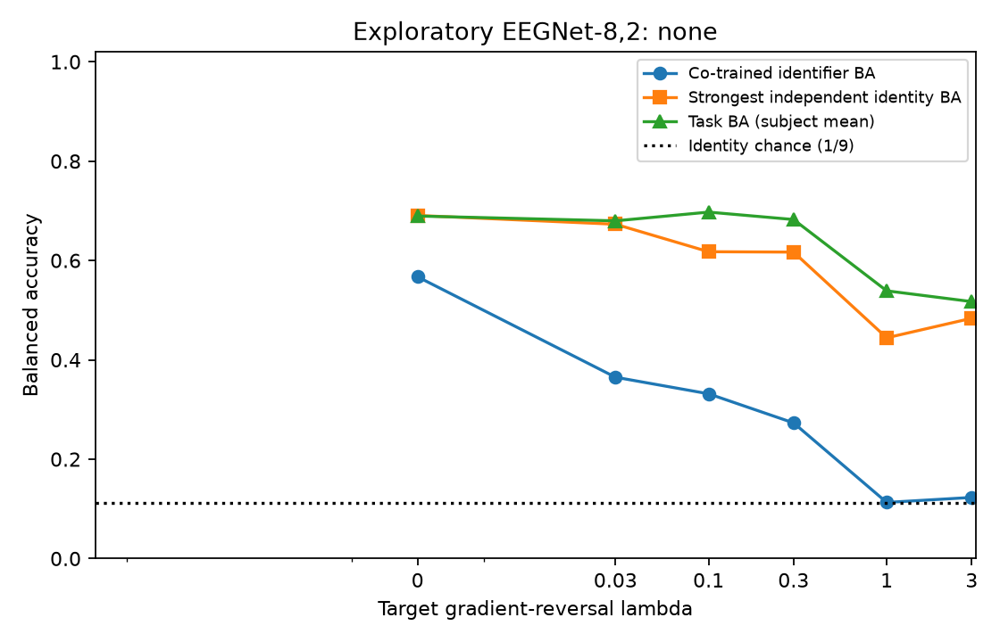

*Figure 7. As Figure 6, without alignment (`results/exp_e/identifier_vs_independent_none.png`).*

### 6.7 Confirmatory replication on Lee2019/OpenBMI (experiment L)

Plan v3 fixes four claims, all predeclared from the 2a findings with thresholds chosen before any Lee2019 outcome analysis (`docs/analysis_plan.md`): **C1**, for P3 at $\lambda = 1$, $d = 8$, the strongest independent attacker exceeds the co-trained head by at least 20 pp; **C2**, P2-RC ($d=8$) has strongest identity BA at least 20 pp below P0 with task BA non-inferior at −5 pp; **C3**, P2-RC command-only identity at $\tau = 0.5$ and $k = 20$ exceeds $2/54$ and exceeds $k = 1$; **C4**, the G transform at the OpenBMI operating point (0.9, 0.60, 0.6, 0.2), attacked with five labelled deployment trials per participant, exceeds $10/54$, subject to a benchmark gate (defended reference-session tangent-SVM accuracy within ±5 pp of 2.4%). Holm's procedure at $\alpha = 0.05$ decides C1–C4. Chance is $1/54 = 1.85\%$.

**Design as carried over.** L applies B's conditions, encoder, seeds and statistics and C's command rule to the 210-d tangent space of 20 motor channels. RBF-SVM ($C = 1$, $\gamma$ = scale) and MLP (at most 500 L-BFGS iterations) attacker settings were fixed from session-1 timing before the seal (`docs/analysis_plan.md`, plan v3; `configs/exp_l.yaml`). Session 1 takes the role of T. The **main (deployment) scenario** trains attackers on one phase of session 2 and tests them on the other phase recorded the same day (offline → online and online → offline, averaged). It therefore measures within-day, cross-phase linkage; only the offline → online direction follows acquisition chronology, and online feedback makes the two phases different experimental conditions. The **auxiliary scenario** trains on session 1 and tests on session 2. Claim-level tests are one-sided $t$-tests over the 54 participant values, multiplied by the number of attacker × scenario combinations (six; four attackers for C4). They are conditional on the fitted systems and on this enrolled cohort; they do not quantify uncertainty over retraining or over new cohorts (plan v3).

**Run record.** Seal 3 is commit `9757c3f` (`results/exp_l/seal.json`, `commit`). The first `final` call stopped in the seal verifier before any session-2 file was opened, because two sealed JSON files had been rewritten locally with CRLF line endings; they were restored from the sealed blobs (identical content) and the command was restarted unchanged. Attempt 1 then stopped after 24 min at the sealed memory guard (`results/exp_l/final_failure_attempt1.json`: `error` MemoryError; all four claims `not_evaluable_computational_failure`). It had loaded session 2 and computed task BA and $\kappa$ in memory during preparation, but no claim-level decision or final summary had been completed. That no session-2 value was viewed is a recorded assertion; the repository cannot prove it. Attempt 2 was an unchanged technical re-execution (same commit, configuration, selections and command), not a reselection, and finished in 34.3 min (`docs/decision_log.md`). All 588 attack jobs completed (`results/exp_l/execution.json`, `jobs`), and no trial was excluded (`results/exp_l/exclusions.csv`: `excluded` = 0 in all 216 participant × session × phase rows). An independent audit recomputed all four decisions and 89 component tests from the committed participant-level files and found agreement (`docs/decision_log.md`).

**MLP non-convergence.** 286 of 586 MLP attacker fits, 45 of the 85 that enter confirmatory tests, reached the fixed 500-iteration budget without converging (`results/exp_l/attacker_diagnostics.json`, records with `record` = convergence and `converged` = false; confirmatory count from the audit entry in `docs/decision_log.md`). The sealed rule retains their fixed-budget predictions with a warning (`configs/exp_l.yaml`, `failure_rules.nonconvergence`). All 15 representation-level MLP fits for P3 at $\lambda = 1$ and all 15 for P2-RC at $d = 8$ are among them, and the MLP is the strongest attacker for both. Identity values from these attackers are fixed-budget values; we did not test whether more iterations would raise or lower them. For C1, the logistic and RBF-SVM components alone also show differences of 45.5 and 45.4 pp (`results/exp_l/decision.json`, `claims.C1.component_tests`, `logistic/main.mean`, `rbf_svm/main.mean`).

| Claim | Tested contrast (observed, seeds) | Claim $p$ | Holm $p$ | Decision |
|---|---|---|---|---|
| C1 | Strongest independent attacker 0.514 vs co-trained head 0.040 at $\lambda = 1$; difference 47.4 pp (5 seeds) | $2.95 \times 10^{-26}$ | $8.86 \times 10^{-26}$ | **Supported** |
| C2 | P0 0.994 vs P2-RC ($d = 8$) 0.340, difference 65.4 pp; task BA 0.698 vs 0.692, change −0.62 pp (lower bound −2.27 pp) (5 seeds) | $2.29 \times 10^{-5}$ | $4.58 \times 10^{-5}$ | **Supported** |
| C3 | P2-RC commands, $\tau = 0.5$: 0.085 at $k = 20$ vs threshold $2/54 = 0.037$ and vs 0.037 at $k = 1$ (5 seeds) | 0.210 | 0.210 | **Not supported** |
| C4 | Benchmark gate passed (defended reference-session TS-SVM 1.34% vs paper 2.4%); five deployment labels per participant: 92.7% vs threshold $10/54 = 18.5\%$ (5 seeds) | $1.12 \times 10^{-35}$ | $4.47 \times 10^{-35}$ | **Supported** |

*Table 9. Confirmatory decisions of L under Holm's procedure at $\alpha = 0.05$; identity chance 0.0185. Sources: `results/exp_l/decision.json` (`claims.Cx.p`, `holm_p`, `decision`, `observed_difference`, `utility`, `benchmark_gate`), `results/exp_l/identity_summary.csv` (kind = representation, keys P0, P2-RC_d8, P3_lambda1; kind = observation, key P2-RC_d8, command, $\tau = 0.5$; kind = enrolment, key G), `results/exp_l/task_summary.csv` (`mean`), `results/exp_l/reproduction.json`. The head value is the strongest independent BA minus `claims.C1.observed_difference`.*

**C1, co-trained evaluation (supported).** At $\lambda = 1$ the co-trained identity head scored 0.040, about twice chance, while the strongest independent attacker (MLP, main scenario) recovered 0.514 (95% interval 0.469–0.559) from the same frozen outputs (`identity_summary.csv`, representation, P3_lambda1, `ba`, `ci_low`, `ci_high`; `claims.C1.observed_difference` = 0.474). All six attacker × scenario differences were positive: 45.4–47.4 pp in the main scenario and 17.6–19.9 pp in the cross-day auxiliary scenario (`claims.C1.component_tests`, `mean`). The cross-day components are pre-registered estimates: the sealed plan computed them as auxiliary-scenario candidates, no verdict decides them on their own, and all three fall below C1's 20 pp margin. Unlike B on 2a, the head did not fall below chance.

**C2, recentred task-only bottleneck versus full features (supported).** Strongest identity BA fell from 0.994 (0.990–0.998) for the full tangent vector to 0.340 (0.288–0.396) for P2-RC at $d = 8$ (`identity_summary.csv`, representation, P0 and P2-RC_d8; `claims.C2.observed_difference` = 0.654). Task BA was 0.698 versus 0.692 (`task_summary.csv`, `mean`); the paired change of −0.62 pp has a one-sided 95% lower bound of −2.27 pp, inside the −5 pp margin (`claims.C2.utility.mean`, `utility.lower`). The utility component sets the claim-level $p$ (`claims.C2.utility.p` = `claims.C2.p`). The reduction is large, but 0.340 is still about 18 times chance; it is lower exposure, not anonymity. Both values are within-day. In the cross-day auxiliary scenario (session 1 → session 2) the full tangent vector gives 0.520 (logistic regression; 0.510 RBF-SVM, 0.368 MLP) and P2-RC $d = 8$ gives 0.054 (MLP) (`identity_summary.csv`, representation, scenario = auxiliary). These cross-day values are pre-registered estimates; C2's verdict rests on the within-day values.

**C3, command streams (not supported).** The pre-registered claim was that P2-RC command-only identity at $\tau = 0.5$ and $k = 20$ both exceeds $2/54$ and exceeds $k = 1$. The point estimates move in that direction: the five-seed confirmatory value is 0.085 at $k = 20$ (about 4.6 times chance) against 0.037 at $k = 1$ (`identity_summary.csv`, observation, P2-RC_d8, command, $\tau = 0.5$); the three-seed observation curve gives 0.079 at $k = 20$ (`results/exp_l/observation_length.csv`, `strongest_ba`). In the best attacker × scenario cell (logistic regression, main scenario), the increase over $k = 1$ is clear (mean 4.78 pp, $p = 5.6 \times 10^{-8}$; across the comparisons with every $k = 1$ cell, largest $p = 0.0065$), but the threshold component is weak: mean 0.0848, one-sided lower bound 0.0416, unadjusted $p = 0.0349$ (`claims.C3.component_tests`, `logistic/main.threshold`, `logistic/main.differences`). The conjunction $p$ is 0.0349, and the six-fold Bonferroni correction fixed in plan v3 gives 0.2096 (`claims.C3.p`, `holm_p`). **C3 is not supported.** In the auxiliary cross-day scenario, command identification at $k = 20$ stayed near chance (0.019–0.029; `component_tests`, `*/auxiliary.threshold.mean`; a pre-registered estimate).

The test had little power at this observation length. Each phase has 100 trials, so at $k = 20$ each participant contributes only five non-overlapping test groups per direction (`results/exp_l/usable_group_counts.csv`, `usable_groups` = 5 for role = test, scenario = main, $k = 20$), and per-participant recall moves in steps of 0.2 per direction. With 54 identities most of these recalls are zero, so the 54 participant values are coarse and skewed, and a mean only a few points above $2/54$ cannot clear a six-fold correction. This explains why the test was weak; it does not show that the effect exists. The claim failed as pre-registered, and we do not replace it with a post-hoc test. `results/exp_l/smallest_k_twice_chance.csv` uses an inclusive comparison ($\ge 2/54$): by point estimate, P2-RC commands *reach* twice chance at $k = 1$ for $\tau = 0.5$ and $0.8$, and P0 and P3 commands at $k = 5$. For P2-RC at $\tau = 0.5$ the $k = 1$ value equals $2/54$, and the smallest $k$ that strictly exceeds it is 5 (0.060; `identity_summary.csv`).

**C4, deployment enrolment against the reference-session-fitted defence (supported).** The benchmark gate passed: the paper-style tangent-space SVM, trained on defended session 1 and tested on defended session 2, scored 1.34% against the paper's 2.4% (gap −1.06 pp, tolerance ±5 pp), and 55.8% on undefended data (`results/exp_l/reproduction.json`, `accuracy`, `gap`, `tolerance`, `undefended_accuracy`; `claims.C4.benchmark_gate` = true). With the first five defended trials per participant from one phase as labelled enrolment, attackers identified the other phase at 92.7% (logistic regression, one-sided lower bound 88.8%), 89.8% (RBF-SVM), 78.5% (MLP) and 67.0% (paper-style TS-SVM), all far above the 18.5% threshold (`claims.C4.component_tests`, `mean`, `lower`). This is an adapted replication: the causal 1–4 s reduced epochs differ from the paper's preprocessing, and the coarse gate (0–7.4%) checks benchmark consistency, not equivalence (`decision.json`, `reproduction_caveat`; plan v3). As on 2a, the result does not show that the paper's reference-session results are wrong; it shows that its protection does not extend to an attacker with a few labelled deployment-period outputs (`decision.json`, `threat_model`).

**Descriptive results (no decisions).** Unless marked, the following use three seeds; intervals are participant-bootstrap 95% intervals.

| Representation | Task BA | Strongest identity BA (95% interval) | Attacker | Seeds |
|---|---|---|---|---|
| P0, full 210-d tangent vector | 0.698 | 0.994 (0.990–0.998) | logistic | 5 |
| P2, $d = 8$ | 0.693 | 0.334 (0.291–0.380) | MLP | 3 |
| P2, $d = 1$ | 0.697 | 0.057 (0.029–0.091) | RBF-SVM | 3 |
| P2-RC, $d = 8$ | 0.692 | 0.340 (0.288–0.396) | MLP | 5 |
| P2-RC, $d = 1$ | 0.685 | 0.085 (0.040–0.142) | RBF-SVM | 3 |
| P3, $\lambda = 0.1$ | 0.693 | 0.331 (0.292–0.374) | MLP | 3 |
| P3, $\lambda = 1$ | 0.692 | 0.514 (0.469–0.559) | MLP | 5 |
| P3, $\lambda = 3$ | 0.671 | 0.550 (0.500–0.599) | MLP | 3 |

*Table 10. L representations, session-2 task BA and main-scenario strongest identity BA; chance 0.0185 (`results/exp_l/identity_summary.csv`, kind = representation, strongest = True; `results/exp_l/task_summary.csv`, `mean`).*

- **Bottleneck width.** At $d = 1$ identity BA is 0.057 (common) and 0.085 (recentred), about 3 and 4.6 times chance, at task BA 0.697 and 0.685 (Table 10). As on 2a, a single scalar per trial still identifies users above chance; unlike 2a, the common-family $d = 1$ bottleneck leaked less than the recentred one.
- **Head versus independent across $\lambda$ (three-seed sweep).** Co-trained head 0.030, 0.037 and 0.037 against strongest independent 0.331, 0.519 and 0.550 at $\lambda = 0.1$, 1 and 3 (`results/exp_l/head_vs_independent.csv`, `head_ba`, `independent_ba`). These are descriptive; C1's tested values are the five-seed ones above. As on 2a, at $\lambda \ge 1$ the independent attacker scored higher than on the $d = 8$ task-only encoder (0.334); at $\lambda = 0.1$ the two were similar (0.331).
- **Observation length.** Feature-mode identity for P2-RC $d = 8$ rose from 0.345 at $k = 1$ to 0.675 at $k = 20$. Command-mode identity rose from 0.037 (five seeds) to 0.085 (five seeds) at $\tau = 0.5$ and from 0.055 to 0.142 at $\tau = 0.8$; for P0 commands from 0.034 to 0.057 and from 0.036 to 0.100; for P3 at $\lambda = 1$ from 0.034 to 0.062 and from 0.037 to 0.081 (`identity_summary.csv`, kind = observation, strongest = True). As on 2a, holding at higher $\tau$ increased command leakage at $k = 20$.
- **Enrolment curve.** Table 11. One labelled deployment trial per participant gives 82.8% on defended and 80.1% on undefended data; from two trials on, defended identification is lower than undefended by 0.8–3.9 pp. Recentring alone (P0-RC) gives values within 3 pp of the defended ones.
- **Number of enrolled identities.** For P2-RC $d = 8$, strongest identity BA falls from 0.579 at $N = 9$ to 0.435, 0.404 and 0.344 at $N = 18$, 27 and 54, while P0 stays at 0.994–0.999 (`identity_summary.csv`, kind = enrolled; fixed subsets, `subset_seed` 42 in `configs/exp_l.yaml`). Chance falls faster than identity BA: relative to chance, P2-RC exposure rises from about 5.2 to 18.6 times chance. The $N = 54$ value (0.344, three seeds) is descriptive and distinct from C2's five-seed 0.340.
- **Replayed control.** Per 20-trial block, the mean absolute angle error was 20.9–21.7° with 6.0–6.1 wrong-direction moves at $\tau = 0.5$, and 14.1–15.9° with 0.6–1.1 wrong-direction moves at $\tau = 0.8$, where 65–73% of commands were held (means over `results/exp_l/control.csv`, `mae_deg`, `wrong_direction_moves`, `hold_rate`, for P0, P2-RC $d = 8$ and P3 $\lambda = 1$). Feature and command transmission gave identical trajectories in all 36 model × seed × $\tau$ combinations (`results/exp_l/processing_timing.csv`, `trajectories_equal`). Replay processing timing excludes filtering on the reduced data and is not online latency (same file, `note`).

| Labelled trials per participant, $n$ | 1 | 2 | 5 | 10 | 20 | all |
|---|---|---|---|---|---|---|
| Defended (G transform), logistic | 82.8 | 89.6 | 92.7† | 94.1 | 95.2 | 96.8 |
| Undefended tangent vector, logistic | 80.1 | 90.4 | 96.3 | 98.0 | 98.7 | 99.4 |
| Recentred tangent vector (P0-RC), logistic | 79.9 | 87.9 | 94.6 | 96.7 | 98.0 | 99.5 |
| Defended, paper-style TS-SVM | 57.4 | — | 67.0 | — | — | — |

*Table 11. L identification (identity BA, %) of the opposite phase versus enrolment size, $k = 1$, both directions averaged; chance 1.85%. †Five seeds (C4); other cells three seeds. Logistic regression is the strongest attacker in every logistic row (`results/exp_l/identity_summary.csv`, kind = enrolment, keys G, G-raw and P0-RC; paper-style row from `results/exp_l/enrolment.csv`, `paper_ts_svm`; —, not listed here).*

**Comparison with the 2a results.**

| Finding | BCI IV 2a (9 users) | Lee2019 (54 users, L) | Replicated? |
|---|---|---|---|
| Full tangent vector identifies users, within-day | 1.00 (B, confirmatory) | 0.994 | Yes |
| Full tangent vector, cross-day | 0.951 (T→E) | 0.520 (session 1 → 2) | Lower in L, still far above chance (both values are pre-registered estimates: B's and L's auxiliary rows) |
| Co-trained head vs independent, $\lambda = 1$ | 0.026 vs 0.951 (B, confirmatory) | 0.040 vs 0.514 (C1) | Gap yes; below-chance head no |
| Recentred task-only $d = 8$ vs full vector | 0.427 vs 1.00; task 0.717 vs 0.679 (exploratory) | 0.340 vs 0.994; task 0.692 vs 0.698 (C2) | Exposure reduction yes; the 2a task-BA gain did not recur |
| Task-only $d = 1$ | 0.253 / 0.209, 2.3 / 1.9 × chance (D, exploratory) | 0.057 / 0.085, 3.1 / 4.6 × chance | Above chance in both |
| P2-RC commands, $\tau = 0.5$, $k = 20$ | 0.244, 2.2 × chance (C, descriptive) | 0.085, 4.6 × chance; claim C3 not supported | Point estimate yes; confirmatory test failed |
| Reference-session attack on the defence | 11.1% (undefended 90.8%; G) | 1.34% (undefended 55.8%) | Benchmark consistent |
| Deployment enrolment, $n = 1$ / $n = 5$ | 81.75% / 97.11% (G, exploratory) | 82.8% / 92.7% (C4) | Yes |

*Table 12. Rows without a scenario label use the main scenario (2a: within session E; L: within session 2), except the 2a reference-session row. 2a values from Tables 2, 4, 5 and 6 (`results/exp_b/tradeoff.csv`, `results/exp_b/adversary_comparison.csv`, `results/exp_d/tradeoff.csv`, `results/exp_c/observation_strongest.csv`, `results/exp_g/bnci/*`); L values from Tables 9–11.*

The conditions differ in ways that limit direct comparison. L has 54 identities (chance 0.0185 instead of 0.111), 20 instead of 22 channels (210-d instead of 253-d tangent vectors), causal reduced epochs also for C4, and a different main scenario: within-day, cross-phase linkage between an offline and an online phase of session 2, rather than linkage between runs 1–3 and 4–6 of one session. Its attacker settings were fixed for runtime, and many MLP fits did not converge. Raw BA values are lower in L at nearly every comparable point, but relative to chance they are similar or higher, so the larger cohort does not by itself indicate better protection.

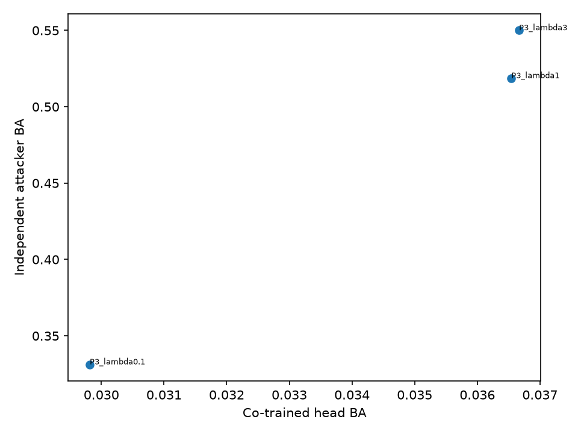

*Figure 8. L: co-trained head versus strongest independent attacker across $\lambda$ (three-seed sweep; `results/exp_l/head_vs_independent.png`).*

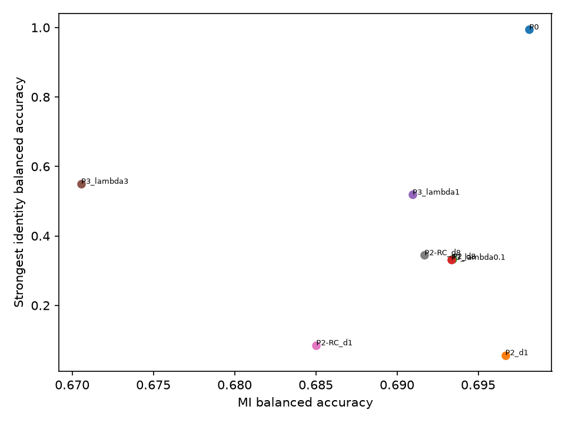

*Figure 9. L: task BA versus identity BA of the representations (`results/exp_l/tradeoff.png`).*

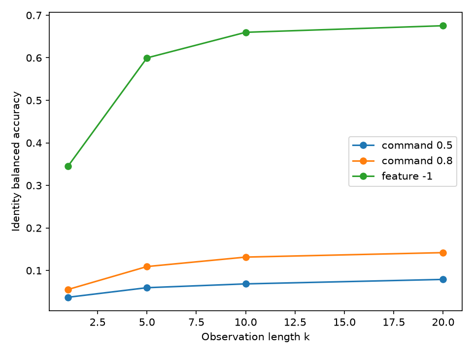

*Figure 10. L: identity BA versus observation length (three-seed curves; `results/exp_l/observation_length.png`).*

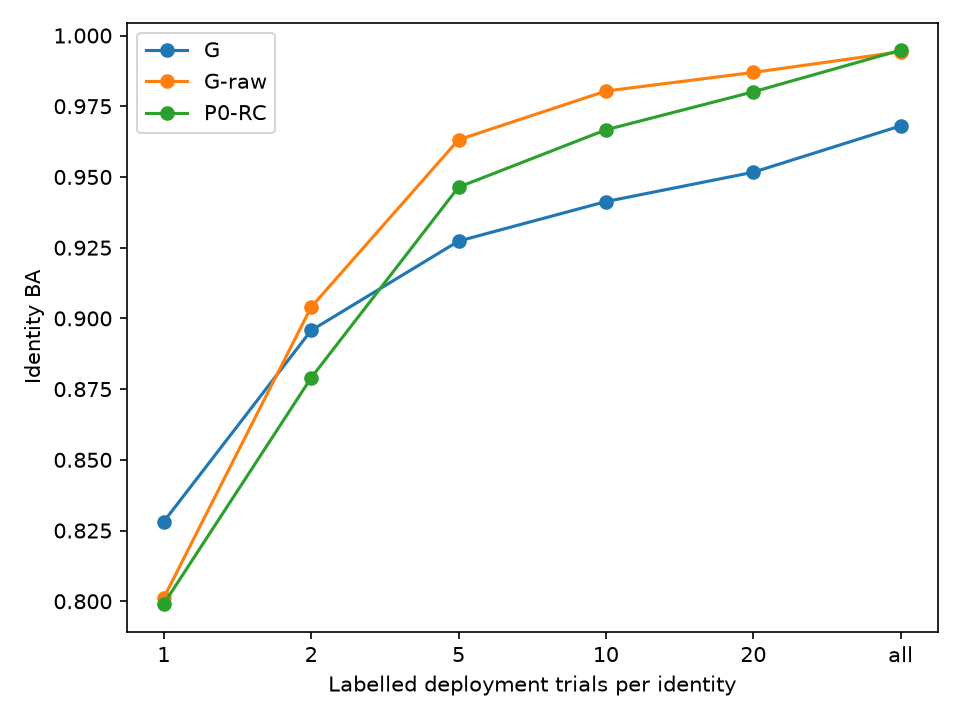

*Figure 11. L: identification versus labelled deployment-period trials per participant (`results/exp_l/enrolment.png`).*

### 6.8 Study K: identity in command streams and group-equalized decoding (exploratory)

K reuses 2a (T calibration, E deployment) and Lee2019 (session 1 calibration, session 2 deployment). It is exploratory and conditional on the fitted systems (`beat/exp_k.py`, `configs/exp_k.yaml`, `results/exp_k/run_summary.json`, `label`).

**Design.**

- **Streams.** The frozen decoders P0, P2-RC ($d = 8$) and P3 ($\lambda = 1$, undefended only) issue left/right/hold with C's rule at $\tau \in \{0.5, 0.8\}$. Calibration-day streams are cross-fitted: B's leave-one-run-out outputs for 2a, and L's leave-one-block-out outputs for Lee2019. In-sample calibration streams, the frozen model applied to its own training day as in C and L, are a contrast only.
- **Attackers.** These are L's battery plus four Bayes attackers: Dirichlet–categorical and first-order Markov, each either target-blind (commands only) or target-aware (cue and command). They aggregate $k$ consecutive commands, up to 72 on 2a and 100 on Lee2019.
- **Metrics.** We report N-way identification BA and within-group identification with the group given, as its excess over $1/|\text{own group}|$.
- **Utility.** The weighted utility per trial is $P(\text{correct move}) - w\,P(\text{wrong move})$ with $w = \tau/(1-\tau)$, the wrong-move cost implied by the hold rule. Net progress ($w = 1$), task bits per trial and ITR are reported alongside.
- **Defences.**
  - Randomized response [31] RR($q$): each command is replaced by a uniform draw over the three outputs with probability $q$, which gives $\varepsilon$-LDP per command and $k\varepsilon$ over $k$ commands.
  - EQ: per-user stochastic $3 \times 3$ matrices from a linear program that maximizes the mean weighted utility. The program requires identical output distributions for every user of a group: $P(\text{output} \mid \text{target})$ for EQ-confusion, $P(\text{output})$ for EQ-marginal. "Always hold" keeps it feasible.
  - Groups are consecutive chunks of users sorted by calibration utility, with $g \in \{2, 3, 5, 9, \text{all}\}$ (9 only for Lee2019), so groups hold $g$ to $2g-1$ users in general; at $g = 3$ every cohort divides exactly (Lee2019 54 = 18 × 3, 2a 9 = 3 × 3, Yang2025 51 = 17 × 3), so every EQ group in K and M has exactly 3 users.
  - The calibration stream that a cross-day attacker enrols on is post-processed with cross-fitted matrices.

**Guarantee and assumptions** (`results/exp_k/eq_guarantee.md`, from the docstring of `eq_lp`). The equality is exact for the confusion matrices the LP receives, the smoothed calibration counts. EQ-confusion then gives every user of a group the same distribution of output sequences given the targets, provided that:

- each trial is post-processed independently;
- the target sequence does not depend on the user;
- commands are conditionally independent across trials given the targets.

Under these conditions every attacker, target-aware or blind and at any $k$, identifies a user within the group at exactly $1/|\text{group}|$. EQ-marginal covers only target-blind attackers and only for i.i.d. user-independent targets. Group membership stays revealed, which is at most $\log_2(N/g)$ bits. Finite calibration data and any calibration → deployment change leave residual leakage.

On the deployment day the guarantee therefore does not hold exactly, and EQ hides identity only within groups of $g = 3$ users (18 groups of exactly 3 on Lee2019). In the fitted LPs the largest equalization residual was $2.5 \times 10^{-14}$ and the largest duality gap $1.8 \times 10^{-15}$ (`run_summary.json`). Unit tests check the LP on synthetic users, verifying identical outputs and the utility optimum (`tests/test_exp_k.py`).

| Defence (Lee2019, P2-RC $d = 8$, $\tau = 0.8$) | Weighted utility | Net progress | Hold rate | Task bits/trial | N-way BA, $k = 20$: within / cross | Within-group excess ($g = 3$), $k = 20$: within / cross |
|---|---|---|---|---|---|---|
| Undefended | 0.075 | 0.241 | 0.648 | 0.221 | 0.186 / 0.082 | 0.316 / 0.112 |
| EQ-confusion, $g = 3$ | 0.108 | 0.180 | 0.773 | 0.158 | 0.144 / 0.062 | 0.150 / 0.009 |
| RR, $q = 0.5$ | below 0 (loss 0.538) | 0.121 | 0.491 | 0.038 | 0.086 / 0.042 | 0.147 / 0.032 |
| EQ-confusion, one group of 54 | 0.000 | 0.000 | 1.000 | 0.000 | 0.020 / 0.022 | — |

*Table 13. K on Lee2019, deployment day, strongest Bayes attacker (`results/exp_k/frontier.csv`: `weighted_utility`, `weighted_utility_loss`, `net_progress`, `hold_rate`, `bits_per_trial`, `nway_ba_within_day_k20`, `nway_ba_cross_day_k20`, `g3_excess_within_day_k20`, `g3_excess_cross_day_k20`). Chance 0.0185. Exploratory.*

**Identity accumulates over commands.** On both datasets the strongest Bayes N-way BA rises from $k = 1$ to $k = 20$ in every condition, $\tau$ and scenario, and at $k = 20$ it is higher within a day than across days (`results/exp_k/identity_curves.csv`). For P2-RC at $\tau = 0.8$ on Lee2019 it reaches 0.186 at $k = 20$ and 0.278 at $k = 100$ within a day, against 0.082 and 0.117 across days (`frontier.csv`, `nway_ba_*_kmax`; $k_{\max} = 100$). Undefended task information is 0.221 bits per trial, or 1.02 bits/min (`itr_bits_per_min`).

**C3's cross-day cell with cross-fitted streams.** L's cross-day command attackers enrolled on in-sample session-1 streams (`beat/exp_l.py`, `final`: the session-1 logits come from the model fitted on session 1). K recomputes the C3 cell (P2-RC, $\tau = 0.5$, $k = 20$, cross-day) from cross-fitted streams (`results/exp_k/identity_curves_all.csv`, `nway`, `cross_day`):

- attackers that see only the commands, the view of C3, give 0.008–0.027;
- target-aware attackers give up to 0.046: the Bayes categorical target-aware attacker gives 0.046 (95% interval 0.016–0.075, which reaches below chance 1/54 = 0.0185; `identity_curves.csv`, `bayes`), and the strongest target-aware attacker overall, logistic regression from L's battery, gives 0.046 (0.021–0.072; `identity_curves_all.csv`, `logistic_aware`).

Within K, the in-sample contrast gives similar values. The near-chance cross-day result of C3 is therefore specific to target-blind attackers, rather than an artefact of in-sample enrolment. This is exploratory and does not change C3's verdict.

**EQ's equality held for an attacker enrolled on the calibration day, not for one enrolled on the deployment day** (exploratory). Both attackers are tested on deployment-day outputs; only the enrolment day differs. Whether this means that EQ equalizes the day rather than the person is the question in §1, not a finding.

- **Cross-day.** At $g = 3$ the within-group excess at $k = 20$ of a cross-day attacker falls from 0.112 to 0.009, close to the exact equality the LP enforces on calibration-day estimates.
- **Within-day.** An attacker who enrols on the deployment day keeps 0.150 of 0.316 (Table 13).
- **Residual decomposition** (`results/exp_k/residual_leakage.csv`, `eqc_g3`, `excess_k20_total`, `excess_k20_floor`, `excess_k20_estimation_minus_floor`, `excess_k20_total_minus_estimation`; computed separately from Table 13). The within-day residual of 0.138 splits into 0.020, the floor of the finite-sample estimators; 0.017, attributable to finite calibration data in a same-day simulation; and 0.100 that the simulation leaves unexplained. That last part covers day-to-day drift, the mismatch between cross-fitted calibration outputs and the final model's deployment outputs, sequential dependence within the deployment day and, for Lee2019, the offline → online phase shift between the deployment segments used by the within-day attacker. It is not drift alone.
- **Whole cohort.** With one group of all 54 users the LP's optimum is "always hold" (weighted utility 0.000, hold rate 1.000), so a whole-cohort release with useful commands was not available here. $g = 3$ is the operating point used in M.

**What the utility numbers do and do not show.**

- EQ's weighted utility above the undefended rule (0.108 against 0.075) is relative to the undefended $\tau$ rule. The LP also remaps each user's commands toward that user's utility optimum, so it mixes recalibration into the defence.
- M therefore reports EQ's cost against recalibration only. On Yang2025 recording day 1 at $\tau^* = 0.60$ that cost was 0.015 (95% interval −0.002 to 0.032; `docs/preregistration_m.md` §4, from `results/exp_m/selection.json`, `rr_matched["0.60"].eq_privacy_cost`).
- K's RR had no recalibration, so Table 13 does not compare RR and EQ at matched utility. That comparison (RR-matched) is one of M's pre-registered estimates.

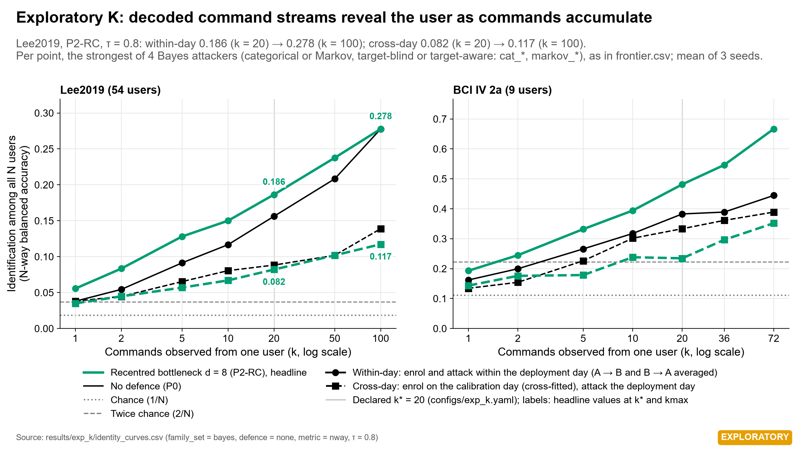

*Figure 12. K: N-way identification versus the number of observed commands, within-day and cross-day, Lee2019 and 2a (`results/figures/summary/fig8_k_command_streams.png`, from `results/exp_k/identity_curves.csv`). Exploratory.*

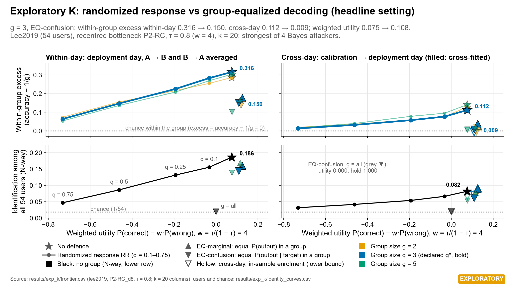

*Figure 13. K: within-group excess and N-way identification at $k = 20$ versus weighted utility for RR and EQ on Lee2019, P2-RC $\tau = 0.8$, within-day and cross-day (`results/figures/summary/fig9_k_rr_eq_frontier.png`, from `results/exp_k/frontier.csv`). Exploratory. The full grids are in `results/exp_k/identity_curves.png` and `results/exp_k/frontier.png`.*

### 6.9 Study R: robustness addendum on L (exploratory)

R reads L's sealed result files and re-decides nothing (`beat/exp_r.py`, `results/exp_r/`).

| Lee2019, strongest independent attacker | Within-day (*confirmatory-sealed*, C1/C2) | Cross-day (*pre-registered estimate*) |
|---|---|---|
| P0, full 210-d tangent vector | 0.994 | 0.520 |
| P2-RC, $d = 8$ | 0.340 | 0.054 |
| P3, $\lambda = 1$ | 0.514 | 0.239 |
| Co-trained head, P3 $\lambda = 1$ | — | 0.040 |

*Table 14. `results/exp_r/cross_day_table.csv` (rows `strongest` and `head`, `within_day_ba`, `cross_day_ba`), compiled from `results/exp_l/identity_summary.csv` and `head_predictions.csv.gz`. The head is trained with the model on session 1 and scored on session 2, so only a cross-day value exists; it is the single head value that C1 tested against the within-day 0.514. The other cross-day values were computed by the sealed seal-3 plan as auxiliary-scenario candidates of C1 and C2, but no verdict decides them on their own, so they are pre-registered estimates.*

- **Pitfall 1 across days.** The strongest independent attacker exceeds the co-trained head by 19.9 pp across days (pre-registered estimate, below C1's 20 pp margin), against 47.4 pp within a day (C1's tested contrast).
- **MLP sensitivity** (`results/exp_r/mlp_sensitivity.json`, `mlp_refits.csv`, `mlp_sensitivity_claims.csv`, `mlp_sensitivity_components.csv`). L kept fixed-budget predictions for 45 confirmatory MLP fits that did not converge in 500 iterations (§6.7). R refitted all 45 through L's own code path (same data, representations, scaler, L2 penalty, solver and seed) with up to 20,000 iterations; 42 of the refits converged. Jobs 269, 278 and 280 (C3, $k = 20$, within-day) stopped again at 20,000 iterations, and their larger-budget predictions were used. Each sealed fit was first reproduced exactly at L's budget (45 of 45 sealed fits). L's decision code was then rerun with the refitted MLP predictions substituted. No Holm decision changes: C1 and C2 remain supported and C3 not supported; C4 had no non-converged MLP. The C1 gap moved from 0.4744 to 0.4584 and the C2 gap from 0.6538 to 0.6599 (P0 MLP against P2-RC MLP within a day: 0.5907 to 0.5969). C3's within-day MLP identity BA moved from 0.0763 to 0.0767 ($p$ 0.068 to 0.066) and its cross-day MLP BA from 0.0289 to 0.0241; C3's Holm $p$ of 0.2096 is set by the logistic within-day row and does not change. The largest per-fit change in identity BA was 2.6 pp for C1, 1.3 pp for C2 and 1.9 pp for C3 (`mlp_refits.csv`, `ba_change`). These results are exploratory. Two optional R items, open-set verification and per-trial identity information, were not done.

### 6.10 Study M: confirmatory cross-day replication on 51 new users (sealed; 2 of 3 claims supported)

**Design** (`docs/preregistration_m.md`, `configs/exp_m.yaml`).

- **Data and systems.** M uses the Yang2025 data of §3. The P0, P2-RC ($d = 8$) and P3 ($\lambda = 1$) systems use L's settings and are fitted on recording day 1 only, with leave-one-run-out cross-fitting for day-1 streams.
- **Decoder accuracy (day 1, pre-registered estimate).** Each system's decoder is shared by all 51 users and keeps Lee2019's settings; by design nothing was tuned on Yang2025. Its day-1 cross-fitted task BA is 0.578 (P0), 0.582 (P2-RC $d = 8$) and 0.565 (P3 $\lambda = 1$) on a 2-class task (chance 0.5). At τ* = 0.60 the P2-RC decoder holds 72.3% of trials, and sends a correct command on 18.5% and a wrong one on 9.2%. These are day-1 development values recorded in the sealed pre-registration (`docs/preregistration_m.md` §4; `results/exp_m/dev_task.csv`, `ba`, mean over users and seeds; `results/exp_m/dev_streams.csv`, P2-RC_d8, τ = 0.6, `hold`, `correct`, `wrong`). M1 uses the full features and does not depend on the decoder; M3 and the EQ estimates describe this weak system (§8).
- **Hold threshold.** τ* = 0.60 is the value on a 0.50–0.90 grid whose day-1 P2-RC hold rate is closest to L's cross-fitted hold rate at its sealed τ = 0.8 (`results/exp_m/selection.json`, `gates.tau.tau_star`). The rule uses no identity outcome; τ = 0.5 is secondary.
- **Scenarios.** The primary scenario is cross-day, *cal_to_dep*: enrol on day 1 and test on days 2–3. *dep_to_dep* and *same_day_halves* are always reported separately.
- **Claims.** Three one-sided claims form one Holm family at α = 0.05. Each has a fixed phrase, pre-committed in `docs/decision_log.md` (commit `7b14cee`):
  - **M1**, 원 특징의 다른 날 식별(사전등록상 저위험 재현): the strongest of three attackers on day-1 full 190-d features exceeds 10/51 on days 2–3. This is cross-day identification from raw features, a low-risk replication by pre-registration.
  - **M2**, 독립 공격자와 공동 학습 head의 격차가 0보다 크고 관측값이 0.10 이상: for P3 λ = 1 the gap between an independent attacker and the co-trained head is greater than 0, and its observed value is at least 0.10. It is never reported as a gap significantly at least 10 pp.
  - **M3**, 본인의 순위가 우연보다 높고 명령 1개일 때보다 높다: for P2-RC at τ*, the target-aware Bayes categorical attacker places the true user's mean percentile rank at 50 commands above 0.5 and above its rank at 1 command. The user's own rank is above chance and above that with one command. It is never reported as "identified from commands alone".
- **Estimates.** EQ-confusion ($g = 3$), recalibration only, RR at $q = 0.5$ and RR matched to EQ's day-1 utility are reported in all three scenarios as 사전등록한 추정치, 판정 없음: pre-registered estimates, no verdict. For EQ the reading rule is also pre-committed. It reports the undefended excess, the EQ excess and their difference with intervals for the three scenarios. If the undefended interval includes 0, the conclusion is that the exposure to be blocked is not distinguishable and no EQ effect can be stated.
- **Gates.** M2 and M3 were confirmatory only if their recording-day-1 gates passed, and both did (pre-registration §7). C3 stays "not supported" whatever M shows.
- **Power** (`results/exp_m/dev_m3_power.csv`). The power of M3 is 0.85 at α = 0.05 and 0.69 at α/3 if days 2–3 keep 55% of the day-1 within-day excess.

**Seal, timestamp and access.**

- **Seal.** Seal 4 is commit `e88154c6f0b3d1a7887f2368763808fc91d9a81a` with annotated tag `seal-4`, listed in `seals/manifest.yaml`.
- **Timestamp.** FreeTSA's RFC 3161 token over the commit id has token time 2026-11-10 20:26:22 GMT, verified with OpenSSL 3.5.7 (`results/exp_m/seal4_timestamp/verification.json`). According to the seal-4 entry of `docs/decision_log.md`, no recording-day-2/3 byte was requested before that time. The byte-range request log behind this statement is self-attested.
- **Guard.** The sealed final stage refuses to run unless the tag, the token, the seal manifest, byte equality of every sealed file and every module it imports, and the package versions all check out (pre-registration §9).
- **Execution location.** The first post-seal fetch stopped in that guard, because OpenSSL split the project path at its space, and no day-2/3 request was made. The sealed stages were run unchanged from a clean clone at a path without spaces (`docs/decision_log.md`).
- **Procedure** (`docs/decision_log.md`, entries of the post-seal run and the independent audit). All 51 users × 3 recording days were available, with no missing user-day (`results/exp_m/decision.json`, `missing_user_days`). The day-2/3 fetch made 511 requests, all later than the token time (first request 20:38:01.593Z; `results/exp_m/download_log_day23.jsonl`). The final stage ran once from the clone (attempt 1, 22:36:31–22:39:54 UTC, exit 0; `results/exp_m/final_attempts.jsonl`), and its outputs were copied back byte-identical. An independent audit regenerated the per-user outputs from the stored final models, refitted the attacker battery with its own test, Holm and missing-cell code, and found every statistic, p-value and decision equal to `decision.json` (PASS).
- **Disclosures** (pre-registration §2 and §12; `docs/decision_log.md`):
  - before stage M0, member names and sizes of all three days were listed through unlogged requests, without day-2/3 member bytes;
  - day-1 identity results were inspected before τ*, the claims and the gates were frozen;
  - the dataset paper and its decoding statistics [37] had been read;
  - fetch attempt 1 ran with `--subjects 1` in the project folder and stopped in the timestamp guard with 0 requests;
  - free RAM dipped to 2.94 GB during the fetch, below the plan's 8 GB floor; the outputs are unaffected;
  - the request log, and so every request time above, is self-attested.

**Result.** The pre-committed wording of case (b) applies: "새 사용자 51명, 다른 날: 사전등록한 주장 3개 중 2개가 지지됐다" / "다른 날에는 M1·M3만 재현됐다. M2는 같은 날 조건의 결과로 남는다." In English: 51 new users on different days, 2 of 3 pre-registered claims supported; across days only M1 and M3 replicated, and M2 remains a result of the within-day condition. The decisions are confirmatory-sealed.

| Claim | Fixed phrase | Effect (cross-day, day 1 → days 2–3) | Claim p | Holm p | Verdict |
|---|---|---|---|---|---|
| M1 | 원 특징의 다른 날 식별(사전등록상 저위험 재현) | Strongest attacker 0.345 (logistic; RBF-SVM 0.343, MLP 0.273) vs 10/51 | 0.0068 | 0.0136 | Supported |
| M2 | 독립 공격자와 공동 학습 head의 격차가 0보다 크고 관측값이 0.10 이상 | Gaps 0.095 / 0.093 / 0.096 (attackers 0.160 / 0.158 / 0.161, head 0.064), below the 0.10 floor, so no attacker was tested | 1 (by rule) | 1 | Not supported |
| M3 | 본인의 순위가 우연보다 높고 명령 1개일 때보다 높다 | Mean percentile rank 0.649 (0.588–0.711) at 50 commands vs 0.538 (0.503–0.572) at 1; $t = 4.88$ vs 0.5, paired $t = 4.32$, permutation $p = 1.0 \times 10^{-4}$ | $3.7 \times 10^{-5}$ | $1.1 \times 10^{-4}$ | Supported |

*Table 15. `results/exp_m/decision.json` (`p`, `p_holm`, `M1.attackers`, `M2.gaps`, `M2.battery`, `M2.head`, `M3.rank_k_star`, `M3.rank_k_base`, `t_vs_chance`, `t_vs_k_base`, `permutation_p`). Holm over M1–M3 at α = 0.05.*

- **M2 is not "no gap".** The gaps are positive; they fall below the sealed floor. Within day 1 the gap was 0.717 (`results/exp_m/selection.json`, `gates.M2.real.best_gap`).
- **M3's rank is not an identification rate.** Top-1 identification at 50 commands is 0.061 (0.037–0.085; chance 1/51) (`results/exp_m/final_estimates_k_curves.csv`, cat_aware, τ = 0.6, cal_to_dep, $k = 50$; pre-registered estimate). M3 is never reported as "identified from commands alone".

**Pre-registered estimates** (사전등록한 추정치, 판정 없음; no verdict).

- **M1 between days 2 and 3** (enrol on one, test on the other): 0.419 (logistic), $p = 1.6 \times 10^{-4}$ (`decision.json`, `M1_dep_to_dep_estimate`).
- **EQ (g = 3), whole pre-registered grid.** The pre-committed reading rule was applied to every cell: four Bayes attackers × $k$ = 20, 50 × τ = 0.60, 0.5 (`results/exp_m/final_estimates_identification.csv`, defence = eq). The rule named no primary τ, $k$ or attacker, and the phrase for an undefended interval that excludes 0 with a reduction interval that includes 0 was added after the result was seen (`docs/decision_log.md`, audit entry). No single cell is the EQ result.

| Cell | Command-only categorical | Target-aware categorical | Command-only Markov | Target-aware Markov |
|---|---|---|---|---|
| τ* = 0.60, $k = 50$ | 막을 노출은 구별됐지만 EQ의 감소는 0과 구별되지 않았다 | K와 같은 방향 | K와 같은 방향 | K와 같은 방향 |
| τ* = 0.60, $k = 20$ | 막을 노출이 구별되지 않아 EQ 효과를 말할 수 없다 | 막을 노출은 구별됐지만 EQ의 감소는 0과 구별되지 않았다 | same | same |
| τ = 0.5, $k = 20$ and 50 | 막을 노출이 구별되지 않아 EQ 효과를 말할 수 없다 | same | same | same |

*Table 16. Reading of every pre-registered EQ cell. "K와 같은 방향": same direction as K (the reduction excludes 0 across days, and EQ's own excess excludes 0 between days 2 and 3 or within one day). "막을 노출은 구별됐지만 …": the exposure to be blocked is distinguishable, but EQ's reduction is not distinguishable from 0. "막을 노출이 구별되지 않아 …": the exposure to be blocked is not distinguishable, so no EQ effect can be stated.*

  One cell as an example, not as the result (target-aware categorical, τ* = 0.60, $k = 50$): across days the within-group excess falls from 0.101 (0.022–0.181) to −0.008 (−0.058 to 0.042), a reduction of 0.109 (0.007–0.211), while EQ's own excess stays 0.059 (0.007–0.110) between days 2 and 3 and 0.181 (0.108–0.253) within one day.
- **EQ does not lower N-way identification.** For the target-aware categorical attacker at τ* across days, N-way top-1 goes from 0.041 to 0.062 at $k = 20$ and from 0.061 to 0.066 at $k = 50$ (`nway_undefended`, `nway_defended`). EQ hides identity only within groups, whose membership is revealed.
- **Utility on days 2–3 at τ* = 0.60** (`results/exp_m/final_estimates_utility.csv`; the three scenarios score the same trials). Undefended weighted utility is −0.041 (−0.086 to 0.004; $w = 1.5$), an interval that includes 0, while undefended net progress is +0.073 (0.039–0.106). EQ gives 0.020 (−0.003 to 0.043) and recalibration only 0.011. EQ's privacy cost against recalibration only is −0.009 (−0.026 to 0.008) in weighted utility but +0.022 (0.012–0.032) in net progress, so EQ's privacy is not free. Hold rates are 0.473 undefended, 0.680 with recalibration only and 0.825 with EQ. The day-1 hold rate of 0.723 came from the cross-fitted day-1 models and 0.473 from the final model on days 2–3; these are different models. The τ rule calibrated on day 1 holds less and errs more on later days (wrong moves 0.092 on day 1, 0.227 on days 2–3). These values do not show that the decoder harms users.
- **Decoding on days 2–3** (final models, argmax BA; `results/exp_m/final_task.csv`, mean over users, days and seeds): P0 0.555, P2-RC 0.544, P3 0.552, with 10–12 of 51 users below 0.5. They are not comparable with the day-1 cross-fitted 0.578 / 0.582 / 0.565, which come from different models.

### 6.11 Version 3: open-set linkage of transmitted outputs (Yang2025 pre-specified, non-blind; 2a and Lee2019 exploratory)

**Question and tiers.** v1–v2 measured identification among enrolled users and showed that the number depends on the day the attacker enrols with; that thesis and its verdicts, tiers and numbers are unchanged. v3 asks the question a builder faces: can an attacker who never enrolled a user link two recordings of that user from what the BCI transmits, and how does that depend on what is transmitted (`docs/plan_v3.md` §1)? The 2a and Lee2019 audit numbers are *exploratory*; the tool was developed on Lee2019. The Yang2025 batch is *pre-specified (non-blind)*: it was fixed at `freeze-5` (commit `55cd01e`) before computation and run once, on a cohort whose identity results were already known from study M, so it is neither blind nor a confirmatory replication (`docs/decision_log.md`, entries of 2026-11-11 and 2026-11-12). Only the predictions V1 and V2 carry verdicts; every other audit number, including the day contrast and the transmission ladder, is an estimate. `results/audit/README.md` explains how the result files are to be read.

**Tool and protocol.** The statistics are those of §4.8. `scripts/audit_cohorts.py` exported the stored outputs of the v1–v2 systems to the tool's input schema (`results/audit/export_manifest.json`): the full tangent features (P0), the recentred 8-d bottleneck (P2-RC, $d = 8$) and the commands of the shared P2-RC decoder at fixed thresholds τ, each output with its trial's task cue (`target`), which the attacker is given (§4.8; an attacker without the cues was not measured). Same-day comparisons link the two segments of one day (2a runs 1–3 and 4–6; Lee2019 offline and online phase; Yang2025 trials 1–100 and 101–200), and cross-day comparisons link 2a sessions T and E, Lee2019 sessions 1 and 2, and Yang2025 day 1 with days 2–3 or day 2 with day 3. Session T, session 1 and day 1 are the calibration days on which the tangent references, the P2-RC encoders and the decoders were fitted, so cross-day cells that include them are in-sample for the BCI in that respect (`day1_note` in `results/audit/summary.csv`). Times in outputs are converted with the protocols' trial periods: 6 s per output on 2a, 13 s on Lee2019 and 8 s on Yang2025 (`seconds_per_output`).

**Synthetic validation and parity.** Every method was checked on synthetic ground truth before use (`results/audit/validation.json`, full lane, 1,000 simulations per case). The analytic checks of EER, $D_\mathrm{sys}$, the Bayes-factor integral, the estimated log likelihood ratio and the independent-gallery prediction passed. The whole procedure with the cosine comparator rejected the null in 0.031 of simulations with 9 users and two days and in 0.047 with 54 users, against a nominal 0.05; under planted linkage the AUC interval covered the large-sample value in 0.938 and 0.969 of simulations and the contrast interval in 0.977 and 0.954. At the batch's shape (51 users, three days) the null was rejected in 0.049 of simulations and the intervals covered in 0.974 (AUC) and 0.967 (contrast). Coverage is gated for the 54- and 51-user designs, not for the 9-user design: the lowest coverage among the gated designs is 0.954, a contrast interval, and the lowest AUC coverage overall is 0.938 (9 users). The other comparators and edge cases are exercised by the test suite. At the shape of the frozen batch (51 users × 3 days, 200 null simulations each), the decision-setting comparators rejected 9 (`cosine_rich`, $k = 20$), 15 (`lda_cosine_rich`, $k = 20$) and 10 (Bayes factor, $k = 50$) times, inside the pre-stated 99% count interval 3–19; 15 of 200 is above the nominal 5% (`additional_null_validation`). Under the generative model the sequential attacker stayed within Ville's bound: on independent synthetic streams its realised false-match and false-non-match rates were 0.047 and 0.024, against the nominal α = β = 0.05 and the model-based bound 0.0526 (= 0.05 / 0.95, `sequential.ville.bound`); on real streams neither the nominal rates nor the bound hold (below). Under the same model a planted drift lowered the mean mated log Bayes factor from 3.36 to −16.49, the expected failure of a same-source model under drift. The closed-set module, run on study L's stored P0 outputs, reproduced L's registered within-day 0.994 and cross-day 0.520 with zero difference (`results/audit/parity.json`); its enrolled command likelihood equals `beat.exp_k`'s Bayes scores on fixed inputs (largest difference 0.0). The MLP rows differ because the settings differ, and they are not a parity comparison.

**Development results on 2a and Lee2019 (exploratory).** Table 17 gives the cross-day cells at 20 outputs with the strongest comparator, which is named after the fact on the target users. On Lee2019 every stream linked across sessions, and the full features almost perfectly. On 2a the full features linked (0.993); the 8-d features and the commands have point estimates above 0.5 but were not detected with nine users in three folds of three, whose intervals the tool prints as unreliable. "Not detected" is not absence.

| Cohort, stream (session 1/T vs 2/E, 20 outputs) | Time | Strongest comparator | Mean per-user AUC [95% interval] | EER | Tool wording |
|---|---|---|---|---|---|
| 2a, full features (P0) | 2.0 min | `cosine_rich` | 0.993 [0.980, 1.000] | 0.026 | linkage detected |
| 2a, 8-d features (P2-RC) | 2.0 min | `cosine_rich` | 0.641 [0.445, 0.793] | 0.430 | not detected |
| 2a, commands of P2-RC, τ = 0.50 | 2.0 min | Bayes factor | 0.578 [0.427, 0.745] | 0.432 | not detected |
| 2a, commands of P2-RC, τ = 0.80 | 2.0 min | Bayes factor | 0.620 [0.455, 0.771] | 0.429 | not detected |
| Lee2019, full features (P0) | 4.3 min | `cosine_rich` | 0.954 [0.928, 0.974] | 0.133 | linkage detected |
| Lee2019, 8-d features (P2-RC) | 4.3 min | `cosine_rich` | 0.688 [0.641, 0.731] | 0.357 | linkage detected |
| Lee2019, commands of P2-RC, τ = 0.50 | 4.3 min | Bayes factor | 0.630 [0.588, 0.672] | 0.400 | linkage detected |
| Lee2019, commands of P2-RC, τ = 0.80 | 4.3 min | Bayes factor | 0.677 [0.627, 0.722] | 0.358 | linkage detected |

*Table 17. Development audit, cross-day (`results/audit/summary.csv`, $k = 20$, `strongest`). Exploratory estimates; the wording column is the tool's per-cell convention, not a verdict. 2a intervals are flagged unreliable (folds of three users).*

**The weak-attacker finding and the data-processing guard.** In the first development run on Lee2019, across sessions at 20 outputs, the 8-d bottleneck gave a mean per-user AUC of 0.542 with the mean-based comparators, while the commands decoded from it gave 0.630–0.677 with the cue-aware Bayes factor (`docs/decision_log.md`, 2026-11-11, item 1). Commands are a deterministic function of those features, so the best attack available to a holder of the features cannot be weaker than the best attack on the commands decoded from them, although a particular implemented feature comparator can be; the mean-based comparators were such a weak attacker, and reporting 0.542 as the bottleneck's exposure would have repeated the weak-attacker error of §6.3 and §6.5. The first plan change, made before any Yang2025 execution, added the rich window summary and a data-processing guard to `beat-audit compare`, which flags both rows whenever a command stream links more than its declared source features. On the final tool the mean-based comparators give 0.518 (cosine) and 0.543 (LDA), and the rich summary gives 0.688 [0.641, 0.731]. The tool's own consistency check, not an outside review, exposed the understatement.

**Freeze and the Yang2025 batch.** Freeze 5 (commit `55cd01e`, annotated tag `freeze-5`, pushed to the private origin before the batch) fixes the `beat_audit` source, the runner, `configs/audit.yaml`, `docs/plan_v3.md`, the environment, the hashes of all export files, the fold assignment, every sampling seed, the job manifest (4 streams, 180 cells) and the two predictions (`results/audit/freeze/`; `docs/decision_log.md`, 2026-11-12). V1's comparator was named by a fixed rule, the highest Lee2019 cross-session mean per-user AUC on full features at 20 outputs among the comparators that survive the runtime gate: `cosine_rich` at 0.9543 against `lda_cosine` at 0.9521, a near tie (`results/audit/v1_selection.json`). The batch ran once (attempt `20261111T144258Z-5c9f0f09`, 14:42:58–15:25:13 UTC, `results/audit/attempts.jsonl`) with 180 of 180 cells evaluable and no technical failure. Both predictions were supported in a Holm family of two at α = 0.05 (Table 18).

| Prediction | Stream, days | Outputs (time) | Comparator | Mean per-user AUC [95% interval] | EER | Holm p | Decision |
|---|---|---|---|---|---|---|---|
| V1 | full features (P0), day 1 vs days 2–3 | 20 (2.7 min) | `cosine_rich` | 0.855 [0.802, 0.905] | 0.233 | 2.0 × 10⁻⁴ | supported |
| V2 | commands of P2-RC at τ = 0.60, day 1 vs days 2–3 | 50 (6.7 min) | cue-aware Bayes factor | 0.567 [0.540, 0.596] | 0.454 | 2.0 × 10⁻⁴ | supported |
| Contrast | full features, same day (days 2–3) minus cross-day, 20 outputs | 20 | `cosine_rich` | 0.144 [0.094, 0.197] | — | — | estimate, no verdict |

*Table 18. Frozen Yang2025 batch, 51 users, pre-specified (non-blind) (`results/audit/yang2025/decision.json`, `results/audit/yang2025/summary.csv`). Each permutation test had no exceedance in 10,000 draws.*

Full features link across days and command streams link weakly but detectably; the contrast estimate shows same-day linkage exceeding cross-day linkage. The day-1 tangent reference of the full features was fitted on day 1, as in M1. Between days 2 and 3, on which no encoder or decoder was fitted, full features link at 0.910 [0.864, 0.950] at 20 outputs and the τ = 0.60 commands at 0.715 [0.633, 0.784] at 50 commands (estimates, same file). The tool's `report.md` files print "linkage detected" on 179 of the batch's 180 rows; the 177 rows that are not V1 or V2 are estimates, and only `decision.json` decides (`results/audit/README.md`).

**Independent audit of the batch.** An independent reviewer recomputed V1, V2 and the contrast with separate code, from the stored evidence and end to end from the exported inputs. All values and both decisions agreed (largest difference 2.2 × 10⁻¹⁶); no target user of a fold contributed to anything fitted for that fold; all 180 cells were present once; and the executed source, configuration and inputs equalled the bundle, whose source archive equals commit `55cd01e`. The reviewer withheld an overall pass for reporting gaps: the "linkage detected" wording on estimate rows, standalone reports that omit the tier and the day-1 status of streams, two summary files instead of one, and two Holm families (over the $k$ grid in `report.md`, over V1 and V2 in `decision.json`). These are answered in `results/audit/README.md` and `results/audit/report_index.json` without touching the frozen outputs (`docs/decision_log.md`, 2026-11-12).

**Transmission ladder (exploratory).** Should a BCI transmit its 8-d features or the commands decoded from them? The ladder (plan stage S4, computed after the batch with the same tool source) audits every alternative on one common trial support per cohort, on days no encoder or decoder was fitted on (Yang2025, day 2 against day 3) or within the latest session (Lee2019 session 2, offline against online phase; 2a session E, runs 1–3 against 4–6), and merges linkage with task utility on the later-day trials through `beat-audit compare` (`results/audit/ladder.csv`, `results/audit/ladder_compare_*.md`). Feature rungs show the best of four comparators on the target users, and command rungs the cue-aware Bayes factor.

| Cohort, recordings linked | Alternative | Task BA | Hold rate | Mean per-user AUC [95% interval], 20 outputs |
|---|---|---|---|---|
| Yang2025, day 2 vs day 3 | full features (P0) | 0.555 | 0.000 | 0.910 [0.864, 0.950] |
| Yang2025, day 2 vs day 3 | 8-d features (P2-RC) | 0.544 | 0.000 | 0.835 [0.781, 0.880] |
| Yang2025, day 2 vs day 3 | commands, shared decoder, τ = 0.50 | 0.544 | 0.000 | 0.663 [0.590, 0.727] |
| Yang2025, day 2 vs day 3 | commands, shared decoder, τ = 0.60 | 0.544 | 0.473 | 0.696 [0.619, 0.759] |
| Yang2025, day 2 vs day 3 | commands, per-user decoders, τ = 0.50 | 0.545 | 0.000 | 0.634 [0.557, 0.707] |
| Lee2019, session 2 offline vs online | full features (P0) | 0.698 | 0.000 | 1.000 [1.000, 1.000] |
| Lee2019, session 2 offline vs online | 8-d features (P2-RC) | 0.692 | 0.000 | 0.961 [0.941, 0.977] |
| Lee2019, session 2 offline vs online | commands, shared decoder, τ = 0.50 | 0.692 | 0.000 | 0.789 [0.740, 0.832] |
| Lee2019, session 2 offline vs online | commands, shared decoder, τ = 0.80 | 0.692 | 0.648 | 0.832 [0.784, 0.874] |
| Lee2019, session 2 offline vs online | commands, per-user decoders, τ = 0.50 | 0.646 | 0.000 | 0.811 [0.768, 0.852] |
| 2a, session E runs 1–3 vs 4–6 | full features (P0) | 0.679 | 0.000 | 1.000 [1.000, 1.000] |
| 2a, session E runs 1–3 vs 4–6 | 8-d features (P2-RC) | 0.718 | 0.000 | 0.848 [0.705, 0.995] |
| 2a, session E runs 1–3 vs 4–6 | commands, shared decoder, τ = 0.50 | 0.718 | 0.000 | 0.740 [0.596, 0.919] |
| 2a, session E runs 1–3 vs 4–6 | commands, shared decoder, τ = 0.80 | 0.718 | 0.602 | 0.796 [0.603, 0.984] |
| 2a, session E runs 1–3 vs 4–6 | commands, per-user decoders, τ = 0.50 | 0.759 | 0.000 | 0.713 [0.494, 0.934] |

*Table 19. Transmission ladder at 20 outputs (`results/audit/ladder.csv`, principal set; exploratory). Task BA and hold rate are the means over users on the later-day trials of the common support. Per-user decoder rungs at τ = 0.60 and 0.80 are in the same file.*

At matched task utility, the shared decoder's commands show lower measured linkage than the 8-d features they are decoded from on Yang2025 and Lee2019 under these attackers, and the intervals do not overlap. On 2a the commands' point estimates are lower but the intervals overlap, so superiority is not established there. The feature comparator shown is the best of four chosen on the same target users, which favours commands in the comparison; every single feature comparator's point estimate still exceeds the command estimates (rung `report.md` files under `results/audit/ladder/`). The cue-aware command attacker and the feature attackers differ in kind, so these are attacker-dependent measurements, not guarantees. Full features and per-user decoders are not at matched utility with the shared-decoder rungs. Lee2019 and 2a have no cross-day contrast free of the calibration day: across Lee2019 sessions 1 and 2, the 8-d features (0.688 [0.641, 0.731]) and the commands (0.630 [0.588, 0.672] at τ = 0.50; 0.677 [0.627, 0.722] at τ = 0.80) have overlapping intervals (`results/audit/ladder_compare_lee2019_calibration_day.md`). The data-processing guard flagged no command stream in any evaluable cell of the principal comparisons of the three cohorts. On the calibration-day comparisons it flagged three cells, all at $k = 1$: on Lee2019 session 1 vs 2, commands at τ = 0.50 (0.520) and τ = 0.80 (0.537) against the 8-d features (0.515); on 2a session T vs E, commands at τ = 0.80 (0.545) against the 8-d features (0.501) (`results/audit/ladder_compare_lee2019_calibration_day_guard.csv`, `results/audit/ladder_compare_bnci2014_001_calibration_day_guard.csv`). A flag means that the implemented feature comparator, not the best possible attack on the features, is weaker there. No rung demonstrated the absence of linkage, and every point estimate is above 0.5. Linkage was detected for every rung on every contrast of Yang2025 and Lee2019, but not for the five command rungs of 2a on its principal comparison (for example shared decoder, τ = 0.50: 0.740 [0.596, 0.919]) nor for its 8-d features and commands on session T vs E (`results/audit/ladder_compare_bnci2014_001.md`); with nine users, "not detected" means insufficient evidence, not absence.

**What failed or was withheld.**

- **Gallery-size extrapolation.** The independence-model prediction of 1:N rates disagreed with measured rates by more than its 0.05 tolerance ("independence model not supported") in more than half of the evaluated cross-day feature cells of Lee2019 and Yang2025, and in fewer on 2a (`gallery_check` in both summaries). Larger-gallery scenarios are therefore not reported.
- **Sequential calibration.** On real command streams the sequential attacker's realised false-match rate is not its nominal 0.05: it reaches 0.244 in the Yang2025 batch (day 2 against day 3, τ = 0.50) and 0.162 on the development cohorts (`seq_fmr`); in the V2 cell it is 0.131 with a false non-match rate of 0.693. The commands needed to decide are reported as operating characteristics, not as guarantees.
- **Decoder utility.** v3 did not produce a working BCI. Per-user decoders did not demonstrate consistent improvement in task accuracy: task BA 0.545 against 0.544 for the shared decoder on Yang2025, 0.646 against 0.692 on Lee2019 and 0.759 against 0.718 on 2a (9 users) (`results/audit/ladder.csv`). No rung of the ladder demonstrated the absence of linkage.

**Disclosures.** Before the freeze the tool was run on the development cohorts three times: before a repair of the first review's findings, after it, and after replacing an ill-conditioned fixed-ridge LDA whitening by Ledoit–Wolf shrinkage (Lee2019 full features cross-session `lda_cosine_rich` 0.913 / 0.762 / 0.946 at $k$ = 10 / 20 / 50 before, 0.935 / 0.946 / 0.956 after); only the last run is reported. The plan was changed twice before any Yang2025 execution: the stronger feature attacker with the data-processing guard described above, and a per-stream runtime limit of 60 instead of 30 minutes, because the 30-minute limit dropped the pairwise-logistic comparator, the gallery module and $k = 1$ although the whole batch was projected well inside its 3 h limit; on the final tool the gate still dropped the pairwise-logistic comparator for Yang2025. The tool was reviewed three times and the runner four times; the last runner review's two findings on the configurable V1 selection were corrected by the Lead with tests and not re-reviewed. The freeze, its timestamps, the absence of unlogged runs, the push order (the freeze precedes the batch by 21 s) and the untracked full `report.json` files, whose sizes and hashes are in `results/audit/report_index.json`, are self-attested (`docs/decision_log.md`, 2026-11-11 items 1–7 and 2026-11-12).

## 7 Discussion

**The day the attacker enrols with decides the number.** The thesis of version 2 rests on two observations from this report's own systems. For exposure, the same attackers identify 54 users at 0.994 within a day (confirmatory-sealed) and 0.520 across days (pre-registered estimate) (§6.7). For protection, EQ with groups of three nearly removes within-group identity for a cross-day attacker who enrols on the calibration day EQ was fitted to (0.112 → 0.009), but leaves 0.150 of 0.316 for an attacker who enrols on the deployment day (exploratory, §6.8). The two observations point in opposite directions: the within-day number overstates the cross-day risk of the raw features, while the cross-day number overstates EQ's protection on the deployment day. A single number of either kind would have been misleading. The sealed study M tested this on new users and new days, and 2 of its 3 claims were supported (case b, §6.10): raw features still re-identified users across days (M1, 0.345 against 10/51), and the true user's rank rose with commands (M3), but the co-trained-head gap stayed below its 0.10 floor across days (M2, 0.093–0.096, against 0.717 within day 1). M's EQ estimates differ across the pre-registered grid, so they neither confirm nor refute K's day contrast.

**What the evidence supports.** On BCI IV 2a, the transmitted representation, not the decoder's accuracy, determines identity exposure. Full tangent features are a near-perfect identifier, and recentring alone does not change that for an attacker with deployment-period labels. A narrow task-only bottleneck lowered exposure the most among the defences we tested, at no measured decoding cost. Adversarial removal, in three variants, did not beat it. In EEGNet (exploratory), some gradient-reversal settings lowered identity BA by 7–8 pp relative to $\lambda = 0$ at non-inferior utility, but identity stayed at 0.50–0.62, and no EEGNet bottleneck was available for comparison.

**What the 54-user replication adds.** Three of four sealed claims held on Lee2019/OpenBMI: the co-trained head understated exposure by 47 pp (C1), a recentred task-only bottleneck lowered identity BA from 0.994 to 0.340 at a 0.6 pp task cost (C2), and five labelled deployment trials re-identified the reference-session-fitted defence at 92.7% (C4). The command-stream claim (C3) failed. Two 2a details did not recur: the co-trained head was not below chance, and the bottleneck did not decode better than the full tangent vector. Larger cohorts lower raw identity BA but not exposure relative to chance (P2-RC $d = 8$: 0.579 at $N = 9$, 0.344 at $N = 54$, i.e. 5.2 and 18.6 times chance), so a lower BA in a larger study is not evidence of better protection. L's main scenario links two phases recorded on the same day; its results describe within-day, cross-phase linkage, not cross-day re-identification, which the auxiliary scenario measures. Across days, identification is markedly lower but remains far above chance: 0.520 for the full tangent vector (0.994 within a day; chance 0.0185), and a co-trained-head gap of 17.6–19.9 pp (47.4 pp within a day). Both cross-day values are pre-registered estimates without a verdict of their own, and the gap is below C1's 20 pp margin.

**Why the evaluation matters more than the defence.** Both pitfalls measure protection against an attacker weaker than a plausible one. A co-trained head is optimised against by the very encoder it evaluates; a reference-session attacker never sees data from the period it attacks. In both cases the reported number (0.026 BA; 11.1%) differed from the independent, deployment-period number (0.951 BA; 81.75–97.11%) by a margin that changes the conclusion. On 54 users the corresponding pairs were 0.040 versus 0.514 BA and 1.34% versus 92.7% (§6.7). On 51 new users across days the gaps between independent attackers and the co-trained head were 0.093–0.096, below the sealed 0.10 floor (M2 not supported), against 0.717 within day 1 (§6.10). The first pitfall is not specific to a shallow encoder on Riemannian features: in EEGNet, a near-chance identifier (0.188 with EA at $\lambda = 1$) coexisted with independent attackers at 0.563. E also shows a quieter variant of the second pitfall: defences fitted on T reduced the cross-day attacker much more than the attacker holding deployment-period labels (Table 7). The fixes are inexpensive: retrain attackers on frozen outputs, and test with a few labelled deployment-period samples. Neither requires new methods, only a different evaluation protocol.

**Commands: leakage observed, confirmation failed.** On 2a, sending only left/right/hold reduces leakage by about an order of magnitude per message, but identity accumulates over a stream, and confidence-based holding, a common safety feature, can increase it. On 54 users the point estimates show the same pattern (P2-RC: 0.037 → 0.085 at $\tau = 0.5$ and 0.055 → 0.142 at $\tau = 0.8$ from 1 to 20 commands), but the pre-registered claim C3 was not supported, and in C3's cross-day setting (P2-RC, $\tau = 0.5$, $k = 20$) command identification stayed near chance (0.019–0.029, a pre-registered estimate). At $\tau = 0.8$ the cross-day point estimates at $k = 20$ exceed twice chance: 0.069 (95% interval 0.043–0.100) for P0 (logistic regression), 0.065 (0.036–0.099) for P2-RC (logistic regression) and 0.075 (0.052–0.099) for P3 (RBF-SVM); these are descriptive three-seed values, and the P2-RC interval reaches below $2/54$ (`results/exp_l/observation_length.csv`, command, $\tau = 0.8$, $k = 20$, scenario = auxiliary, `ba`, `ci_low`, `ci_high`). C3's cross-day attackers enrolled on in-sample session-1 streams. With cross-fitted streams (K, exploratory), command-only attackers stay at 0.008–0.027 and target-aware Bayes attackers reach 0.046 in C3's cell (§6.8). The confirmatory evidence therefore does not establish that 20 commands exceed twice chance in a 54-person cohort. On 51 new users across days, M3 found the true user's mean percentile rank above chance and above its one-command value (0.649 versus 0.538); that is a rank, not identification, whose top-1 rate at 50 commands is 0.061 (§6.10). C3 stays not supported. A failed test is not evidence that commands are safe either; any privacy claim for a command-only BCI should state the observation length and scenario it covers.

**What the audit tool adds (v3).** Identification among enrolled users answers a question few builders face: whether an attacker who already holds labelled recordings of every user can name them. The open-set linkage of §6.11 asks whether recordings of a user the attacker never enrolled can be tied together, which is the exposure of any stored or transmitted output stream. On 51 users it is high for full features across days (V1, 0.855) and weak but present for commands (V2, 0.567), and same-day linkage exceeds cross-day linkage, consistent with the v2 thesis that the day matters. The exploratory ladder favours transmitting commands rather than the 8-d features they are decoded from on Yang2025 and Lee2019, for these attackers and at matched utility, and no alternative demonstrated the absence of linkage. The tool's own checks shaped what is reported. A weak feature comparator understated the bottleneck's exposure (0.542 against 0.688 on Lee2019 across sessions, where 0.542 is from the first development run and the stored run of the final tool gives 0.543) and was caught only because commands linked more than that comparator linked the features they are decoded from (the best attack available to a holder of the features cannot be weaker than the best attack on the commands decoded from them, although a particular implemented feature comparator can be); the gallery-size extrapolation failed its own check and is withheld; and the sequential attacker's error rates on real streams differ from its nominal ones. These are the same kind of error as pitfalls 1 and 2, an attacker or a model weaker than the evaluation assumes, now detected by the tool rather than by a later study.

**Inference versus fact.** Our explanation for the below-chance co-trained head (the encoder learns to mislead a specific head rather than to remove identity) is an interpretation consistent with Table 4 and with [9]; we did not test it directly. The interpretation of recentring as removing a within-session offset rests on the contrast between main and auxiliary scenarios (Table 2), not on a dedicated experiment; the same holds for the corresponding reading of EA and the identifier in E. Why the EEGNet identifier approached chance without falling below it, unlike the tangent-space head of B, was not investigated; architecture, training budget and the identifier's capacity all differ. The same question applies to L's head. Attributing C3's failure to low power (five test groups per participant and direction at $k = 20$) is our reading of the design, not a tested result.

## 8 Limitations

- **Closed sets of 9, 54 and 51 users.** All 2a results are closed-set identification among nine people. Chance is high (0.111) and statistical power is low ($n=9$; the smallest exact sign-flip p-value is $1/512$). L tests four claims on 54 people and M three claims on 51 people, which are larger but still closed sets; no result transfers automatically to other populations or to open-set verification.
- **L inference is conditional.** L's tests and intervals are conditional on the fitted systems and on the enrolled cohort; they do not cover retraining variability or new cohorts, and blocks, directions and seeds are not independent replicates (plan v3).
- **L's main scenario is within-day and cross-phase.** Attackers link the offline and online phases of one session; only offline → online follows acquisition chronology, and the online phase includes feedback. Cross-day evidence in L comes from the auxiliary scenario.
- **L attackers and convergence.** RBF-SVM and MLP settings were fixed for runtime before the seal. 286 of 586 MLP fits (45 of 85 confirmatory) did not converge within 500 iterations; their fixed-budget predictions were kept by the sealed rule (§6.7). Identity values from these MLPs may differ from those of fully converged attackers in either direction; R's exploratory refit of the 45 confirmatory fits changed no Holm decision (§6.9).
- **C3 power.** At $k = 20$ each participant has only five test groups per direction, which made the pre-registered command test weak; the claim failed, and no post-hoc test replaces it.
- **C4 is an adapted replication.** L uses causal reduced 1–4 s epochs rather than the paper's preprocessing, and the benchmark gate (0–7.4%) checks consistency, not equivalence.
- **L run history.** Attempt 1 loaded session 2 and computed task BA and $\kappa$ in memory before the memory guard stopped it; that no value was viewed is a recorded assertion. The reported results come from an unchanged technical re-execution.
- **Exploratory status of D, E and G.** D and E reuse session E, which had already shaped their motivation; G was added after the literature review and evaluates on both 2a sessions. Their settings were fixed before their own runs, but they are hypothesis-generating. L tested four of their findings prospectively (§6.7); the remaining D and E findings, including frontier dominance, have no confirmatory test. E in particular uses one architecture, three seeds and no EEGNet bottleneck sweep, and is not a reproduction of ID-RemovalNet [2].
- **2a main scenario is within-session.** The main attacker trains and tests on runs of the same session E. Cross-day evidence comes from the auxiliary scenario, which the plan deems insufficient alone. Leakage statements in this report name their scenario.
- **Self-attested seals.** Seals 1–3 are Git commits and annotated tags made by the project itself, all on 2026-11-10, and pushed to a private repository. No third party timestamped them, so the repository shows the order of commits (checked by `python -m beat.verify` against `seals/manifest.yaml`) but cannot prove when they were made or that held-out data were not viewed earlier; these are recorded assertions. Seal 4 has an RFC 3161 token that shows its commit existed no later than the token time, but the log of when M's test days were requested is self-attested, and member names and sizes of all days had been listed before stage M0 (§6.10).
- **K and R are exploratory.** Both reuse 2a and Lee2019, which had already been analysed. K's grid, attackers and EQ variants were not pre-registered, and its results are conditional on the fitted systems. K's EQ and RR utilities are not compared at matched utility, and EQ's utility relative to the undefended rule includes a recalibration gain (§6.8).
- **EQ's guarantee is conditional.** The equality is exact only for the calibration-day confusion matrices the LP receives, under per-trial post-processing, user-independent targets and conditionally independent commands. It hides identity only within groups, whose membership is revealed. On the deployment day K measured residual within-group identity (0.150 at $k = 20$ within a day).
- **M1 rests on two attackers.** M1's strongest values come from logistic regression (0.345) and RBF-SVM (0.343); according to the independent audit, the MLP attacker (0.273) alone would not pass after the ×3 Holm correction.
- **M's EQ estimates depend on the cell.** Over the pre-registered grid the reading differs by attacker, number of commands and threshold (Table 16); the rule named no primary cell, and its phrase for one case was added after the result was seen. No single cell is M's EQ result.
- **M's decoder is weak.** On Yang2025 the shared decoder reaches day-1 cross-fitted task BA 0.578 (P0), 0.582 (P2-RC) and 0.565 (P3) against chance 0.5, and at τ* = 0.60 the P2-RC decoder holds 72.3% of trials (correct 18.5%, wrong 9.2%); these are pre-registered day-1 development values (§6.10). On days 2–3 the final models decode at 0.555, 0.544 and 0.552, with 10–12 of 51 users below 0.5. Nothing was tuned on Yang2025 by design. M1 does not depend on the decoder, but M3 and the EQ estimates describe a weak system that held about 72% of day-1 trials, not a more accurate one.
- **The day-1 τ rule is miscalibrated on later days.** τ* was chosen on cross-fitted day-1 models; with the final model on days 2–3 the hold rate falls from 0.723 to 0.473 and wrong moves rise from 0.092 to 0.227, and undefended weighted utility has an interval that includes 0 (§6.10).
- **Replay, not closed-loop control.** The virtual arm replays recorded EEG; users did not receive feedback from it. Processing times are replay times on a laptop CPU, not online latency.
- **Attacker family.** Attackers are logistic regression, RBF-SVM and MLP on transmitted outputs (plus covariance-space attackers in G). We did not evaluate white-box, adaptive encoder fine-tuning or deep sequence attackers [5]. Any identity BA here is a lower bound on what a stronger attacker could achieve; a low value is not anonymity.
- **Experiment G re-implementation.** The defence was re-implemented from the paper's text with 18 documented interpretations; SPDNet-ID and the decoding-utility evaluation were not run, so the defence's utility cost is not measured here. G uses the paper's preprocessing, which differs from A–E.
- **No formal privacy guarantee on the deployment day.** None of the feature defences of A–G provides a formal bound. Randomized response gives $\varepsilon$-LDP per command, and EQ gives exact within-group equality only for its calibration-day estimates (§6.8). Neither bound was shown to hold for the identity exposure measured on the deployment day. Plan v3 had set randomized response aside (`docs/analysis_plan.md`, "Not pursued"); K added it as an exploratory baseline.
- **v3 tiers.** The Yang2025 audit batch is pre-specified but not blind: its cohort's identity results were already known from study M, so it is not a confirmatory replication. Only V1 and V2 carry verdicts; the day contrast, the ladder and all 2a and Lee2019 audit numbers are exploratory estimates, and the tool was developed on Lee2019. The tool's `report.md` files print "linkage detected" on estimate rows (§6.11).
- **v3 attackers and comparators.** Linkage values are measured for the comparators implemented (cosine, LDA-cosine, their rich variants, pairwise logistic regression, a cue-aware Bayes factor); a stronger attacker could link more, and "not detected" is not absence. The attacker is given each trial's task cue with the outputs: the rich summaries and the Bayes factor, the comparators of V1 and V2, condition on it, the mean-based comparators do not, and an attacker who sees the outputs without the cues was not measured. V1's comparator was chosen by a fixed rule from a near tie (0.9543 against 0.9521). In the ladder the feature comparator shown is the best of four on the target users and the command attacker differs in kind from the feature attackers, so the ladder is attacker-dependent and not a guarantee.
- **v3 calibration days and validation.** Target users are unseen by the attacker's comparator but not by the BCI: encoders, recentring and decoders were fitted with their calibration-day data, and Lee2019 and 2a have no cross-day contrast free of the calibration day. Null validation at the batch's shape rejected 9, 15 and 10 of 200 times, inside the pre-stated 99% interval 3–19, although 15 of 200 is above the nominal 5%. The lowest interval coverage among the gated synthetic designs is 0.954 (a contrast interval), and the lowest AUC coverage overall is 0.938 (9 users, not gated). The gallery-size extrapolation is not reported, and the sequential attacker's realised error rates on real streams differ from its nominal ones and from its model-based bound.
- **v3 run history and attestation.** The tool was run three times on the development cohorts before the freeze, and the plan was changed twice before the batch (§6.11, Appendix A). The last correction of the runner was made by the Lead and not re-reviewed. The freeze, its timestamps, the push order and the untracked full `report.json` files are self-attested; freeze 5 has no third-party timestamp.
- **No working BCI from v3.** Per-user decoders did not demonstrate consistent improvement in task accuracy (higher only on 2a, lower on Lee2019, unchanged on Yang2025); no alternative in the ladder demonstrated the absence of linkage.
- **Data licence.** BNCI2014-001 is CC BY-ND 4.0; raw EEG and per-subject features are not redistributed, so reproduction requires downloading the data.

## 9 Audit checklist for identity-protection claims in BCIs

Derived from pitfalls 1 and 2, from the design of experiments B, C and G, and from the 54-user replication (L).

1. **Independent attackers.** Retrain several attackers from scratch on the *frozen* outputs of the defended system, tuned only on their own training data. Report co-trained head scores, if at all, beside them and never as evidence.
2. **Sanity-check near- and below-chance scores.** An identity score well below chance indicates a systematically misled identifier; treat it as a warning, not a success. A co-trained score near chance is not reassuring either: in E it coexisted with independent attackers at 0.44–0.58 (§6.6), and in L a head at about twice chance (0.040) coexisted with 0.514 (§6.7).
3. **Deployment-period labels.** Evaluate an attacker that holds a few labelled outputs from the deployment period, and report an enrolment curve ($n = 1, 2, 5, \ldots$ per user), not only reference-session attacks.
4. **Name the scenario.** State for every number whether attacker training and test data come from the same session, a different day, or the defence's training distribution. A training-distribution-only scenario never establishes protection; in B and E, defences fitted on T lowered the cross-day attacker far more than the deployment-period one (§6.2, §6.6), and in K, EQ lowered the cross-day within-group excess to 0.009 but left 0.150 within the deployment day (§6.8). Report exposure and defence effects for an attacker who enrols on the calibration day and for one who enrols on the deployment day.
5. **Simple baselines.** Compare against a task-only bottleneck sweep and per-subject recentring or alignment before crediting an adversarial objective with any gain.
6. **Observation length.** Report identity versus the number of observed messages, for features and for commands; a single-message number understates exposure. Before sealing a test at long observation lengths, count the test groups each user contributes; in L, five groups per direction at $k = 20$ left the command claim with little power (§6.7).
7. **Strongest attacker, full table.** Report the maximum over attackers and scenarios, and publish the full attacker × scenario × seed table, not only maxima.
8. **Chance and population.** State chance, the number of identities and closed versus open set; do not describe an attacker's failure as anonymisation. Compare cohorts relative to chance: in L, raw identity BA fell from 0.579 to 0.344 as the cohort grew from 9 to 54 users while exposure relative to chance rose (§6.7).
9. **Utility on the same footing.** Measure task performance on the same held-out data with a predeclared non-inferiority margin, at every reported privacy setting; a near-chance identifier at near-chance task accuracy (E without alignment, $\lambda \ge 1$) is not a privacy–utility operating point.
10. **Pre-register and seal.** Fix the analysis, code and training-data-only selections by commit before scoring held-out data, and report deviations, failed claims, aborted runs and attacker non-convergence.

## 10 Reproducibility statement

All code, configurations, result tables and figures are in the repository. The analysis plan (`docs/analysis_plan.md`, versions 1–3) and the append-only decision log (`docs/decision_log.md`) record hypotheses, decision rules, seal commits and deviations. The pipeline is reproduced with

```powershell
python -m venv .venv
.venv\Scripts\python -m pip install -r requirements.txt
.venv\Scripts\python -m pip install -e . --no-deps   # makes `beat` importable from scripts/
.venv\Scripts\python scripts\download_data.py   # about 750 MB, SHA-256 printed
.venv\Scripts\python scripts\verify_inputs.py   # input files against checksums/*.sha256
.venv\Scripts\python -m pytest
.venv\Scripts\python -m beat.verify             # seal manifest and registered numbers
.venv\Scripts\python -m beat.run_all            # A, B and C (both gate variants) and their figures
```

`beat.run_all` regenerates A–C only; D, E, G and L have their own commands, listed with their measured times in `README.md` ("Reproduction"). Stage times on an 8-thread laptop CPU without GPU were A 2 min, B 3 + 4 min, C 13 min per gate variant and D 13.3 min (`README.md`, `docs/decision_log.md`); the E final run took 43 min with two workers (`results/exp_e/summary.json`, `wall_seconds`). CI runs the synthetic test suite (`pytest -m "not data"`), the seal-manifest and number checks (`python -m beat.verify`) and lint on every push, on Windows and Ubuntu; it does not download EEG and therefore does not reproduce the reported numbers. Lee2019 preparation uses `scripts/prepare_lee2019.py`, with raw-file checksums in `data/processed/lee2019/SHA256SUMS`, committed as `checksums/lee2019_raw.sha256`; the reduced `.npz` files were hashed on 2026-11-11, after the L run (`checksums/lee2019_processed.sha256`), and the BNCI2014-001 files in `checksums/bnci2014_001.sha256`. The raw files were deleted after reduction, so re-deriving the reduced epochs requires a new download (Appendix A). The confirmatory L run is started with `python -m beat.exp_l final --seal-commit 9757c3fceca585db3f56530d54091ab0fa28ce0b`, which verifies the sealed plan, configuration, selections and sources before opening session 2 (`docs/decision_log.md`); the completed run took 34.3 min (`docs/decision_log.md`); six workers were requested and five were scheduled (`results/exp_l/execution.json`, `scheduling.requested_workers`, `scheduling.workers`). The participant-level files from which the audit recomputed all L decisions are in `results/exp_l/`. Study K runs as `python -m beat.exp_k pilot` and then `run`, from B's and L's stored outputs; its first full run took 97 min (`results/exp_k/run_summary.json`, `first_run_wall_seconds`). Study R runs as `python -m beat.exp_r crossday`, `pilot` and `run`. Study M fetches day-1 members with `python scripts/fetch_yang2025.py` and runs `python -m beat.exp_m dev` and `streams` before the seal. After seal 4 it runs `python scripts/fetch_yang2025.py --days 2 3 --seal-commit e88154c6f0b3d1a7887f2368763808fc91d9a81a` and `python -m beat.exp_m final --seal-commit e88154c6f0b3d1a7887f2368763808fc91d9a81a --result-dir results/exp_m --artifact-dir artifacts/exp_m`, which verifies the tag, the RFC 3161 token and every sealed file first (`docs/preregistration_m.md` §9). The 2a data are not redistributed (CC BY-ND 4.0), and neither are Lee2019 data or features.

The v3 audit tool installs with `pip install -e .` and runs on any table of outputs as `beat-audit run <outputs.csv> --out <dir>`; `beat-audit compare` merges reports with task utility (`beat_audit/README.md`, `examples/`). The cohort audit runs as `python scripts/audit_cohorts.py --config configs/audit.yaml` with stages as subcommands (exports, synthetic validation, parity, development runs, frozen batch); the frozen batch requires checking out `freeze-5` and the environment in `results/audit/freeze/pip_freeze.txt`, and ran once in 14:42:58–15:25:13 UTC (`results/audit/attempts.jsonl`). The transmission ladder runs as `python scripts/audit_ladder.py prepare`, `run` (per cohort, also with `--set calibration_day`) and `table`. The tracked `report.md`, summaries, decisions, validation and ladder tables are in `results/audit/`; the full per-stream `report.json` files are written to the same folders but not tracked in Git, and their sizes and hashes are listed in `results/audit/report_index.json`. `results/audit/README.md` describes how to read the folder.

## References

Numbers follow `docs/related_work.md`, which gives status labels, access dates and what was read for each work; [8] there is a source that could not be opened and is not cited here. Bibliographic details were checked against Crossref and the arXiv API (for [37] also the figshare API, for [38] Crossref's RFC Editor record). Every DOI, arXiv identifier and URL in the reference lists of `README.md`, this report and `docs/related_work.md` was resolved by `python scripts/check_references.py`; the recorded output is in `results/reference_check/` (`docs/related_work.md`, Appendix). Author-year labels in the text (for example [Barachant 2012]) refer to the entries [32]–[36] that carry the same label.

- [1] L. Meng, X. Jiang, J. Huang, W. Li, H. Luo, D. Wu. User identity protection in EEG-based brain–computer interfaces. *IEEE Trans. Neural Syst. Rehabil. Eng.*, 31:3576–3586, 2023. doi:10.1109/TNSRE.2023.3310883
- [2] H. Wang, J. Ruan, C. Fan, Y. Cheng, Z. Lv. ID-RemovalNet: Identity removal network for EEG privacy protection with enhancing decoding tasks. *Proc. IJCAI-25*, pp. 4209–4217, 2025. doi:10.24963/ijcai.2025/469
- [3] S. S. Gomasta, B. Chhaglani, P. Shenoy. NeuroPriv: Adversarial representation learning for privacy in wearable EEG systems. *Proc. 1st Workshop on Hot Topics in Mobile and Wireless Systems for Health*, ACM, pp. 9–14, 2026 (workshop paper; read as arXiv:2609.00390). doi:10.1145/3842657.3842784
- [4] N. Mehlman, S. Narayanan. Task-preserving EEG anonymization using latent feature masking. *IEEE J. Biomed. Health Inform.*, 2026, early access. doi:10.1109/JBHI.2026.3704845
- [5] M. S. Mondair. Subject re-identification leakage in motor-imagery BCI models: a multi-corpus, audit-clean benchmark of attacks and defenses. GitHub technical report (unreviewed repository). https://github.com/manrajmondair/bci-identity-leakage
- [6] S. S. Muhaimin, A. Nagarajan. Riemannian suppression of cross-session identity leakage in motor-imagery EEG. arXiv:2610.15626, October 2026 (preprint, not peer-reviewed). https://arxiv.org/abs/2610.15626
- [7] O. Özdenizci, Y. Wang, T. Koike-Akino, D. Erdoğmuş. Learning invariant representations from EEG via adversarial inference. *IEEE Access*, 8:27074–27085, 2020. doi:10.1109/ACCESS.2020.2971600
- [9] Y. Elazar, Y. Goldberg. Adversarial removal of demographic attributes from text data. *Proc. EMNLP*, pp. 11–21, 2018. doi:10.18653/v1/D18-1002
- [10] M. Barrett, Y. Kementchedjhieva, Y. Elazar, D. Elliott, A. Søgaard. Adversarial removal of demographic attributes revisited. *Proc. EMNLP-IJCNLP*, pp. 6329–6334, 2019. doi:10.18653/v1/D19-1662
- [11] P. C. Roy, V. N. Boddeti. Mitigating information leakage in image representations: a maximum entropy approach. *Proc. CVPR*, pp. 2581–2589, 2019. doi:10.1109/CVPR.2019.00269
- [12] C. Song, V. Shmatikov. Overlearning reveals sensitive attributes. *Proc. ICLR*, 2020. https://openreview.net/forum?id=SJeNz04tDS
- [13] E. Maiorana, P. Campisi. Longitudinal evaluation of EEG-based biometric recognition. *IEEE Trans. Inf. Forensics Security*, 13(5):1123–1138, 2018. doi:10.1109/TIFS.2017.2778010
- [14] I. Martinovic, D. Davies, M. Frank, D. Perito, T. Ros, D. Song. On the feasibility of side-channel attacks with brain-computer interfaces. *Proc. 21st USENIX Security Symp.*, pp. 143–158, 2012. https://www.usenix.org/conference/usenixsecurity12/technical-sessions/presentation/martinovic
- [15] N. Sadiq, M. Toorani. Differentially private EEG feature anonymization: a privacy–utility case study in clinical neurophysiology. arXiv:2609.11777, 2026 (preprint). https://arxiv.org/abs/2609.11777
- [16] A. Bay, S. Şengül Ayan, S. Demir. A sensitivity-aware privacy budget selection framework for EEG data under local differential privacy. *EURASIP J. Inf. Security*, 2026 (published online 5 September 2026; no volume assigned). doi:10.1186/s13635-026-00242-w
- [17] K. Xia et al. Privacy-preserving brain-computer interfaces: a systematic review. *IEEE Trans. Comput. Soc. Syst.*, 10(5):2312–2324, 2023. doi:10.1109/TCSS.2022.3184818
- [18] P. Zanini, M. Congedo, C. Jutten, S. Said, Y. Berthoumieu. Transfer learning: a Riemannian geometry framework with applications to brain–computer interfaces. *IEEE Trans. Biomed. Eng.*, 65(5):1107–1116, 2018. doi:10.1109/TBME.2017.2742541
- [19] P. L. C. Rodrigues, C. Jutten, M. Congedo. Riemannian Procrustes analysis: transfer learning for brain–computer interfaces. *IEEE Trans. Biomed. Eng.*, 66(8):2390–2401, 2019. doi:10.1109/TBME.2018.2889705
- [20] H. He, D. Wu. Transfer learning for brain–computer interfaces: a Euclidean space data alignment approach. *IEEE Trans. Biomed. Eng.*, 67(2):399–410, 2020. doi:10.1109/TBME.2019.2913914
- [21] S. Marcel, J. del R. Millán. Person authentication using brainwaves (EEG) and maximum a posteriori model adaptation. *IEEE Trans. Pattern Anal. Mach. Intell.*, 29(4):743–752, 2007. doi:10.1109/TPAMI.2007.1012
- [22] S. Bak, J. Jeong. User biometric identification methodology via EEG-based motor imagery signals. *IEEE Access*, 11:41303–41314, 2023. doi:10.1109/ACCESS.2023.3268551
- [23] O. Özdenizci, Y. Wang, T. Koike-Akino, D. Erdoğmuş. Adversarial deep learning in EEG biometrics. *IEEE Signal Process. Lett.*, 26(5):710–714, 2019. doi:10.1109/LSP.2019.2906826
- [24] L. Meng, X. Jiang, T. Jia, D. Wu. Protecting multiple types of privacy simultaneously in EEG-based brain-computer interfaces. *Proc. IEEE Int. Conf. Systems, Man, and Cybernetics (SMC)*, pp. 2894–2899, 2024. doi:10.1109/SMC54092.2024.10832088
- [25] M. Tangermann et al. Review of the BCI Competition IV. *Front. Neurosci.*, 6:55, 2012. doi:10.3389/fnins.2012.00055 (BCI Competition IV data set 2a = BNCI2014-001)
- [26] E. Radiya-Dixit, S. Hong, N. Carlini, F. Tramèr. Data poisoning won't save you from facial recognition. *Proc. ICLR*, 2022. https://openreview.net/forum?id=B5XahNLmna
- [27] L. Sun, X. Mao, S. Zhang, Q. Zeng, M. Zhao, J. Li, W. Dong. Revisiting privacy preservation in brain-computer interfaces: conceptual boundaries, risk pathways, and a protection-strength grading framework. arXiv:2605.11386, 2026 (preprint). doi:10.48550/arXiv.2605.11386
- [28] M. Hardt, E. Price, N. Srebro. Equality of opportunity in supervised learning. *Advances in Neural Information Processing Systems 29 (NIPS 2016)*, 2016. https://proceedings.neurips.cc/paper_files/paper/2016/hash/6a9659feb1216f14f7384ba499518b38-Abstract.html
- [29] P. Putzel, S. Lee. Blackbox post-processing for multiclass fairness. *SafeAI 2022 workshop, co-located with AAAI-22*, CEUR Workshop Proceedings vol. 3087, 2022 (workshop paper). https://ceur-ws.org/Vol-3087/paper_36.pdf
- [30] B. Rassouli, D. Gündüz. On perfect privacy. *IEEE J. Sel. Areas Inf. Theory*, 2(1):177–191, 2021. doi:10.1109/JSAIT.2021.3053432
- [31] S. L. Warner. Randomized response: a survey technique for eliminating evasive answer bias. *J. Amer. Statist. Assoc.*, 60(309):63–69, 1965. doi:10.1080/01621459.1965.10480775
- [32] [Lee2019] M.-H. Lee, O.-Y. Kwon, Y.-J. Kim, H.-K. Kim, Y.-E. Lee, J. Williamson, S. Fazli, S.-W. Lee. EEG dataset and OpenBMI toolbox for three BCI paradigms: an investigation into BCI illiteracy. *GigaScience*, 8(5):giz002, 2019. doi:10.1093/gigascience/giz002; data doi:10.5524/100542
- [33] [Barachant 2012] A. Barachant, S. Bonnet, M. Congedo, C. Jutten. Multiclass brain–computer interface classification by Riemannian geometry. *IEEE Trans. Biomed. Eng.*, 59(4):920–928, 2012. doi:10.1109/TBME.2011.2172210
- [34] [Ramoser 2000] H. Ramoser, J. Müller-Gerking, G. Pfurtscheller. Optimal spatial filtering of single trial EEG during imagined hand movement. *IEEE Trans. Rehabil. Eng.*, 8(4):441–446, 2000. doi:10.1109/86.895946
- [35] [Ganin 2015] Y. Ganin, V. Lempitsky. Unsupervised domain adaptation by backpropagation. *Proc. ICML*, PMLR 37:1180–1189, 2015. https://proceedings.mlr.press/v37/ganin15.html
- [36] [Lawhern 2018] V. J. Lawhern, A. J. Solon, N. R. Waytowich, S. M. Gordon, C. P. Hung, B. J. Lance. EEGNet: a compact convolutional neural network for EEG-based brain–computer interfaces. *J. Neural Eng.*, 15(5):056013, 2018. doi:10.1088/1741-2552/aace8c
- [37] B. Yang, F. Rong, Y. Xie, D. Li, J. Zhang, F. Li, G. Shi, X. Gao. A multi-day and high-quality EEG dataset for motor imagery brain-computer interface. *Sci. Data*, 12:488, 2025. doi:10.1038/s41597-025-04826-y; data: B. Yang, F. Rong, WBCIC-SHU Motor Imagery Dataset, version 5, figshare+, 2024, CC BY 4.0, doi:10.25452/figshare.plus.22671172.v5
- [38] C. Adams, P. Cain, D. Pinkas, R. Zuccherato. Internet X.509 Public Key Infrastructure Time-Stamp Protocol (TSP). RFC 3161, RFC Editor, August 2001. doi:10.17487/RFC3161

## Appendix A: Deviations and technical events

All entries are from `docs/analysis_plan.md` ("Deviations from the 2026-10-09 proposal") and `docs/decision_log.md`.

| # | When | Deviation or event | Reason | Effect on conclusions |
|---|---|---|---|---|
| 1 | Plan v1 (pre-seal) | Causal filtering in all experiments; no separate non-causal analysis | Online-compatible processing | None; G uses the paper's zero-phase filter |
| 2 | Plan v1 | Data from the TU Graz host of the same BNCI files, with checksums | BNCI website unreachable | None |
| 3 | Plan v1 | Dropped mixed-effects regression, chronological calibration conditions, continuous-command auxiliary, unseen-user and external-dataset extensions | Schedule | Narrower scope; external dataset later added as L |
| 4 | Plan v1 | Observation-length training groups slide with stride 1 | More training groups | None |
| 5 | Plan v1 | SVM attacker hyperparameters tuned within the attacker's own training data, not T-CV | Attacker independence | None |
| 6 | Plan v1 | Results by 2026-11-15; demo, report and explainer after the presentation | Schedule | None |
| — | Pre-seal | Protection requires both the strongest-over-scenarios and the main-scenario comparison to pass | Operationalises "auxiliary alone never establishes protection" | Stricter rule |
| — | Pre-seal | T-only development showed the co-trained head at or below chance while independent attackers rose with $\lambda$; head scores added as diagnostics, per-epoch checkpoints and MLP convergence added | Known failure of GRL removal; no E data involved | Origin of pitfall 1 |
| — | Pre-seal | One loader sanity check scored per-subject tangent space + logistic regression (6 T runs) on E (mean BA 0.758) | Validate trial extraction | Equals A's B3 at 6 runs; no setting chosen from it |
| 7 | Post-seal | Experiment C's sealed rejection rule (median + 3·MAD Riemannian distance) held 3.4% of T but 35% of E (user 5: 99.3%); primary C analysis holds only non-finite trials; sealed rule still reported in `results/exp_c/sealed_gate/` | Rule detected cross-day drift, not artifacts; replacement has no E-tunable parameter | C primary results use the replacement; sealed-variant feature-mode main cells for user 5 not evaluable |
| — | Post-seal 2 | `python -m beat.exp_d final` failed with a joblib pickling error; D and E final runs started through an import without editing sealed code | Editing would invalidate the sealed source hash | None |
| — | Post-seal 2 | First import-based D run stalled after a worker died; cancelled before writing any table and restarted unchanged | Memory pressure from concurrent jobs | None; no result from the stalled run was read |
| — | Plan v3 | Lee2019 raw files deleted after reduction; raw SHA-256 retained | Disk space (~66 GB) | Reduced epochs cannot be re-derived without re-download |
| — | Plan v3 | L uses fixed RBF-SVM ($C=1$, $\gamma$ = scale) and capped MLP iterations, fixed from session-1 timing (identity BA 0.9704 vs 0.9706 for the full grid on session 1) | Runtime on one laptop CPU | Attacker set fixed before seal 3 |
| — | Plan v3 | Confirmatory plan reviewed by an independent reviewer instead of the advisor agent | Advisor reviews refused by a safety classifier | None |
| — | Post-seal 3 | First L `final` call stopped in the seal verifier: two sealed JSON files had been rewritten with CRLF line endings; restored from the seal-3 blobs and restarted unchanged | Line-ending mismatch in a byte comparison | None; stopped before any session-2 file was opened |
| — | Post-seal 3 | L attempt 1 stopped after 24 min at the sealed memory guard (`MemoryError`); session 2 had been loaded and task BA and $\kappa$ computed in memory, but no claim-level decision or final summary was completed | Available memory below the 2,048 MiB reserve while other jobs ran | Unchanged technical re-execution (attempt 2); that no session-2 value was viewed is a recorded assertion |
| — | Post-seal 3 | 286 of 586 MLP attacker fits (45 of 85 confirmatory) did not converge within 500 iterations; fixed-budget predictions retained | Sealed rule `failure_rules.nonconvergence` | Disclosed in §6.7 and §8; not re-run |
| — | v3, pre-freeze | Development runs of `beat_audit` on 2a and Lee2019 before the freeze: before and after repairing the first review's findings, and after replacing a fixed-ridge LDA whitening by Ledoit–Wolf shrinkage | Repairs and an ill-conditioned whitening | Only the third run is reported; all exploratory (`docs/decision_log.md`, 2026-11-11) |
| — | v3, pre-freeze | Plan change 1: rich window summary for feature comparators and a data-processing guard in `beat-audit compare` | Mean-based comparators linked the 8-d features less (0.542 in the first development run) than the commands decoded from them | Stronger feature attacker; made before any Yang2025 execution |
| — | v3, pre-freeze | Plan change 2: per-stream runtime limit 60 instead of 30 min | The 30-min limit dropped comparators and the gallery module although the batch was projected within its 3 h limit | Pairwise logistic regression still dropped for Yang2025 |
| — | v3, pre-freeze | Last runner review's two findings on the configurable V1 selection corrected by the Lead with tests | Reviewer findings | Not re-reviewed |
| — | Freeze 5 | Yang2025 audit batch run once (180 of 180 cells evaluable); independent audit reproduced V1, V2 and the contrast and withheld an overall pass for reporting gaps | — | Reporting gaps answered in `results/audit/README.md` and `results/audit/report_index.json`; frozen outputs unchanged |
| — | Post-freeze 5 | `report.md` files print "linkage detected" on estimate rows; full `report.json` files untracked | Tool's per-cell convention; file size | Only `decision.json` decides; self-attested index of untracked files |
